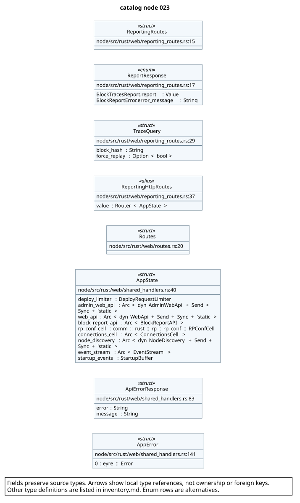

# catalog node 023

[Inventory](inventory.md) | [PlantUML](catalog-node-023.puml)

## Cross-Page References

- `AppState: block_report_api -> BlockReportAPI [catalog-casper-004.svg]`
- `AppState: connections_cell -> ConnectionsCell [catalog-comm-004.svg]`
- `AppState: deploy_limiter -> DeployRequestLimiter [catalog-node-003.svg]`
- `AppState: event_stream -> EventStream [catalog-shared-006.svg]`
- `AppState: rp_conf_cell -> RPConfCell [catalog-comm-004.svg]`
- `AppState: startup_events -> StartupBuffer [catalog-shared-005.svg]`
