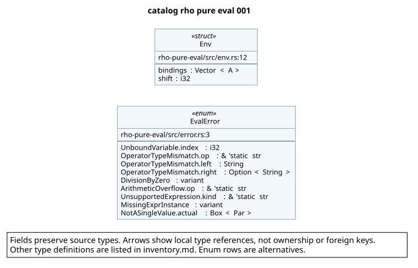

# catalog rho pure eval 001

[Inventory](inventory.md) | [PlantUML](catalog-rho-pure-eval-001.puml)

## Cardinality and Size

[Method, units, limits, and runtime evidence](sizing.md). These are declaration-level assessments, not measured live counts.

### Env

Cardinality: 0..n live values. Current count and owner-level limits are not derivable from this declaration.

Size: Sum of field inline layouts plus compiler padding, then uniquely owned allocations. repr and custom implementations can change layout.

| Field or variant | Cardinality | Inline bytes or layout | Additional storage or wire encoding |
| --- | --- | --- | --- |
| `bindings` | 1 value | Compiler layout required | Follow the referenced declaration or external implementation. No allocation bound established. |
| `shift` | 1 scalar | 4 B | None |

### EvalError

Cardinality: 0..n live values. Current count and owner-level limits are not derivable from this declaration.

Size: Compiler enum layout plus allocations of the active variant only. Do not sum alternative variants.

| Field or variant | Cardinality | Inline bytes or layout | Additional storage or wire encoding |
| --- | --- | --- | --- |
| `UnboundVariable.index` | 1 scalar when this variant is active | 4 B | None |
| `OperatorTypeMismatch.op` | 1 borrowed reference when this variant is active | Pointer or fat pointer. Referent layout required | No owned allocation. Referent: 1 value |
| `OperatorTypeMismatch.left` | 0..n UTF-8 bytes when this variant is active | 24 B. String header on the generator target | capacity() bytes, excluding allocator overhead. UTF-8 byte length is not character count |
| `OperatorTypeMismatch.right` | 0..1 present payload when this variant is active | Option layout includes any tag or niche optimization. Do not assume I(T) + 1 | None when absent. Present payload: 0..n UTF-8 bytes. capacity() bytes, excluding allocator overhead. UTF-8 byte length is not character count |
| `DivisionByZero` | 1 mutually exclusive alternative | No payload. Enum discriminant layout required | None for this unit variant |
| `ArithmeticOverflow.op` | 1 borrowed reference when this variant is active | Pointer or fat pointer. Referent layout required | No owned allocation. Referent: 1 value |
| `UnsupportedExpression.kind` | 1 borrowed reference when this variant is active | Pointer or fat pointer. Referent layout required | No owned allocation. Referent: 1 value |
| `MissingExprInstance` | 1 mutually exclusive alternative | No payload. Enum discriminant layout required | None for this unit variant |
| `NotASingleValue.actual` | 1 owned target when this variant is active | Pointer or fat pointer, depending on target type | I(target) and its owned allocations, plus allocator overhead. Zero-sized targets need no allocation |

## Cross-Page References

No resolved cross-page references.
