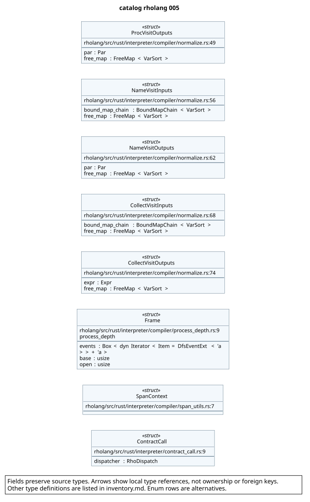

# catalog rholang 005

[Inventory](inventory.md) | [PlantUML](catalog-rholang-005.puml)

## Cardinality and Size

[Method, units, limits, and runtime evidence](sizing.md). These are declaration-level assessments, not measured live counts.

### ProcVisitOutputs

Cardinality: 0..n live values. Current count and owner-level limits are not derivable from this declaration.

Size: Sum of field inline layouts plus compiler padding, then uniquely owned allocations. repr and custom implementations can change layout.

| Field or variant | Cardinality | Inline bytes or layout | Additional storage or wire encoding |
| --- | --- | --- | --- |
| `par` | 1 value | Compiler layout required | Follow the referenced declaration or external implementation. No allocation bound established. |
| `free_map` | 1 value | Compiler layout required | Follow the referenced declaration or external implementation. No allocation bound established. |

### NameVisitInputs

Cardinality: 0..n live values. Current count and owner-level limits are not derivable from this declaration.

Size: Sum of field inline layouts plus compiler padding, then uniquely owned allocations. repr and custom implementations can change layout.

| Field or variant | Cardinality | Inline bytes or layout | Additional storage or wire encoding |
| --- | --- | --- | --- |
| `bound_map_chain` | 1 value | Compiler layout required | Follow the referenced declaration or external implementation. No allocation bound established. |
| `free_map` | 1 value | Compiler layout required | Follow the referenced declaration or external implementation. No allocation bound established. |

### NameVisitOutputs

Cardinality: 0..n live values. Current count and owner-level limits are not derivable from this declaration.

Size: Sum of field inline layouts plus compiler padding, then uniquely owned allocations. repr and custom implementations can change layout.

| Field or variant | Cardinality | Inline bytes or layout | Additional storage or wire encoding |
| --- | --- | --- | --- |
| `par` | 1 value | Compiler layout required | Follow the referenced declaration or external implementation. No allocation bound established. |
| `free_map` | 1 value | Compiler layout required | Follow the referenced declaration or external implementation. No allocation bound established. |

### CollectVisitInputs

Cardinality: 0..n live values. Current count and owner-level limits are not derivable from this declaration.

Size: Sum of field inline layouts plus compiler padding, then uniquely owned allocations. repr and custom implementations can change layout.

| Field or variant | Cardinality | Inline bytes or layout | Additional storage or wire encoding |
| --- | --- | --- | --- |
| `bound_map_chain` | 1 value | Compiler layout required | Follow the referenced declaration or external implementation. No allocation bound established. |
| `free_map` | 1 value | Compiler layout required | Follow the referenced declaration or external implementation. No allocation bound established. |

### CollectVisitOutputs

Cardinality: 0..n live values. Current count and owner-level limits are not derivable from this declaration.

Size: Sum of field inline layouts plus compiler padding, then uniquely owned allocations. repr and custom implementations can change layout.

| Field or variant | Cardinality | Inline bytes or layout | Additional storage or wire encoding |
| --- | --- | --- | --- |
| `expr` | 1 value | Compiler layout required | Follow the referenced declaration or external implementation. No allocation bound established. |
| `free_map` | 1 value | Compiler layout required | Follow the referenced declaration or external implementation. No allocation bound established. |

### Frame

Cardinality: 0..n live values. Current count and owner-level limits are not derivable from this declaration.

Size: Sum of field inline layouts plus compiler padding, then uniquely owned allocations. repr and custom implementations can change layout.

| Field or variant | Cardinality | Inline bytes or layout | Additional storage or wire encoding |
| --- | --- | --- | --- |
| `events` | 1 owned target | Pointer or fat pointer, depending on target type | I(target) and its owned allocations, plus allocator overhead. Zero-sized targets need no allocation |
| `base` | 1 scalar | 8 B | None |
| `open` | 1 scalar | 8 B | None |

### SpanContext

Cardinality: 0..n live values. Current count and owner-level limits are not derivable from this declaration.

Size: Sum of field inline layouts plus compiler padding, then uniquely owned allocations. repr and custom implementations can change layout.

| Field or variant | Cardinality | Inline bytes or layout | Additional storage or wire encoding |
| --- | --- | --- | --- |
| No declared fields | 0 field payloads | Compiler layout required | No field-owned allocations |

### ContractCall

Cardinality: 0..n live values. Current count and owner-level limits are not derivable from this declaration.

Size: Sum of field inline layouts plus compiler padding, then uniquely owned allocations. repr and custom implementations can change layout.

| Field or variant | Cardinality | Inline bytes or layout | Additional storage or wire encoding |
| --- | --- | --- | --- |
| `dispatcher` | 1 value | Compiler layout required | Follow the referenced declaration or external implementation. No allocation bound established. |

## Cross-Page References

- `CollectVisitInputs: bound_map_chain -> BoundMapChain [catalog-rholang-003.svg]`
- `CollectVisitInputs: bound_map_chain -> VarSort [catalog-rholang-004.svg]`
- `CollectVisitInputs: free_map -> VarSort [catalog-rholang-004.svg]`
- `CollectVisitOutputs: free_map -> VarSort [catalog-rholang-004.svg]`
- `ContractCall: dispatcher -> RhoDispatch [catalog-rholang-006.svg]`
- `NameVisitInputs: bound_map_chain -> BoundMapChain [catalog-rholang-003.svg]`
- `NameVisitInputs: bound_map_chain -> VarSort [catalog-rholang-004.svg]`
- `NameVisitInputs: free_map -> VarSort [catalog-rholang-004.svg]`
- `NameVisitOutputs: free_map -> VarSort [catalog-rholang-004.svg]`
- `ProcVisitOutputs: free_map -> VarSort [catalog-rholang-004.svg]`
