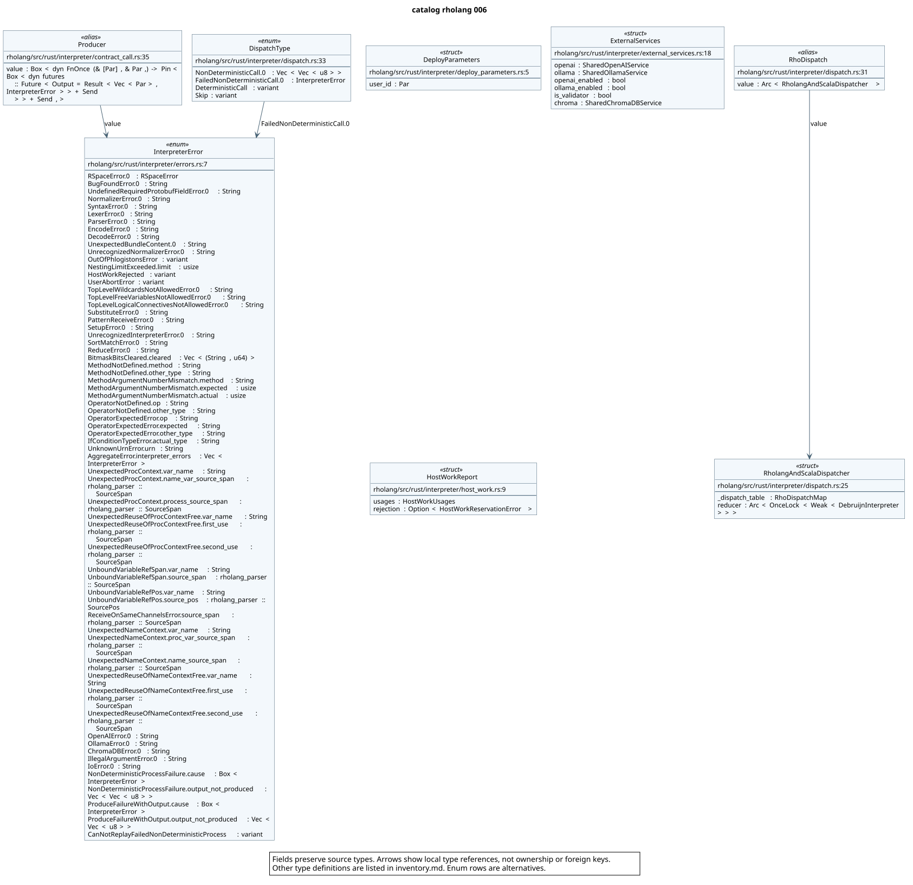

# catalog rholang 006

[Inventory](inventory.md) | [PlantUML](catalog-rholang-006.puml)

## Cross-Page References

- `ExternalServices: ollama -> SharedOllamaService [catalog-rholang-029.svg]`
- `ExternalServices: openai -> SharedOpenAIService [catalog-rholang-030.svg]`
- `HostWorkReport: rejection -> HostWorkReservationError [catalog-models-036.svg]`
- `HostWorkReport: usages -> HostWorkUsages [catalog-models-035.svg]`
- `InterpreterError: RSpaceError.0 -> RSpaceError [catalog-rspacepp-001.svg]`
- `RholangAndScalaDispatcher: _dispatch_table -> RhoDispatchMap [catalog-rholang-043.svg]`
- `RholangAndScalaDispatcher: reducer -> DebruijnInterpreter [catalog-rholang-031.svg]`
