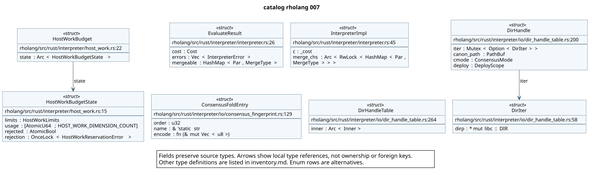

# catalog rholang 007

[Inventory](inventory.md) | [PlantUML](catalog-rholang-007.puml)

## Cross-Page References

- `DirHandle: cmode -> ConsensusMode [catalog-rholang-022.svg]`
- `DirHandle: deploy -> DeployScope [catalog-rholang-020.svg]`
- `DirHandleTable: inner -> Inner [catalog-rholang-008.svg]`
- `EvaluateResult: cost -> Cost [catalog-rholang-001.svg]`
- `EvaluateResult: errors -> InterpreterError [catalog-rholang-006.svg]`
- `EvaluateResult: mergeable -> MergeType [catalog-rspacepp-011.svg]`
- `HostWorkBudgetState: limits -> HostWorkLimits [catalog-models-035.svg]`
- `HostWorkBudgetState: rejection -> HostWorkReservationError [catalog-models-036.svg]`
- `InterpreterImpl: c -> _cost [catalog-rholang-001.svg]`
- `InterpreterImpl: merge_chs -> MergeType [catalog-rspacepp-011.svg]`
