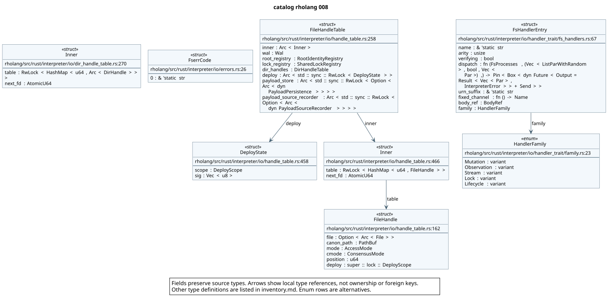

# catalog rholang 008

[Inventory](inventory.md) | [PlantUML](catalog-rholang-008.puml)

## Cross-Page References

- `DeployState: scope -> DeployScope [catalog-rholang-020.svg]`
- `FileHandle: cmode -> ConsensusMode [catalog-rholang-022.svg]`
- `FileHandle: deploy -> DeployScope [catalog-rholang-020.svg]`
- `FileHandle: mode -> AccessMode [catalog-rholang-022.svg]`
- `FileHandleTable: dir_handles -> DirHandleTable [catalog-rholang-007.svg]`
- `FileHandleTable: lock_registry -> SharedLockRegistry [catalog-rholang-022.svg]`
- `FileHandleTable: root_registry -> RootIdentityRegistry [catalog-rholang-023.svg]`
- `FileHandleTable: wal -> Wal [catalog-rholang-025.svg]`
- `FsHandlerEntry: body_ref -> BodyRef [catalog-rholang-043.svg]`
- `FsHandlerEntry: dispatch -> FsProcesses [catalog-rholang-009.svg]`
- `FsHandlerEntry: dispatch -> InterpreterError [catalog-rholang-006.svg]`
- `Inner: table -> DirHandle [catalog-rholang-007.svg]`
