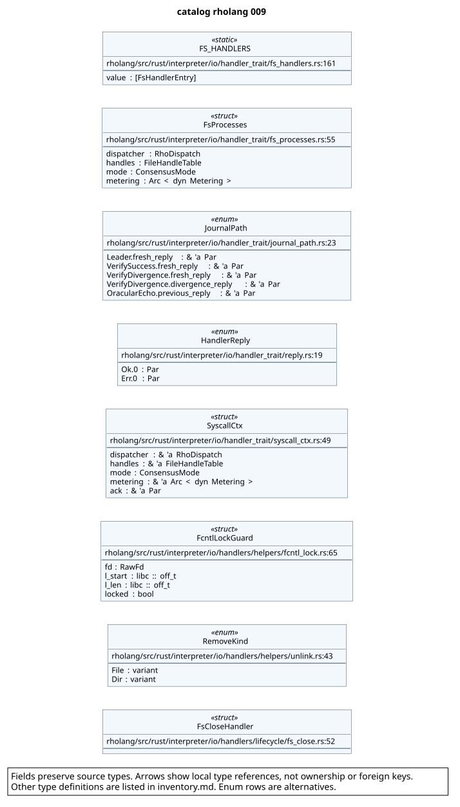

# catalog rholang 009

[Inventory](inventory.md) | [PlantUML](catalog-rholang-009.puml)

## Cardinality and Size

[Method, units, limits, and runtime evidence](sizing.md). These are declaration-level assessments, not measured live counts.

### FS_HANDLERS

Cardinality: One slot per linked process instance. Lazy payload can be uninitialized.

Size: Declared slot or lazy wrapper layout plus initialized owned allocations.

| Field or variant | Cardinality | Inline bytes or layout | Additional storage or wire encoding |
| --- | --- | --- | --- |
| `value` | 0..n elements | Unsized slice | Storage belongs to its owner. Length and capacity require measurement |

### FsProcesses

Cardinality: 0..n live values. Current count and owner-level limits are not derivable from this declaration.

Size: Sum of field inline layouts plus compiler padding, then uniquely owned allocations. repr and custom implementations can change layout.

| Field or variant | Cardinality | Inline bytes or layout | Additional storage or wire encoding |
| --- | --- | --- | --- |
| `dispatcher` | 1 value | Compiler layout required | Follow the referenced declaration or external implementation. No allocation bound established. |
| `handles` | 1 value | Compiler layout required | Follow the referenced declaration or external implementation. No allocation bound established. |
| `mode` | 1 value | Compiler layout required | Follow the referenced declaration or external implementation. No allocation bound established. |
| `metering` | 1 shared strong reference | Pointer or fat pointer, depending on target type | One shared allocation holds the target, counters and alignment. Count it once across all handles |

### JournalPath

Cardinality: 0..n live values. Current count and owner-level limits are not derivable from this declaration.

Size: Compiler enum layout plus allocations of the active variant only. Do not sum alternative variants.

| Field or variant | Cardinality | Inline bytes or layout | Additional storage or wire encoding |
| --- | --- | --- | --- |
| `Leader.fresh_reply` | 1 borrowed reference when this variant is active | Pointer or fat pointer. Referent layout required | No owned allocation. Referent: 1 value |
| `VerifySuccess.fresh_reply` | 1 borrowed reference when this variant is active | Pointer or fat pointer. Referent layout required | No owned allocation. Referent: 1 value |
| `VerifyDivergence.fresh_reply` | 1 borrowed reference when this variant is active | Pointer or fat pointer. Referent layout required | No owned allocation. Referent: 1 value |
| `VerifyDivergence.divergence_reply` | 1 borrowed reference when this variant is active | Pointer or fat pointer. Referent layout required | No owned allocation. Referent: 1 value |
| `OracularEcho.previous_reply` | 1 borrowed reference when this variant is active | Pointer or fat pointer. Referent layout required | No owned allocation. Referent: 1 value |

### HandlerReply

Cardinality: 0..n live values. Current count and owner-level limits are not derivable from this declaration.

Size: Compiler enum layout plus allocations of the active variant only. Do not sum alternative variants.

| Field or variant | Cardinality | Inline bytes or layout | Additional storage or wire encoding |
| --- | --- | --- | --- |
| `Ok.0` | 1 value when this variant is active | Compiler layout required | Follow the referenced declaration or external implementation. No allocation bound established. |
| `Err.0` | 1 value when this variant is active | Compiler layout required | Follow the referenced declaration or external implementation. No allocation bound established. |

### SyscallCtx

Cardinality: 0..n live values. Current count and owner-level limits are not derivable from this declaration.

Size: Sum of field inline layouts plus compiler padding, then uniquely owned allocations. repr and custom implementations can change layout.

| Field or variant | Cardinality | Inline bytes or layout | Additional storage or wire encoding |
| --- | --- | --- | --- |
| `dispatcher` | 1 borrowed reference | Pointer or fat pointer. Referent layout required | No owned allocation. Referent: 1 value |
| `handles` | 1 borrowed reference | Pointer or fat pointer. Referent layout required | No owned allocation. Referent: 1 value |
| `mode` | 1 value | Compiler layout required | Follow the referenced declaration or external implementation. No allocation bound established. |
| `metering` | 1 borrowed reference | Pointer or fat pointer. Referent layout required | No owned allocation. Referent: 1 shared strong reference |
| `ack` | 1 borrowed reference | Pointer or fat pointer. Referent layout required | No owned allocation. Referent: 1 value |

### FcntlLockGuard

Cardinality: 0..n live values. Current count and owner-level limits are not derivable from this declaration.

Size: Sum of field inline layouts plus compiler padding, then uniquely owned allocations. repr and custom implementations can change layout.

| Field or variant | Cardinality | Inline bytes or layout | Additional storage or wire encoding |
| --- | --- | --- | --- |
| `fd` | 1 value | Compiler layout required | Follow the referenced declaration or external implementation. No allocation bound established. |
| `l_start` | 1 value | Compiler layout required | Follow the referenced declaration or external implementation. No allocation bound established. |
| `l_len` | 1 value | Compiler layout required | Follow the referenced declaration or external implementation. No allocation bound established. |
| `locked` | 1 scalar | 1 B | None |

### RemoveKind

Cardinality: 0..n live values. Current count and owner-level limits are not derivable from this declaration.

Size: Compiler enum layout plus allocations of the active variant only. Do not sum alternative variants.

| Field or variant | Cardinality | Inline bytes or layout | Additional storage or wire encoding |
| --- | --- | --- | --- |
| `File` | 1 mutually exclusive alternative | No payload. Enum discriminant layout required | None for this unit variant |
| `Dir` | 1 mutually exclusive alternative | No payload. Enum discriminant layout required | None for this unit variant |

### FsCloseHandler

Cardinality: 0..n live values. Current count and owner-level limits are not derivable from this declaration.

Size: Sum of field inline layouts plus compiler padding, then uniquely owned allocations. repr and custom implementations can change layout.

| Field or variant | Cardinality | Inline bytes or layout | Additional storage or wire encoding |
| --- | --- | --- | --- |
| No declared fields | 0 field payloads | Compiler layout required | No field-owned allocations |

## Cross-Page References

- `FS_HANDLERS: value -> FsHandlerEntry [catalog-rholang-008.svg]`
- `FsProcesses: dispatcher -> RhoDispatch [catalog-rholang-006.svg]`
- `FsProcesses: handles -> FileHandleTable [catalog-rholang-008.svg]`
- `FsProcesses: mode -> ConsensusMode [catalog-rholang-022.svg]`
- `SyscallCtx: dispatcher -> RhoDispatch [catalog-rholang-006.svg]`
- `SyscallCtx: handles -> FileHandleTable [catalog-rholang-008.svg]`
- `SyscallCtx: mode -> ConsensusMode [catalog-rholang-022.svg]`
