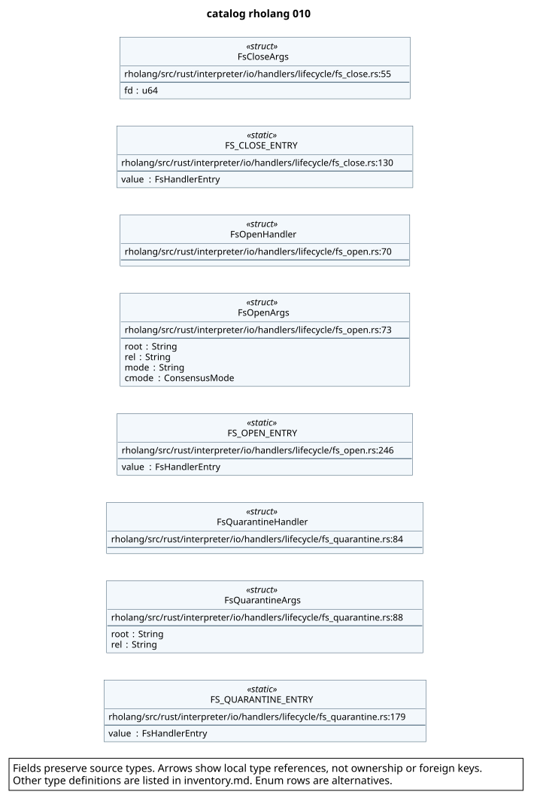

# catalog rholang 010

[Inventory](inventory.md) | [PlantUML](catalog-rholang-010.puml)

## Cross-Page References

- `FS_CLOSE_ENTRY: value -> FsHandlerEntry [catalog-rholang-008.svg]`
- `FS_OPEN_ENTRY: value -> FsHandlerEntry [catalog-rholang-008.svg]`
- `FS_QUARANTINE_ENTRY: value -> FsHandlerEntry [catalog-rholang-008.svg]`
- `FsOpenArgs: cmode -> ConsensusMode [catalog-rholang-022.svg]`
