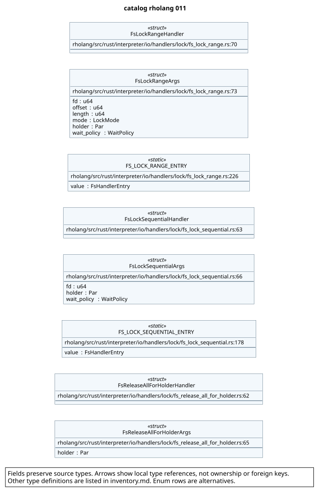

# catalog rholang 011

[Inventory](inventory.md) | [PlantUML](catalog-rholang-011.puml)

## Cardinality and Size

[Method, units, limits, and runtime evidence](sizing.md). These are declaration-level assessments, not measured live counts.

### FsLockRangeHandler

Cardinality: 0..n live values. Current count and owner-level limits are not derivable from this declaration.

Size: Sum of field inline layouts plus compiler padding, then uniquely owned allocations. repr and custom implementations can change layout.

| Field or variant | Cardinality | Inline bytes or layout | Additional storage or wire encoding |
| --- | --- | --- | --- |
| No declared fields | 0 field payloads | Compiler layout required | No field-owned allocations |

### FsLockRangeArgs

Cardinality: 0..n live values. Current count and owner-level limits are not derivable from this declaration.

Size: Sum of field inline layouts plus compiler padding, then uniquely owned allocations. repr and custom implementations can change layout.

| Field or variant | Cardinality | Inline bytes or layout | Additional storage or wire encoding |
| --- | --- | --- | --- |
| `fd` | 1 scalar | 8 B | None |
| `offset` | 1 scalar | 8 B | None |
| `length` | 1 scalar | 8 B | None |
| `mode` | 1 value | Compiler layout required | Follow the referenced declaration or external implementation. No allocation bound established. |
| `holder` | 1 value | Compiler layout required | Follow the referenced declaration or external implementation. No allocation bound established. |
| `wait_policy` | 1 value | Compiler layout required | Follow the referenced declaration or external implementation. No allocation bound established. |

### FS_LOCK_RANGE_ENTRY

Cardinality: One slot per linked process instance. Lazy payload can be uninitialized.

Size: Declared slot or lazy wrapper layout plus initialized owned allocations.

| Field or variant | Cardinality | Inline bytes or layout | Additional storage or wire encoding |
| --- | --- | --- | --- |
| `value` | 1 value | Compiler layout required | Follow the referenced declaration or external implementation. No allocation bound established. |

### FsLockSequentialHandler

Cardinality: 0..n live values. Current count and owner-level limits are not derivable from this declaration.

Size: Sum of field inline layouts plus compiler padding, then uniquely owned allocations. repr and custom implementations can change layout.

| Field or variant | Cardinality | Inline bytes or layout | Additional storage or wire encoding |
| --- | --- | --- | --- |
| No declared fields | 0 field payloads | Compiler layout required | No field-owned allocations |

### FsLockSequentialArgs

Cardinality: 0..n live values. Current count and owner-level limits are not derivable from this declaration.

Size: Sum of field inline layouts plus compiler padding, then uniquely owned allocations. repr and custom implementations can change layout.

| Field or variant | Cardinality | Inline bytes or layout | Additional storage or wire encoding |
| --- | --- | --- | --- |
| `fd` | 1 scalar | 8 B | None |
| `holder` | 1 value | Compiler layout required | Follow the referenced declaration or external implementation. No allocation bound established. |
| `wait_policy` | 1 value | Compiler layout required | Follow the referenced declaration or external implementation. No allocation bound established. |

### FS_LOCK_SEQUENTIAL_ENTRY

Cardinality: One slot per linked process instance. Lazy payload can be uninitialized.

Size: Declared slot or lazy wrapper layout plus initialized owned allocations.

| Field or variant | Cardinality | Inline bytes or layout | Additional storage or wire encoding |
| --- | --- | --- | --- |
| `value` | 1 value | Compiler layout required | Follow the referenced declaration or external implementation. No allocation bound established. |

### FsReleaseAllForHolderHandler

Cardinality: 0..n live values. Current count and owner-level limits are not derivable from this declaration.

Size: Sum of field inline layouts plus compiler padding, then uniquely owned allocations. repr and custom implementations can change layout.

| Field or variant | Cardinality | Inline bytes or layout | Additional storage or wire encoding |
| --- | --- | --- | --- |
| No declared fields | 0 field payloads | Compiler layout required | No field-owned allocations |

### FsReleaseAllForHolderArgs

Cardinality: 0..n live values. Current count and owner-level limits are not derivable from this declaration.

Size: Sum of field inline layouts plus compiler padding, then uniquely owned allocations. repr and custom implementations can change layout.

| Field or variant | Cardinality | Inline bytes or layout | Additional storage or wire encoding |
| --- | --- | --- | --- |
| `holder` | 1 value | Compiler layout required | Follow the referenced declaration or external implementation. No allocation bound established. |

## Cross-Page References

- `FS_LOCK_RANGE_ENTRY: value -> FsHandlerEntry [catalog-rholang-008.svg]`
- `FS_LOCK_SEQUENTIAL_ENTRY: value -> FsHandlerEntry [catalog-rholang-008.svg]`
- `FsLockRangeArgs: mode -> LockMode [catalog-rholang-021.svg]`
- `FsLockRangeArgs: wait_policy -> WaitPolicy [catalog-rholang-021.svg]`
- `FsLockSequentialArgs: wait_policy -> WaitPolicy [catalog-rholang-021.svg]`
