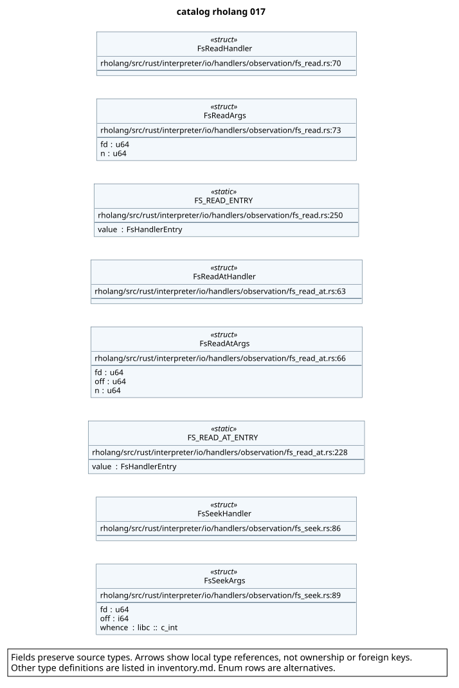

# catalog rholang 017

[Inventory](inventory.md) | [PlantUML](catalog-rholang-017.puml)

## Cross-Page References

- `FS_READ_AT_ENTRY: value -> FsHandlerEntry [catalog-rholang-008.svg]`
- `FS_READ_ENTRY: value -> FsHandlerEntry [catalog-rholang-008.svg]`
