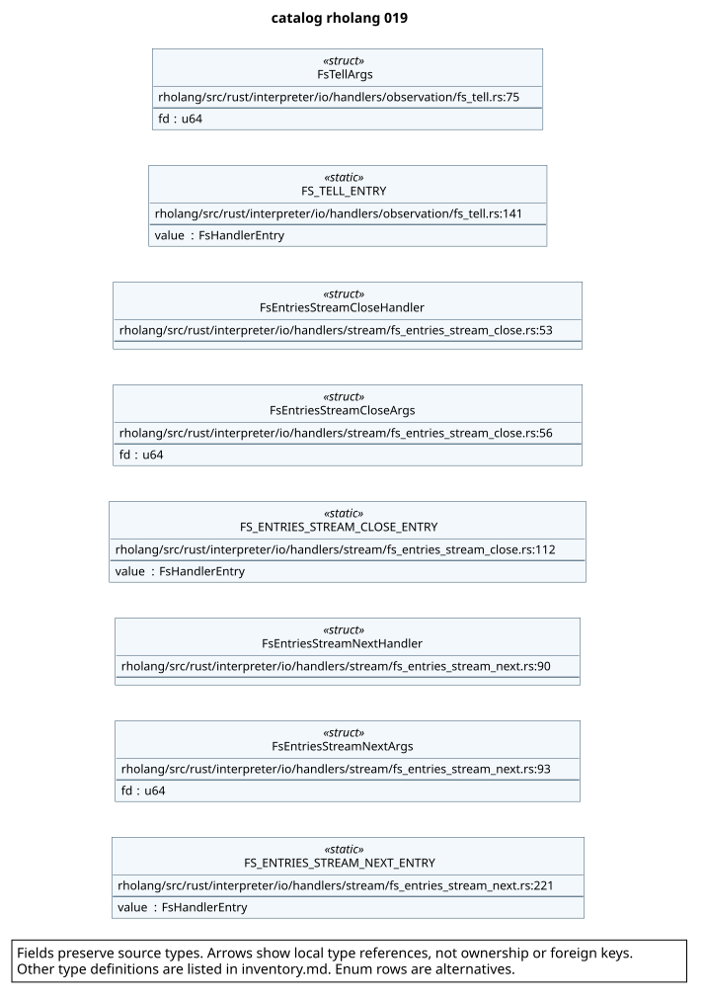

# catalog rholang 019

[Inventory](inventory.md) | [PlantUML](catalog-rholang-019.puml)

## Cross-Page References

- `FS_ENTRIES_STREAM_CLOSE_ENTRY: value -> FsHandlerEntry [catalog-rholang-008.svg]`
- `FS_ENTRIES_STREAM_NEXT_ENTRY: value -> FsHandlerEntry [catalog-rholang-008.svg]`
- `FS_TELL_ENTRY: value -> FsHandlerEntry [catalog-rholang-008.svg]`
