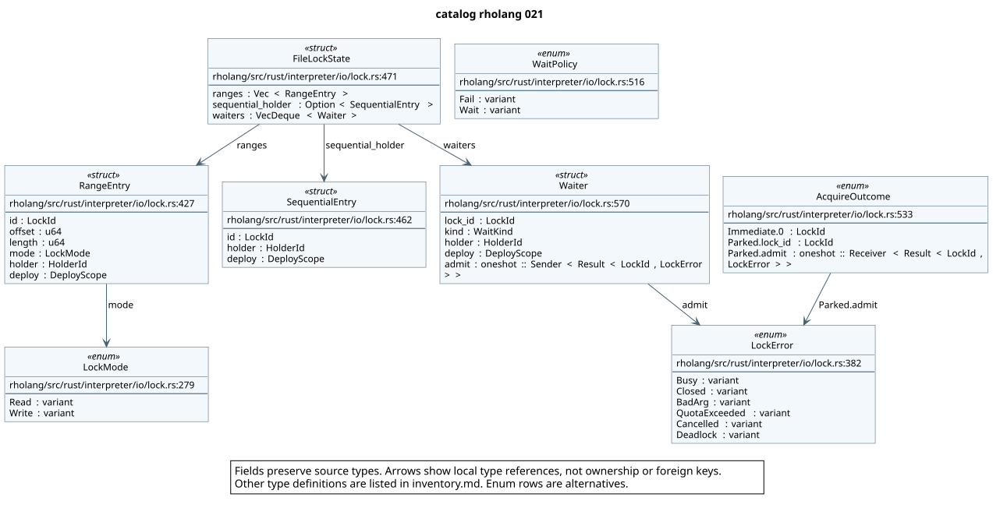

# catalog rholang 021

[Inventory](inventory.md) | [PlantUML](catalog-rholang-021.puml)

## Cardinality and Size

[Method, units, limits, and runtime evidence](sizing.md). These are declaration-level assessments, not measured live counts.

### LockMode

Cardinality: 0..n live values. Current count and owner-level limits are not derivable from this declaration.

Size: Compiler enum layout plus allocations of the active variant only. Do not sum alternative variants.

| Field or variant | Cardinality | Inline bytes or layout | Additional storage or wire encoding |
| --- | --- | --- | --- |
| `Read` | 1 mutually exclusive alternative | No payload. Enum discriminant layout required | None for this unit variant |
| `Write` | 1 mutually exclusive alternative | No payload. Enum discriminant layout required | None for this unit variant |

### LockError

Cardinality: 0..n live values. Current count and owner-level limits are not derivable from this declaration.

Size: Compiler enum layout plus allocations of the active variant only. Do not sum alternative variants.

| Field or variant | Cardinality | Inline bytes or layout | Additional storage or wire encoding |
| --- | --- | --- | --- |
| `Busy` | 1 mutually exclusive alternative | No payload. Enum discriminant layout required | None for this unit variant |
| `Closed` | 1 mutually exclusive alternative | No payload. Enum discriminant layout required | None for this unit variant |
| `BadArg` | 1 mutually exclusive alternative | No payload. Enum discriminant layout required | None for this unit variant |
| `QuotaExceeded` | 1 mutually exclusive alternative | No payload. Enum discriminant layout required | None for this unit variant |
| `Cancelled` | 1 mutually exclusive alternative | No payload. Enum discriminant layout required | None for this unit variant |
| `Deadlock` | 1 mutually exclusive alternative | No payload. Enum discriminant layout required | None for this unit variant |

### RangeEntry

Cardinality: 0..n live values. Current count and owner-level limits are not derivable from this declaration.

Size: Sum of field inline layouts plus compiler padding, then uniquely owned allocations. repr and custom implementations can change layout.

| Field or variant | Cardinality | Inline bytes or layout | Additional storage or wire encoding |
| --- | --- | --- | --- |
| `id` | 1 value | Compiler layout required | Follow the referenced declaration or external implementation. No allocation bound established. |
| `offset` | 1 scalar | 8 B | None |
| `length` | 1 scalar | 8 B | None |
| `mode` | 1 value | Compiler layout required | Follow the referenced declaration or external implementation. No allocation bound established. |
| `holder` | 1 value | Compiler layout required | Follow the referenced declaration or external implementation. No allocation bound established. |
| `deploy` | 1 value | Compiler layout required | Follow the referenced declaration or external implementation. No allocation bound established. |

### SequentialEntry

Cardinality: 0..n live values. Current count and owner-level limits are not derivable from this declaration.

Size: Sum of field inline layouts plus compiler padding, then uniquely owned allocations. repr and custom implementations can change layout.

| Field or variant | Cardinality | Inline bytes or layout | Additional storage or wire encoding |
| --- | --- | --- | --- |
| `id` | 1 value | Compiler layout required | Follow the referenced declaration or external implementation. No allocation bound established. |
| `holder` | 1 value | Compiler layout required | Follow the referenced declaration or external implementation. No allocation bound established. |
| `deploy` | 1 value | Compiler layout required | Follow the referenced declaration or external implementation. No allocation bound established. |

### FileLockState

Cardinality: 0..n live values. Current count and owner-level limits are not derivable from this declaration.

Size: Sum of field inline layouts plus compiler padding, then uniquely owned allocations. repr and custom implementations can change layout.

| Field or variant | Cardinality | Inline bytes or layout | Additional storage or wire encoding |
| --- | --- | --- | --- |
| `ranges` | 0..n elements | 24 B. Vec header on the generator target | capacity * I(element), plus live element-owned allocations. Zero-sized elements need no backing allocation. Element: Follow the referenced declaration or external implementation. No allocation bound established. |
| `sequential_holder` | 0..1 present payload | Option layout includes any tag or niche optimization. Do not assume I(T) + 1 | None when absent. Present payload: 1 value. Follow the referenced declaration or external implementation. No allocation bound established. |
| `waiters` | 0..n elements | Container implementation required | Element storage, owned allocations, spare capacity or per-node links. No type-level count cap |

### WaitPolicy

Cardinality: 0..n live values. Current count and owner-level limits are not derivable from this declaration.

Size: Compiler enum layout plus allocations of the active variant only. Do not sum alternative variants.

| Field or variant | Cardinality | Inline bytes or layout | Additional storage or wire encoding |
| --- | --- | --- | --- |
| `Fail` | 1 mutually exclusive alternative | No payload. Enum discriminant layout required | None for this unit variant |
| `Wait` | 1 mutually exclusive alternative | No payload. Enum discriminant layout required | None for this unit variant |

### AcquireOutcome

Cardinality: 0..n live values. Current count and owner-level limits are not derivable from this declaration.

Size: Compiler enum layout plus allocations of the active variant only. Do not sum alternative variants.

| Field or variant | Cardinality | Inline bytes or layout | Additional storage or wire encoding |
| --- | --- | --- | --- |
| `Immediate.0` | 1 value when this variant is active | Compiler layout required | Follow the referenced declaration or external implementation. No allocation bound established. |
| `Parked.lock_id` | 1 value when this variant is active | Compiler layout required | Follow the referenced declaration or external implementation. No allocation bound established. |
| `Parked.admit` | 1 value when this variant is active | Compiler layout required | Follow the referenced declaration or external implementation. No allocation bound established. |

### Waiter

Cardinality: 0..n live values. Current count and owner-level limits are not derivable from this declaration.

Size: Sum of field inline layouts plus compiler padding, then uniquely owned allocations. repr and custom implementations can change layout.

| Field or variant | Cardinality | Inline bytes or layout | Additional storage or wire encoding |
| --- | --- | --- | --- |
| `lock_id` | 1 value | Compiler layout required | Follow the referenced declaration or external implementation. No allocation bound established. |
| `kind` | 1 value | Compiler layout required | Follow the referenced declaration or external implementation. No allocation bound established. |
| `holder` | 1 value | Compiler layout required | Follow the referenced declaration or external implementation. No allocation bound established. |
| `deploy` | 1 value | Compiler layout required | Follow the referenced declaration or external implementation. No allocation bound established. |
| `admit` | 1 value | Compiler layout required | Follow the referenced declaration or external implementation. No allocation bound established. |

## Cross-Page References

- `AcquireOutcome: Immediate.0 -> LockId [catalog-rholang-020.svg]`
- `AcquireOutcome: Parked.admit -> LockId [catalog-rholang-020.svg]`
- `AcquireOutcome: Parked.lock_id -> LockId [catalog-rholang-020.svg]`
- `RangeEntry: deploy -> DeployScope [catalog-rholang-020.svg]`
- `RangeEntry: holder -> HolderId [catalog-rholang-020.svg]`
- `RangeEntry: id -> LockId [catalog-rholang-020.svg]`
- `SequentialEntry: deploy -> DeployScope [catalog-rholang-020.svg]`
- `SequentialEntry: holder -> HolderId [catalog-rholang-020.svg]`
- `SequentialEntry: id -> LockId [catalog-rholang-020.svg]`
- `Waiter: admit -> LockId [catalog-rholang-020.svg]`
- `Waiter: deploy -> DeployScope [catalog-rholang-020.svg]`
- `Waiter: holder -> HolderId [catalog-rholang-020.svg]`
- `Waiter: kind -> WaitKind [catalog-rholang-022.svg]`
- `Waiter: lock_id -> LockId [catalog-rholang-020.svg]`
