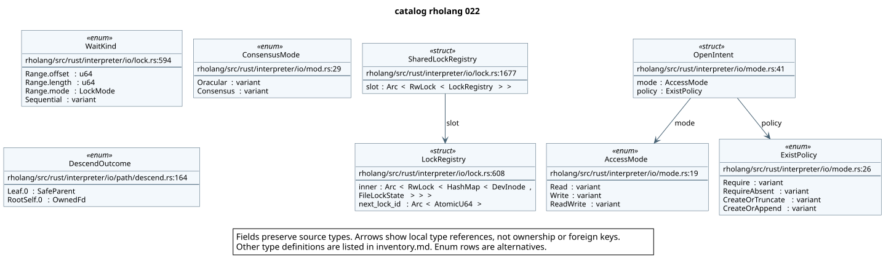

# catalog rholang 022

[Inventory](inventory.md) | [PlantUML](catalog-rholang-022.puml)

## Cardinality and Size

[Method, units, limits, and runtime evidence](sizing.md). These are declaration-level assessments, not measured live counts.

### WaitKind

Cardinality: 0..n live values. Current count and owner-level limits are not derivable from this declaration.

Size: Compiler enum layout plus allocations of the active variant only. Do not sum alternative variants.

| Field or variant | Cardinality | Inline bytes or layout | Additional storage or wire encoding |
| --- | --- | --- | --- |
| `Range.offset` | 1 scalar when this variant is active | 8 B | None |
| `Range.length` | 1 scalar when this variant is active | 8 B | None |
| `Range.mode` | 1 value when this variant is active | Compiler layout required | Follow the referenced declaration or external implementation. No allocation bound established. |
| `Sequential` | 1 mutually exclusive alternative | No payload. Enum discriminant layout required | None for this unit variant |

### LockRegistry

Cardinality: 0..n live values. Current count and owner-level limits are not derivable from this declaration.

Size: Sum of field inline layouts plus compiler padding, then uniquely owned allocations. repr and custom implementations can change layout.

| Field or variant | Cardinality | Inline bytes or layout | Additional storage or wire encoding |
| --- | --- | --- | --- |
| `inner` | 1 shared strong reference | Pointer or fat pointer, depending on target type | One shared allocation holds the target, counters and alignment. Count it once across all handles |
| `next_lock_id` | 1 shared strong reference | Pointer or fat pointer, depending on target type | One shared allocation holds the target, counters and alignment. Count it once across all handles |

### SharedLockRegistry

Cardinality: 0..n live values. Current count and owner-level limits are not derivable from this declaration.

Size: Sum of field inline layouts plus compiler padding, then uniquely owned allocations. repr and custom implementations can change layout.

| Field or variant | Cardinality | Inline bytes or layout | Additional storage or wire encoding |
| --- | --- | --- | --- |
| `slot` | 1 shared strong reference | Pointer or fat pointer, depending on target type | One shared allocation holds the target, counters and alignment. Count it once across all handles |

### ConsensusMode

Cardinality: 0..n live values. Current count and owner-level limits are not derivable from this declaration.

Size: Compiler enum layout plus allocations of the active variant only. Do not sum alternative variants.

| Field or variant | Cardinality | Inline bytes or layout | Additional storage or wire encoding |
| --- | --- | --- | --- |
| `Oracular` | 1 mutually exclusive alternative | No payload. Enum discriminant layout required | None for this unit variant |
| `Consensus` | 1 mutually exclusive alternative | No payload. Enum discriminant layout required | None for this unit variant |

### AccessMode

Cardinality: 0..n live values. Current count and owner-level limits are not derivable from this declaration.

Size: Compiler enum layout plus allocations of the active variant only. Do not sum alternative variants.

| Field or variant | Cardinality | Inline bytes or layout | Additional storage or wire encoding |
| --- | --- | --- | --- |
| `Read` | 1 mutually exclusive alternative | No payload. Enum discriminant layout required | None for this unit variant |
| `Write` | 1 mutually exclusive alternative | No payload. Enum discriminant layout required | None for this unit variant |
| `ReadWrite` | 1 mutually exclusive alternative | No payload. Enum discriminant layout required | None for this unit variant |

### ExistPolicy

Cardinality: 0..n live values. Current count and owner-level limits are not derivable from this declaration.

Size: Compiler enum layout plus allocations of the active variant only. Do not sum alternative variants.

| Field or variant | Cardinality | Inline bytes or layout | Additional storage or wire encoding |
| --- | --- | --- | --- |
| `Require` | 1 mutually exclusive alternative | No payload. Enum discriminant layout required | None for this unit variant |
| `RequireAbsent` | 1 mutually exclusive alternative | No payload. Enum discriminant layout required | None for this unit variant |
| `CreateOrTruncate` | 1 mutually exclusive alternative | No payload. Enum discriminant layout required | None for this unit variant |
| `CreateOrAppend` | 1 mutually exclusive alternative | No payload. Enum discriminant layout required | None for this unit variant |

### OpenIntent

Cardinality: 0..n live values. Current count and owner-level limits are not derivable from this declaration.

Size: Sum of field inline layouts plus compiler padding, then uniquely owned allocations. repr and custom implementations can change layout.

| Field or variant | Cardinality | Inline bytes or layout | Additional storage or wire encoding |
| --- | --- | --- | --- |
| `mode` | 1 value | Compiler layout required | Follow the referenced declaration or external implementation. No allocation bound established. |
| `policy` | 1 value | Compiler layout required | Follow the referenced declaration or external implementation. No allocation bound established. |

### DescendOutcome

Cardinality: 0..n live values. Current count and owner-level limits are not derivable from this declaration.

Size: Compiler enum layout plus allocations of the active variant only. Do not sum alternative variants.

| Field or variant | Cardinality | Inline bytes or layout | Additional storage or wire encoding |
| --- | --- | --- | --- |
| `Leaf.0` | 1 value when this variant is active | Compiler layout required | Follow the referenced declaration or external implementation. No allocation bound established. |
| `RootSelf.0` | 1 value when this variant is active | Compiler layout required | Follow the referenced declaration or external implementation. No allocation bound established. |

## Cross-Page References

- `DescendOutcome: Leaf.0 -> SafeParent [catalog-rholang-023.svg]`
- `LockRegistry: inner -> DevInode [catalog-rholang-020.svg]`
- `LockRegistry: inner -> FileLockState [catalog-rholang-021.svg]`
- `WaitKind: Range.mode -> LockMode [catalog-rholang-021.svg]`
