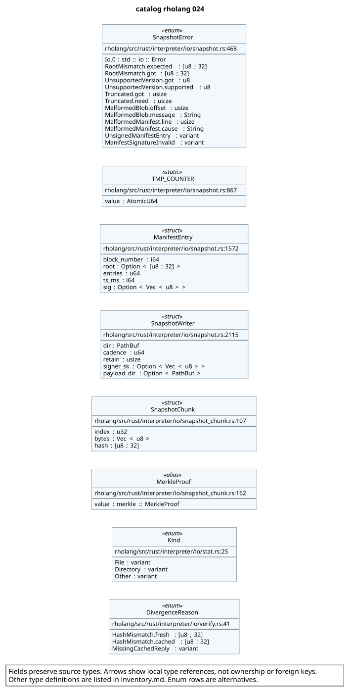

# catalog rholang 024

[Inventory](inventory.md) | [PlantUML](catalog-rholang-024.puml)

## Cardinality and Size

[Method, units, limits, and runtime evidence](sizing.md). These are declaration-level assessments, not measured live counts.

### SnapshotError

Cardinality: 0..n live values. Current count and owner-level limits are not derivable from this declaration.

Size: Compiler enum layout plus allocations of the active variant only. Do not sum alternative variants.

| Field or variant | Cardinality | Inline bytes or layout | Additional storage or wire encoding |
| --- | --- | --- | --- |
| `Io.0` | 1 value when this variant is active | Compiler layout required | Follow the referenced declaration or external implementation. No allocation bound established. |
| `RootMismatch.expected` | 32 elements when this variant is active | 32 B. 32 * I(element), inline array | Sum of element-owned allocations. Element: None |
| `RootMismatch.got` | 32 elements when this variant is active | 32 B. 32 * I(element), inline array | Sum of element-owned allocations. Element: None |
| `UnsupportedVersion.got` | 1 scalar when this variant is active | 1 B | None |
| `UnsupportedVersion.supported` | 1 scalar when this variant is active | 1 B | None |
| `Truncated.got` | 1 scalar when this variant is active | 8 B | None |
| `Truncated.need` | 1 scalar when this variant is active | 8 B | None |
| `MalformedBlob.offset` | 1 scalar when this variant is active | 8 B | None |
| `MalformedBlob.message` | 0..n UTF-8 bytes when this variant is active | 24 B. String header on the generator target | capacity() bytes, excluding allocator overhead. UTF-8 byte length is not character count |
| `MalformedManifest.line` | 1 scalar when this variant is active | 8 B | None |
| `MalformedManifest.cause` | 0..n UTF-8 bytes when this variant is active | 24 B. String header on the generator target | capacity() bytes, excluding allocator overhead. UTF-8 byte length is not character count |
| `UnsignedManifestEntry` | 1 mutually exclusive alternative | No payload. Enum discriminant layout required | None for this unit variant |
| `ManifestSignatureInvalid` | 1 mutually exclusive alternative | No payload. Enum discriminant layout required | None for this unit variant |

### TMP_COUNTER

Cardinality: One slot per linked process instance. Lazy payload can be uninitialized.

Size: Declared slot or lazy wrapper layout plus initialized owned allocations.

| Field or variant | Cardinality | Inline bytes or layout | Additional storage or wire encoding |
| --- | --- | --- | --- |
| `value` | 1 atomic value | Target atomic layout required | None for the atomic value itself |

### ManifestEntry

Cardinality: 0..n live values. Current count and owner-level limits are not derivable from this declaration.

Size: Sum of field inline layouts plus compiler padding, then uniquely owned allocations. repr and custom implementations can change layout.

| Field or variant | Cardinality | Inline bytes or layout | Additional storage or wire encoding |
| --- | --- | --- | --- |
| `block_number` | 1 scalar | 8 B | None |
| `root` | 0..1 present payload | Option layout includes any tag or niche optimization. Do not assume I(T) + 1 | None when absent. Present payload: 32 elements. Sum of element-owned allocations. Element: None |
| `entries` | 1 scalar | 8 B | None |
| `ts_ms` | 1 scalar | 8 B | None |
| `sig` | 0..1 present payload | Option layout includes any tag or niche optimization. Do not assume I(T) + 1 | None when absent. Present payload: 0..n elements. capacity * I(element), plus live element-owned allocations. Zero-sized elements need no backing allocation. Element: None |

### SnapshotWriter

Cardinality: 0..n live values. Current count and owner-level limits are not derivable from this declaration.

Size: Sum of field inline layouts plus compiler padding, then uniquely owned allocations. repr and custom implementations can change layout.

| Field or variant | Cardinality | Inline bytes or layout | Additional storage or wire encoding |
| --- | --- | --- | --- |
| `dir` | 1 value | Compiler layout required | Follow the referenced declaration or external implementation. No allocation bound established. |
| `cadence` | 1 scalar | 8 B | None |
| `retain` | 1 scalar | 8 B | None |
| `signer_sk` | 0..1 present payload | Option layout includes any tag or niche optimization. Do not assume I(T) + 1 | None when absent. Present payload: 0..n elements. capacity * I(element), plus live element-owned allocations. Zero-sized elements need no backing allocation. Element: None |
| `payload_dir` | 0..1 present payload | Option layout includes any tag or niche optimization. Do not assume I(T) + 1 | None when absent. Present payload: 1 value. Follow the referenced declaration or external implementation. No allocation bound established. |

### SnapshotChunk

Cardinality: 0..n live values. Current count and owner-level limits are not derivable from this declaration.

Size: Sum of field inline layouts plus compiler padding, then uniquely owned allocations. repr and custom implementations can change layout.

| Field or variant | Cardinality | Inline bytes or layout | Additional storage or wire encoding |
| --- | --- | --- | --- |
| `index` | 1 scalar | 4 B | None |
| `bytes` | 0..n elements | 24 B. Vec header on the generator target | capacity * I(element), plus live element-owned allocations. Zero-sized elements need no backing allocation. Element: None |
| `hash` | 32 elements | 32 B. 32 * I(element), inline array | Sum of element-owned allocations. Element: None |

### MerkleProof

Cardinality: Alias, not a separate allocation. Count values of the target type.

Size: Same layout and allocations as target. Do not add alias bytes again.

| Field or variant | Cardinality | Inline bytes or layout | Additional storage or wire encoding |
| --- | --- | --- | --- |
| `value` | 1 value | Compiler layout required | Follow the referenced declaration or external implementation. No allocation bound established. |

### Kind

Cardinality: 0..n live values. Current count and owner-level limits are not derivable from this declaration.

Size: Compiler enum layout plus allocations of the active variant only. Do not sum alternative variants.

| Field or variant | Cardinality | Inline bytes or layout | Additional storage or wire encoding |
| --- | --- | --- | --- |
| `File` | 1 mutually exclusive alternative | No payload. Enum discriminant layout required | None for this unit variant |
| `Directory` | 1 mutually exclusive alternative | No payload. Enum discriminant layout required | None for this unit variant |
| `Other` | 1 mutually exclusive alternative | No payload. Enum discriminant layout required | None for this unit variant |

### DivergenceReason

Cardinality: 0..n live values. Current count and owner-level limits are not derivable from this declaration.

Size: Compiler enum layout plus allocations of the active variant only. Do not sum alternative variants.

| Field or variant | Cardinality | Inline bytes or layout | Additional storage or wire encoding |
| --- | --- | --- | --- |
| `HashMismatch.fresh` | 32 elements when this variant is active | 32 B. 32 * I(element), inline array | Sum of element-owned allocations. Element: None |
| `HashMismatch.cached` | 32 elements when this variant is active | 32 B. 32 * I(element), inline array | Sum of element-owned allocations. Element: None |
| `MissingCachedReply` | 1 mutually exclusive alternative | No payload. Enum discriminant layout required | None for this unit variant |

## Cross-Page References

No resolved cross-page references.
