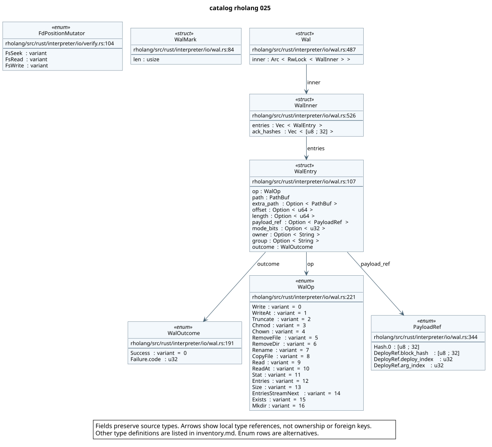

# catalog rholang 025

[Inventory](inventory.md) | [PlantUML](catalog-rholang-025.puml)

## Cardinality and Size

[Method, units, limits, and runtime evidence](sizing.md). These are declaration-level assessments, not measured live counts.

### FdPositionMutator

Cardinality: 0..n live values. Current count and owner-level limits are not derivable from this declaration.

Size: Compiler enum layout plus allocations of the active variant only. Do not sum alternative variants.

| Field or variant | Cardinality | Inline bytes or layout | Additional storage or wire encoding |
| --- | --- | --- | --- |
| `FsSeek` | 1 mutually exclusive alternative | No payload. Enum discriminant layout required | None for this unit variant |
| `FsRead` | 1 mutually exclusive alternative | No payload. Enum discriminant layout required | None for this unit variant |
| `FsWrite` | 1 mutually exclusive alternative | No payload. Enum discriminant layout required | None for this unit variant |

### WalMark

Cardinality: 0..n live values. Current count and owner-level limits are not derivable from this declaration.

Size: Sum of field inline layouts plus compiler padding, then uniquely owned allocations. repr and custom implementations can change layout.

| Field or variant | Cardinality | Inline bytes or layout | Additional storage or wire encoding |
| --- | --- | --- | --- |
| `len` | 1 scalar | 8 B | None |

### WalEntry

Cardinality: 0..n live values. Current count and owner-level limits are not derivable from this declaration.

Size: Sum of field inline layouts plus compiler padding, then uniquely owned allocations. repr and custom implementations can change layout.

| Field or variant | Cardinality | Inline bytes or layout | Additional storage or wire encoding |
| --- | --- | --- | --- |
| `op` | 1 value | Compiler layout required | Follow the referenced declaration or external implementation. No allocation bound established. |
| `path` | 1 value | Compiler layout required | Follow the referenced declaration or external implementation. No allocation bound established. |
| `extra_path` | 0..1 present payload | Option layout includes any tag or niche optimization. Do not assume I(T) + 1 | None when absent. Present payload: 1 value. Follow the referenced declaration or external implementation. No allocation bound established. |
| `offset` | 0..1 present payload | Option layout includes any tag or niche optimization. Do not assume I(T) + 1 | None when absent. Present payload: 1 scalar. None |
| `length` | 0..1 present payload | Option layout includes any tag or niche optimization. Do not assume I(T) + 1 | None when absent. Present payload: 1 scalar. None |
| `payload_ref` | 0..1 present payload | Option layout includes any tag or niche optimization. Do not assume I(T) + 1 | None when absent. Present payload: 1 value. Follow the referenced declaration or external implementation. No allocation bound established. |
| `mode_bits` | 0..1 present payload | Option layout includes any tag or niche optimization. Do not assume I(T) + 1 | None when absent. Present payload: 1 scalar. None |
| `owner` | 0..1 present payload | Option layout includes any tag or niche optimization. Do not assume I(T) + 1 | None when absent. Present payload: 0..n UTF-8 bytes. capacity() bytes, excluding allocator overhead. UTF-8 byte length is not character count |
| `group` | 0..1 present payload | Option layout includes any tag or niche optimization. Do not assume I(T) + 1 | None when absent. Present payload: 0..n UTF-8 bytes. capacity() bytes, excluding allocator overhead. UTF-8 byte length is not character count |
| `outcome` | 1 value | Compiler layout required | Follow the referenced declaration or external implementation. No allocation bound established. |

### WalOutcome

Cardinality: 0..n live values. Current count and owner-level limits are not derivable from this declaration.

Size: Compiler enum layout plus allocations of the active variant only. Do not sum alternative variants.

| Field or variant | Cardinality | Inline bytes or layout | Additional storage or wire encoding |
| --- | --- | --- | --- |
| `Success` | 1 mutually exclusive alternative | No payload. Enum discriminant layout required | None for this unit variant |
| `Failure.code` | 1 scalar when this variant is active | 4 B | None |

### WalOp

Cardinality: 0..n live values. Current count and owner-level limits are not derivable from this declaration.

Size: Compiler enum layout plus allocations of the active variant only. Do not sum alternative variants.

| Field or variant | Cardinality | Inline bytes or layout | Additional storage or wire encoding |
| --- | --- | --- | --- |
| `Write` | 1 mutually exclusive alternative | No payload. Enum discriminant layout required | None for this unit variant |
| `WriteAt` | 1 mutually exclusive alternative | No payload. Enum discriminant layout required | None for this unit variant |
| `Truncate` | 1 mutually exclusive alternative | No payload. Enum discriminant layout required | None for this unit variant |
| `Chmod` | 1 mutually exclusive alternative | No payload. Enum discriminant layout required | None for this unit variant |
| `Chown` | 1 mutually exclusive alternative | No payload. Enum discriminant layout required | None for this unit variant |
| `RemoveFile` | 1 mutually exclusive alternative | No payload. Enum discriminant layout required | None for this unit variant |
| `RemoveDir` | 1 mutually exclusive alternative | No payload. Enum discriminant layout required | None for this unit variant |
| `Rename` | 1 mutually exclusive alternative | No payload. Enum discriminant layout required | None for this unit variant |
| `CopyFile` | 1 mutually exclusive alternative | No payload. Enum discriminant layout required | None for this unit variant |
| `Read` | 1 mutually exclusive alternative | No payload. Enum discriminant layout required | None for this unit variant |
| `ReadAt` | 1 mutually exclusive alternative | No payload. Enum discriminant layout required | None for this unit variant |
| `Stat` | 1 mutually exclusive alternative | No payload. Enum discriminant layout required | None for this unit variant |
| `Entries` | 1 mutually exclusive alternative | No payload. Enum discriminant layout required | None for this unit variant |
| `Size` | 1 mutually exclusive alternative | No payload. Enum discriminant layout required | None for this unit variant |
| `EntriesStreamNext` | 1 mutually exclusive alternative | No payload. Enum discriminant layout required | None for this unit variant |
| `Exists` | 1 mutually exclusive alternative | No payload. Enum discriminant layout required | None for this unit variant |
| `Mkdir` | 1 mutually exclusive alternative | No payload. Enum discriminant layout required | None for this unit variant |

### PayloadRef

Cardinality: 0..n live values. Current count and owner-level limits are not derivable from this declaration.

Size: Compiler enum layout plus allocations of the active variant only. Do not sum alternative variants.

| Field or variant | Cardinality | Inline bytes or layout | Additional storage or wire encoding |
| --- | --- | --- | --- |
| `Hash.0` | 32 elements when this variant is active | 32 B. 32 * I(element), inline array | Sum of element-owned allocations. Element: None |
| `DeployRef.block_hash` | 32 elements when this variant is active | 32 B. 32 * I(element), inline array | Sum of element-owned allocations. Element: None |
| `DeployRef.deploy_index` | 1 scalar when this variant is active | 4 B | None |
| `DeployRef.arg_index` | 1 scalar when this variant is active | 4 B | None |

### Wal

Cardinality: 0..n live values. Current count and owner-level limits are not derivable from this declaration.

Size: Sum of field inline layouts plus compiler padding, then uniquely owned allocations. repr and custom implementations can change layout.

| Field or variant | Cardinality | Inline bytes or layout | Additional storage or wire encoding |
| --- | --- | --- | --- |
| `inner` | 1 shared strong reference | Pointer or fat pointer, depending on target type | One shared allocation holds the target, counters and alignment. Count it once across all handles |

### WalInner

Cardinality: 0..n live values. Current count and owner-level limits are not derivable from this declaration.

Size: Sum of field inline layouts plus compiler padding, then uniquely owned allocations. repr and custom implementations can change layout.

| Field or variant | Cardinality | Inline bytes or layout | Additional storage or wire encoding |
| --- | --- | --- | --- |
| `entries` | 0..n elements | 24 B. Vec header on the generator target | capacity * I(element), plus live element-owned allocations. Zero-sized elements need no backing allocation. Element: Follow the referenced declaration or external implementation. No allocation bound established. |
| `ack_hashes` | 0..n elements | 24 B. Vec header on the generator target | capacity * I(element), plus live element-owned allocations. Zero-sized elements need no backing allocation. Element: Sum of element-owned allocations. Element: None |

## Cross-Page References

No resolved cross-page references.
