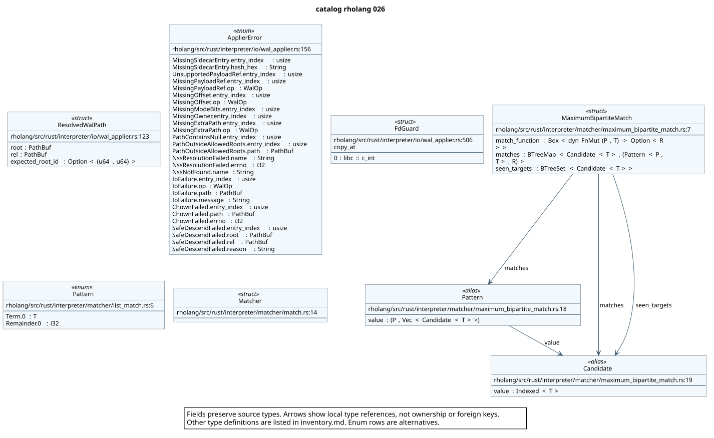

# catalog rholang 026

[Inventory](inventory.md) | [PlantUML](catalog-rholang-026.puml)

## Cardinality and Size

[Method, units, limits, and runtime evidence](sizing.md). These are declaration-level assessments, not measured live counts.

### ResolvedWalPath

Cardinality: 0..n live values. Current count and owner-level limits are not derivable from this declaration.

Size: Sum of field inline layouts plus compiler padding, then uniquely owned allocations. repr and custom implementations can change layout.

| Field or variant | Cardinality | Inline bytes or layout | Additional storage or wire encoding |
| --- | --- | --- | --- |
| `root` | 1 value | Compiler layout required | Follow the referenced declaration or external implementation. No allocation bound established. |
| `rel` | 1 value | Compiler layout required | Follow the referenced declaration or external implementation. No allocation bound established. |
| `expected_root_id` | 0..1 present payload | Option layout includes any tag or niche optimization. Do not assume I(T) + 1 | None when absent. Present payload: 2 component values. Sum of component-owned allocations |

### ApplierError

Cardinality: 0..n live values. Current count and owner-level limits are not derivable from this declaration.

Size: Compiler enum layout plus allocations of the active variant only. Do not sum alternative variants.

| Field or variant | Cardinality | Inline bytes or layout | Additional storage or wire encoding |
| --- | --- | --- | --- |
| `MissingSidecarEntry.entry_index` | 1 scalar when this variant is active | 8 B | None |
| `MissingSidecarEntry.hash_hex` | 0..n UTF-8 bytes when this variant is active | 24 B. String header on the generator target | capacity() bytes, excluding allocator overhead. UTF-8 byte length is not character count |
| `UnsupportedPayloadRef.entry_index` | 1 scalar when this variant is active | 8 B | None |
| `MissingPayloadRef.entry_index` | 1 scalar when this variant is active | 8 B | None |
| `MissingPayloadRef.op` | 1 value when this variant is active | Compiler layout required | Follow the referenced declaration or external implementation. No allocation bound established. |
| `MissingOffset.entry_index` | 1 scalar when this variant is active | 8 B | None |
| `MissingOffset.op` | 1 value when this variant is active | Compiler layout required | Follow the referenced declaration or external implementation. No allocation bound established. |
| `MissingModeBits.entry_index` | 1 scalar when this variant is active | 8 B | None |
| `MissingOwner.entry_index` | 1 scalar when this variant is active | 8 B | None |
| `MissingExtraPath.entry_index` | 1 scalar when this variant is active | 8 B | None |
| `MissingExtraPath.op` | 1 value when this variant is active | Compiler layout required | Follow the referenced declaration or external implementation. No allocation bound established. |
| `PathContainsNull.entry_index` | 1 scalar when this variant is active | 8 B | None |
| `PathOutsideAllowedRoots.entry_index` | 1 scalar when this variant is active | 8 B | None |
| `PathOutsideAllowedRoots.path` | 1 value when this variant is active | Compiler layout required | Follow the referenced declaration or external implementation. No allocation bound established. |
| `NssResolutionFailed.name` | 0..n UTF-8 bytes when this variant is active | 24 B. String header on the generator target | capacity() bytes, excluding allocator overhead. UTF-8 byte length is not character count |
| `NssResolutionFailed.errno` | 1 scalar when this variant is active | 4 B | None |
| `NssNotFound.name` | 0..n UTF-8 bytes when this variant is active | 24 B. String header on the generator target | capacity() bytes, excluding allocator overhead. UTF-8 byte length is not character count |
| `IoFailure.entry_index` | 1 scalar when this variant is active | 8 B | None |
| `IoFailure.op` | 1 value when this variant is active | Compiler layout required | Follow the referenced declaration or external implementation. No allocation bound established. |
| `IoFailure.path` | 1 value when this variant is active | Compiler layout required | Follow the referenced declaration or external implementation. No allocation bound established. |
| `IoFailure.message` | 0..n UTF-8 bytes when this variant is active | 24 B. String header on the generator target | capacity() bytes, excluding allocator overhead. UTF-8 byte length is not character count |
| `ChownFailed.entry_index` | 1 scalar when this variant is active | 8 B | None |
| `ChownFailed.path` | 1 value when this variant is active | Compiler layout required | Follow the referenced declaration or external implementation. No allocation bound established. |
| `ChownFailed.errno` | 1 scalar when this variant is active | 4 B | None |
| `SafeDescendFailed.entry_index` | 1 scalar when this variant is active | 8 B | None |
| `SafeDescendFailed.root` | 1 value when this variant is active | Compiler layout required | Follow the referenced declaration or external implementation. No allocation bound established. |
| `SafeDescendFailed.rel` | 1 value when this variant is active | Compiler layout required | Follow the referenced declaration or external implementation. No allocation bound established. |
| `SafeDescendFailed.reason` | 0..n UTF-8 bytes when this variant is active | 24 B. String header on the generator target | capacity() bytes, excluding allocator overhead. UTF-8 byte length is not character count |

### FdGuard

Cardinality: 0..n live values. Current count and owner-level limits are not derivable from this declaration.

Size: Sum of field inline layouts plus compiler padding, then uniquely owned allocations. repr and custom implementations can change layout.

| Field or variant | Cardinality | Inline bytes or layout | Additional storage or wire encoding |
| --- | --- | --- | --- |
| `0` | 1 value | Compiler layout required | Follow the referenced declaration or external implementation. No allocation bound established. |

### Pattern

Cardinality: 0..n live values. Current count and owner-level limits are not derivable from this declaration.

Size: Compiler enum layout plus allocations of the active variant only. Do not sum alternative variants.

| Field or variant | Cardinality | Inline bytes or layout | Additional storage or wire encoding |
| --- | --- | --- | --- |
| `Term.0` | 1 value when this variant is active | Compiler layout required | Follow the referenced declaration or external implementation. No allocation bound established. |
| `Remainder.0` | 1 scalar when this variant is active | 4 B | None |

### Matcher

Cardinality: 0..n live values. Current count and owner-level limits are not derivable from this declaration.

Size: Sum of field inline layouts plus compiler padding, then uniquely owned allocations. repr and custom implementations can change layout.

| Field or variant | Cardinality | Inline bytes or layout | Additional storage or wire encoding |
| --- | --- | --- | --- |
| No declared fields | 0 field payloads | Compiler layout required | No field-owned allocations |

### MaximumBipartiteMatch

Cardinality: 0..n live values. Current count and owner-level limits are not derivable from this declaration.

Size: Sum of field inline layouts plus compiler padding, then uniquely owned allocations. repr and custom implementations can change layout.

| Field or variant | Cardinality | Inline bytes or layout | Additional storage or wire encoding |
| --- | --- | --- | --- |
| `match_function` | 1 owned target | Pointer or fat pointer, depending on target type | I(target) and its owned allocations, plus allocator overhead. Zero-sized targets need no allocation |
| `matches` | 0..n key/value pairs | Container and hasher implementation required | n keys and n values, their owned allocations, spare capacity, buckets or tree nodes, and control bytes. No type-level count cap |
| `seen_targets` | 0..n distinct elements | Container and hasher implementation required | Element storage, owned allocations, spare capacity and index overhead. No type-level count cap |

### Pattern

Cardinality: Alias, not a separate allocation. Count values of the target type.

Size: Same layout and allocations as target. Do not add alias bytes again.

| Field or variant | Cardinality | Inline bytes or layout | Additional storage or wire encoding |
| --- | --- | --- | --- |
| `value` | 2 component values | Sum of component inline sizes plus compiler padding | Sum of component-owned allocations |

### Candidate

Cardinality: Alias, not a separate allocation. Count values of the target type.

Size: Same layout and allocations as target. Do not add alias bytes again.

| Field or variant | Cardinality | Inline bytes or layout | Additional storage or wire encoding |
| --- | --- | --- | --- |
| `value` | 1 value | Compiler layout required | Follow the referenced declaration or external implementation. No allocation bound established. |

## Cross-Page References

- `ApplierError: IoFailure.op -> WalOp [catalog-rholang-025.svg]`
- `ApplierError: MissingExtraPath.op -> WalOp [catalog-rholang-025.svg]`
- `ApplierError: MissingOffset.op -> WalOp [catalog-rholang-025.svg]`
- `ApplierError: MissingPayloadRef.op -> WalOp [catalog-rholang-025.svg]`
- `Candidate: value -> Indexed [catalog-rholang-027.svg]`
