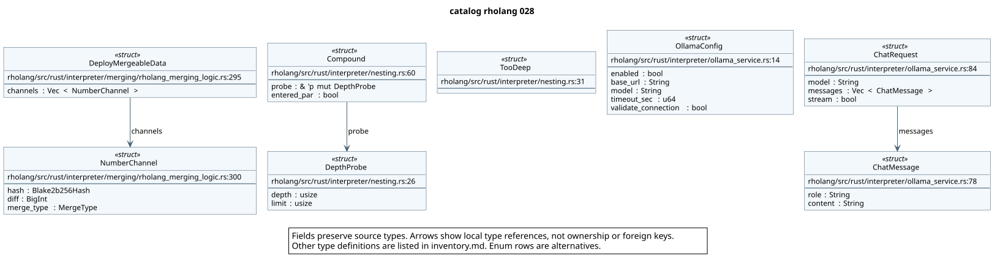

# catalog rholang 028

[Inventory](inventory.md) | [PlantUML](catalog-rholang-028.puml)

## Cross-Page References

- `NumberChannel: hash -> Blake2b256Hash [catalog-rspacepp-002.svg]`
- `NumberChannel: merge_type -> MergeType [catalog-rspacepp-011.svg]`
