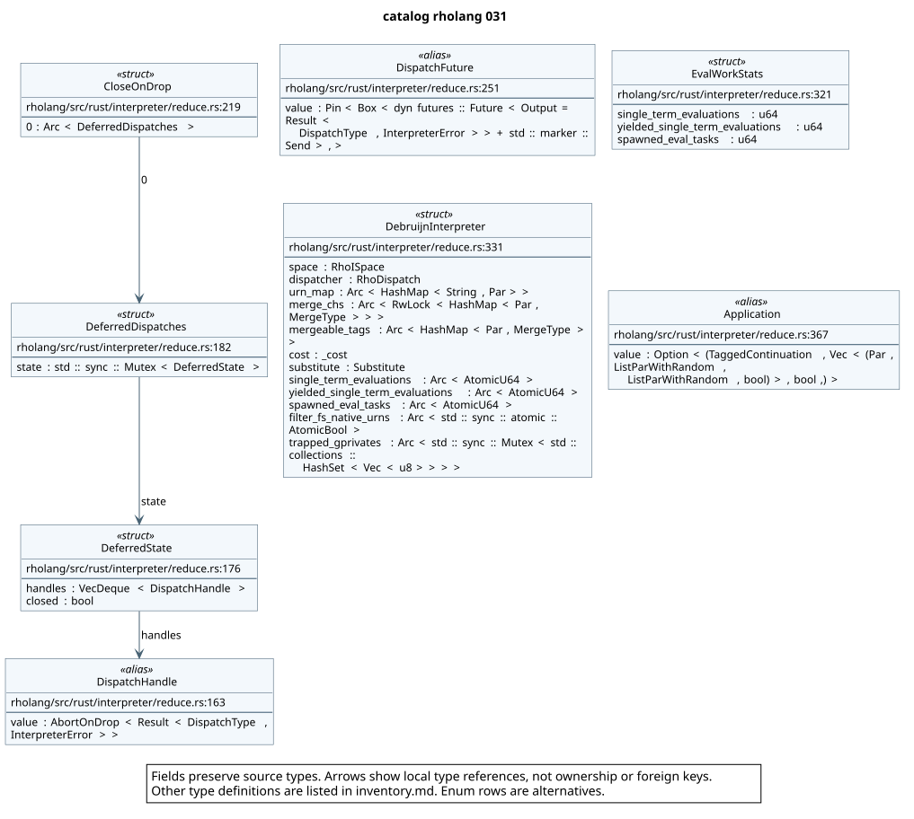

# catalog rholang 031

[Inventory](inventory.md) | [PlantUML](catalog-rholang-031.puml)

## Cross-Page References

- `DebruijnInterpreter: cost -> _cost [catalog-rholang-001.svg]`
- `DebruijnInterpreter: dispatcher -> RhoDispatch [catalog-rholang-006.svg]`
- `DebruijnInterpreter: merge_chs -> MergeType [catalog-rspacepp-011.svg]`
- `DebruijnInterpreter: mergeable_tags -> MergeType [catalog-rspacepp-011.svg]`
- `DebruijnInterpreter: space -> RhoISpace [catalog-rholang-040.svg]`
- `DebruijnInterpreter: substitute -> Substitute [catalog-rholang-043.svg]`
- `DispatchFuture: value -> DispatchType [catalog-rholang-006.svg]`
- `DispatchFuture: value -> InterpreterError [catalog-rholang-006.svg]`
- `DispatchHandle: value -> AbortOnDrop [catalog-rholang-030.svg]`
- `DispatchHandle: value -> DispatchType [catalog-rholang-006.svg]`
- `DispatchHandle: value -> InterpreterError [catalog-rholang-006.svg]`
