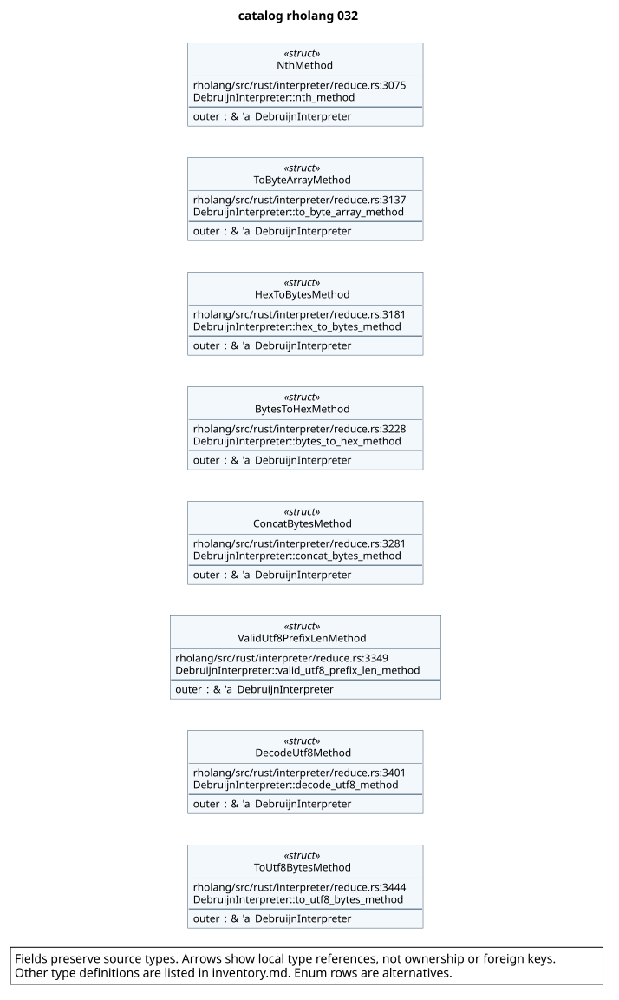

# catalog rholang 032

[Inventory](inventory.md) | [PlantUML](catalog-rholang-032.puml)

## Cross-Page References

- `BytesToHexMethod: outer -> DebruijnInterpreter [catalog-rholang-031.svg]`
- `ConcatBytesMethod: outer -> DebruijnInterpreter [catalog-rholang-031.svg]`
- `DecodeUtf8Method: outer -> DebruijnInterpreter [catalog-rholang-031.svg]`
- `HexToBytesMethod: outer -> DebruijnInterpreter [catalog-rholang-031.svg]`
- `NthMethod: outer -> DebruijnInterpreter [catalog-rholang-031.svg]`
- `ToByteArrayMethod: outer -> DebruijnInterpreter [catalog-rholang-031.svg]`
- `ToUtf8BytesMethod: outer -> DebruijnInterpreter [catalog-rholang-031.svg]`
- `ValidUtf8PrefixLenMethod: outer -> DebruijnInterpreter [catalog-rholang-031.svg]`
