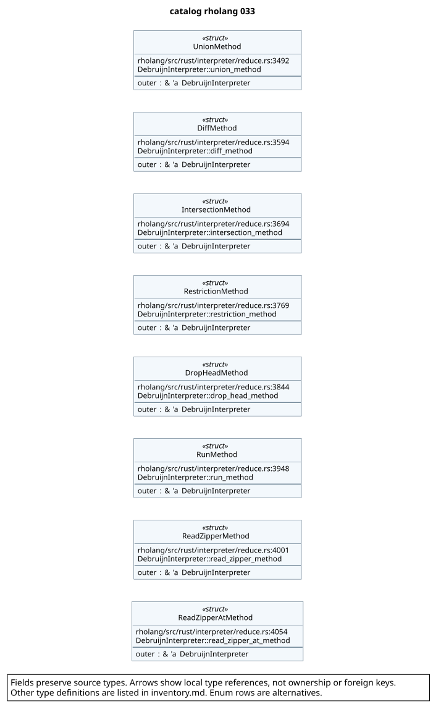

# catalog rholang 033

[Inventory](inventory.md) | [PlantUML](catalog-rholang-033.puml)

## Cross-Page References

- `DiffMethod: outer -> DebruijnInterpreter [catalog-rholang-031.svg]`
- `DropHeadMethod: outer -> DebruijnInterpreter [catalog-rholang-031.svg]`
- `IntersectionMethod: outer -> DebruijnInterpreter [catalog-rholang-031.svg]`
- `ReadZipperAtMethod: outer -> DebruijnInterpreter [catalog-rholang-031.svg]`
- `ReadZipperMethod: outer -> DebruijnInterpreter [catalog-rholang-031.svg]`
- `RestrictionMethod: outer -> DebruijnInterpreter [catalog-rholang-031.svg]`
- `RunMethod: outer -> DebruijnInterpreter [catalog-rholang-031.svg]`
- `UnionMethod: outer -> DebruijnInterpreter [catalog-rholang-031.svg]`
