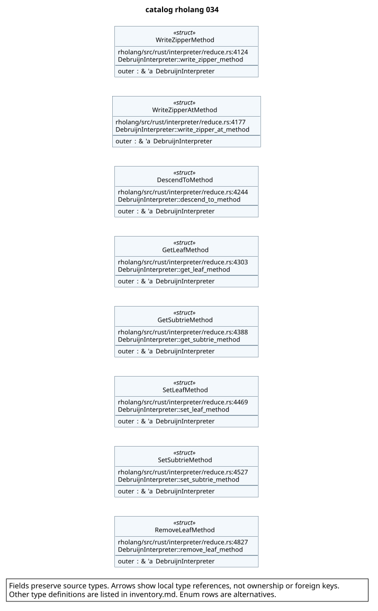

# catalog rholang 034

[Inventory](inventory.md) | [PlantUML](catalog-rholang-034.puml)

## Cross-Page References

- `DescendToMethod: outer -> DebruijnInterpreter [catalog-rholang-031.svg]`
- `GetLeafMethod: outer -> DebruijnInterpreter [catalog-rholang-031.svg]`
- `GetSubtrieMethod: outer -> DebruijnInterpreter [catalog-rholang-031.svg]`
- `RemoveLeafMethod: outer -> DebruijnInterpreter [catalog-rholang-031.svg]`
- `SetLeafMethod: outer -> DebruijnInterpreter [catalog-rholang-031.svg]`
- `SetSubtrieMethod: outer -> DebruijnInterpreter [catalog-rholang-031.svg]`
- `WriteZipperAtMethod: outer -> DebruijnInterpreter [catalog-rholang-031.svg]`
- `WriteZipperMethod: outer -> DebruijnInterpreter [catalog-rholang-031.svg]`
