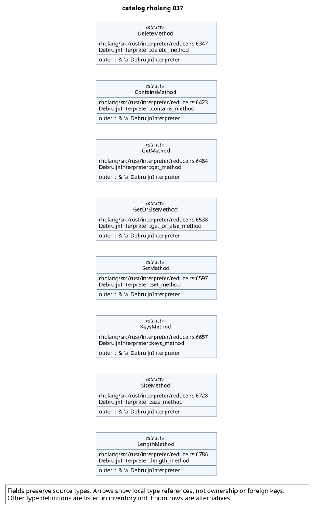

# catalog rholang 037

[Inventory](inventory.md) | [PlantUML](catalog-rholang-037.puml)

## Cross-Page References

- `ContainsMethod: outer -> DebruijnInterpreter [catalog-rholang-031.svg]`
- `DeleteMethod: outer -> DebruijnInterpreter [catalog-rholang-031.svg]`
- `GetMethod: outer -> DebruijnInterpreter [catalog-rholang-031.svg]`
- `GetOrElseMethod: outer -> DebruijnInterpreter [catalog-rholang-031.svg]`
- `KeysMethod: outer -> DebruijnInterpreter [catalog-rholang-031.svg]`
- `LengthMethod: outer -> DebruijnInterpreter [catalog-rholang-031.svg]`
- `SetMethod: outer -> DebruijnInterpreter [catalog-rholang-031.svg]`
- `SizeMethod: outer -> DebruijnInterpreter [catalog-rholang-031.svg]`
