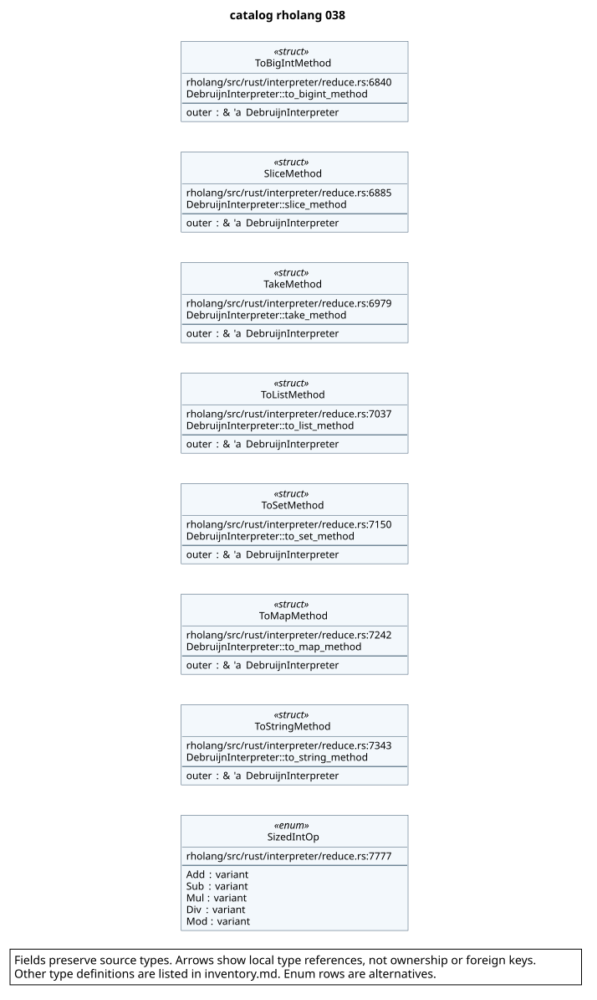

# catalog rholang 038

[Inventory](inventory.md) | [PlantUML](catalog-rholang-038.puml)

## Cross-Page References

- `SliceMethod: outer -> DebruijnInterpreter [catalog-rholang-031.svg]`
- `TakeMethod: outer -> DebruijnInterpreter [catalog-rholang-031.svg]`
- `ToBigIntMethod: outer -> DebruijnInterpreter [catalog-rholang-031.svg]`
- `ToListMethod: outer -> DebruijnInterpreter [catalog-rholang-031.svg]`
- `ToMapMethod: outer -> DebruijnInterpreter [catalog-rholang-031.svg]`
- `ToSetMethod: outer -> DebruijnInterpreter [catalog-rholang-031.svg]`
- `ToStringMethod: outer -> DebruijnInterpreter [catalog-rholang-031.svg]`
