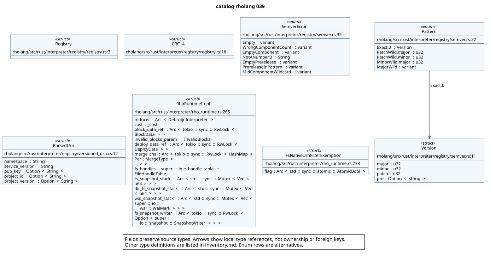

# catalog rholang 039

[Inventory](inventory.md) | [PlantUML](catalog-rholang-039.puml)

## Cardinality and Size

[Method, units, limits, and runtime evidence](sizing.md). These are declaration-level assessments, not measured live counts.

### Registry

Cardinality: 0..n live values. Current count and owner-level limits are not derivable from this declaration.

Size: Sum of field inline layouts plus compiler padding, then uniquely owned allocations. repr and custom implementations can change layout.

| Field or variant | Cardinality | Inline bytes or layout | Additional storage or wire encoding |
| --- | --- | --- | --- |
| No declared fields | 0 field payloads | Compiler layout required | No field-owned allocations |

### CRC14

Cardinality: 0..n live values. Current count and owner-level limits are not derivable from this declaration.

Size: Sum of field inline layouts plus compiler padding, then uniquely owned allocations. repr and custom implementations can change layout.

| Field or variant | Cardinality | Inline bytes or layout | Additional storage or wire encoding |
| --- | --- | --- | --- |
| No declared fields | 0 field payloads | Compiler layout required | No field-owned allocations |

### Version

Cardinality: 0..n live values. Current count and owner-level limits are not derivable from this declaration.

Size: Sum of field inline layouts plus compiler padding, then uniquely owned allocations. repr and custom implementations can change layout.

| Field or variant | Cardinality | Inline bytes or layout | Additional storage or wire encoding |
| --- | --- | --- | --- |
| `major` | 1 scalar | 4 B | None |
| `minor` | 1 scalar | 4 B | None |
| `patch` | 1 scalar | 4 B | None |
| `pre` | 0..1 present payload | Option layout includes any tag or niche optimization. Do not assume I(T) + 1 | None when absent. Present payload: 0..n UTF-8 bytes. capacity() bytes, excluding allocator overhead. UTF-8 byte length is not character count |

### Pattern

Cardinality: 0..n live values. Current count and owner-level limits are not derivable from this declaration.

Size: Compiler enum layout plus allocations of the active variant only. Do not sum alternative variants.

| Field or variant | Cardinality | Inline bytes or layout | Additional storage or wire encoding |
| --- | --- | --- | --- |
| `Exact.0` | 1 value when this variant is active | Compiler layout required | Follow the referenced declaration or external implementation. No allocation bound established. |
| `PatchWild.major` | 1 scalar when this variant is active | 4 B | None |
| `PatchWild.minor` | 1 scalar when this variant is active | 4 B | None |
| `MinorWild.major` | 1 scalar when this variant is active | 4 B | None |
| `MajorWild` | 1 mutually exclusive alternative | No payload. Enum discriminant layout required | None for this unit variant |

### SemverError

Cardinality: 0..n live values. Current count and owner-level limits are not derivable from this declaration.

Size: Compiler enum layout plus allocations of the active variant only. Do not sum alternative variants.

| Field or variant | Cardinality | Inline bytes or layout | Additional storage or wire encoding |
| --- | --- | --- | --- |
| `Empty` | 1 mutually exclusive alternative | No payload. Enum discriminant layout required | None for this unit variant |
| `WrongComponentCount` | 1 mutually exclusive alternative | No payload. Enum discriminant layout required | None for this unit variant |
| `EmptyComponent` | 1 mutually exclusive alternative | No payload. Enum discriminant layout required | None for this unit variant |
| `NotANumber.0` | 0..n UTF-8 bytes when this variant is active | 24 B. String header on the generator target | capacity() bytes, excluding allocator overhead. UTF-8 byte length is not character count |
| `EmptyPrerelease` | 1 mutually exclusive alternative | No payload. Enum discriminant layout required | None for this unit variant |
| `PrereleaseInPattern` | 1 mutually exclusive alternative | No payload. Enum discriminant layout required | None for this unit variant |
| `MidComponentWildcard` | 1 mutually exclusive alternative | No payload. Enum discriminant layout required | None for this unit variant |

### ParsedUrn

Cardinality: 0..n live values. Current count and owner-level limits are not derivable from this declaration.

Size: Sum of field inline layouts plus compiler padding, then uniquely owned allocations. repr and custom implementations can change layout.

| Field or variant | Cardinality | Inline bytes or layout | Additional storage or wire encoding |
| --- | --- | --- | --- |
| `namespace` | 0..n UTF-8 bytes | 24 B. String header on the generator target | capacity() bytes, excluding allocator overhead. UTF-8 byte length is not character count |
| `service_version` | 0..n UTF-8 bytes | 24 B. String header on the generator target | capacity() bytes, excluding allocator overhead. UTF-8 byte length is not character count |
| `pub_key` | 0..1 present payload | Option layout includes any tag or niche optimization. Do not assume I(T) + 1 | None when absent. Present payload: 0..n UTF-8 bytes. capacity() bytes, excluding allocator overhead. UTF-8 byte length is not character count |
| `project_id` | 0..1 present payload | Option layout includes any tag or niche optimization. Do not assume I(T) + 1 | None when absent. Present payload: 0..n UTF-8 bytes. capacity() bytes, excluding allocator overhead. UTF-8 byte length is not character count |
| `project_version` | 0..1 present payload | Option layout includes any tag or niche optimization. Do not assume I(T) + 1 | None when absent. Present payload: 0..n UTF-8 bytes. capacity() bytes, excluding allocator overhead. UTF-8 byte length is not character count |

### RhoRuntimeImpl

Cardinality: 0..n live values. Current count and owner-level limits are not derivable from this declaration.

Size: Sum of field inline layouts plus compiler padding, then uniquely owned allocations. repr and custom implementations can change layout.

| Field or variant | Cardinality | Inline bytes or layout | Additional storage or wire encoding |
| --- | --- | --- | --- |
| `reducer` | 1 shared strong reference | Pointer or fat pointer, depending on target type | One shared allocation holds the target, counters and alignment. Count it once across all handles |
| `cost` | 1 value | Compiler layout required | Follow the referenced declaration or external implementation. No allocation bound established. |
| `block_data_ref` | 1 shared strong reference | Pointer or fat pointer, depending on target type | One shared allocation holds the target, counters and alignment. Count it once across all handles |
| `invalid_blocks_param` | 1 value | Compiler layout required | Follow the referenced declaration or external implementation. No allocation bound established. |
| `deploy_data_ref` | 1 shared strong reference | Pointer or fat pointer, depending on target type | One shared allocation holds the target, counters and alignment. Count it once across all handles |
| `merge_chs` | 1 shared strong reference | Pointer or fat pointer, depending on target type | One shared allocation holds the target, counters and alignment. Count it once across all handles |
| `fs_handles` | 1 value | Compiler layout required | Follow the referenced declaration or external implementation. No allocation bound established. |
| `fs_snapshot_stack` | 1 shared strong reference | Pointer or fat pointer, depending on target type | One shared allocation holds the target, counters and alignment. Count it once across all handles |
| `dir_fs_snapshot_stack` | 1 shared strong reference | Pointer or fat pointer, depending on target type | One shared allocation holds the target, counters and alignment. Count it once across all handles |
| `wal_snapshot_stack` | 1 shared strong reference | Pointer or fat pointer, depending on target type | One shared allocation holds the target, counters and alignment. Count it once across all handles |
| `fs_snapshot_writer` | 1 shared strong reference | Pointer or fat pointer, depending on target type | One shared allocation holds the target, counters and alignment. Count it once across all handles |

### FsNativeUrnFilterExemption

Cardinality: 0..n live values. Current count and owner-level limits are not derivable from this declaration.

Size: Sum of field inline layouts plus compiler padding, then uniquely owned allocations. repr and custom implementations can change layout.

| Field or variant | Cardinality | Inline bytes or layout | Additional storage or wire encoding |
| --- | --- | --- | --- |
| `flag` | 1 shared strong reference | Pointer or fat pointer, depending on target type | One shared allocation holds the target, counters and alignment. Count it once across all handles |

## Cross-Page References

- `RhoRuntimeImpl: block_data_ref -> BlockData [catalog-rholang-044.svg]`
- `RhoRuntimeImpl: cost -> _cost [catalog-rholang-001.svg]`
- `RhoRuntimeImpl: fs_handles -> FileHandleTable [catalog-rholang-008.svg]`
- `RhoRuntimeImpl: fs_snapshot_writer -> SnapshotWriter [catalog-rholang-024.svg]`
- `RhoRuntimeImpl: invalid_blocks_param -> InvalidBlocks [catalog-rholang-044.svg]`
- `RhoRuntimeImpl: merge_chs -> MergeType [catalog-rspacepp-011.svg]`
- `RhoRuntimeImpl: reducer -> DebruijnInterpreter [catalog-rholang-031.svg]`
- `RhoRuntimeImpl: wal_snapshot_stack -> WalMark [catalog-rholang-025.svg]`
