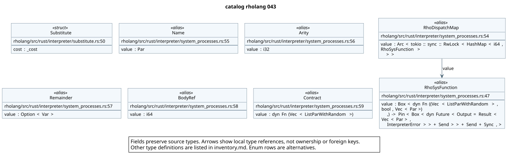

# catalog rholang 043

[Inventory](inventory.md) | [PlantUML](catalog-rholang-043.puml)

## Cross-Page References

- `RhoSysFunction: value -> InterpreterError [catalog-rholang-006.svg]`
- `Substitute: cost -> _cost [catalog-rholang-001.svg]`
