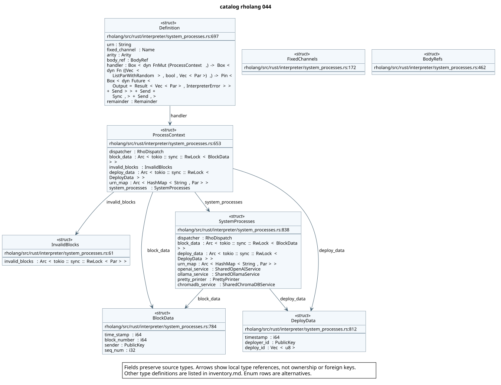

# catalog rholang 044

[Inventory](inventory.md) | [PlantUML](catalog-rholang-044.puml)

## Cardinality and Size

[Method, units, limits, and runtime evidence](sizing.md). These are declaration-level assessments, not measured live counts.

### InvalidBlocks

Cardinality: 0..n live values. Current count and owner-level limits are not derivable from this declaration.

Size: Sum of field inline layouts plus compiler padding, then uniquely owned allocations. repr and custom implementations can change layout.

| Field or variant | Cardinality | Inline bytes or layout | Additional storage or wire encoding |
| --- | --- | --- | --- |
| `invalid_blocks` | 1 shared strong reference | Pointer or fat pointer, depending on target type | One shared allocation holds the target, counters and alignment. Count it once across all handles |

### FixedChannels

Cardinality: 0..n live values. Current count and owner-level limits are not derivable from this declaration.

Size: Sum of field inline layouts plus compiler padding, then uniquely owned allocations. repr and custom implementations can change layout.

| Field or variant | Cardinality | Inline bytes or layout | Additional storage or wire encoding |
| --- | --- | --- | --- |
| No declared fields | 0 field payloads | Compiler layout required | No field-owned allocations |

### BodyRefs

Cardinality: 0..n live values. Current count and owner-level limits are not derivable from this declaration.

Size: Sum of field inline layouts plus compiler padding, then uniquely owned allocations. repr and custom implementations can change layout.

| Field or variant | Cardinality | Inline bytes or layout | Additional storage or wire encoding |
| --- | --- | --- | --- |
| No declared fields | 0 field payloads | Compiler layout required | No field-owned allocations |

### ProcessContext

Cardinality: 0..n live values. Current count and owner-level limits are not derivable from this declaration.

Size: Sum of field inline layouts plus compiler padding, then uniquely owned allocations. repr and custom implementations can change layout.

| Field or variant | Cardinality | Inline bytes or layout | Additional storage or wire encoding |
| --- | --- | --- | --- |
| `dispatcher` | 1 value | Compiler layout required | Follow the referenced declaration or external implementation. No allocation bound established. |
| `block_data` | 1 shared strong reference | Pointer or fat pointer, depending on target type | One shared allocation holds the target, counters and alignment. Count it once across all handles |
| `invalid_blocks` | 1 value | Compiler layout required | Follow the referenced declaration or external implementation. No allocation bound established. |
| `deploy_data` | 1 shared strong reference | Pointer or fat pointer, depending on target type | One shared allocation holds the target, counters and alignment. Count it once across all handles |
| `urn_map` | 1 shared strong reference | Pointer or fat pointer, depending on target type | One shared allocation holds the target, counters and alignment. Count it once across all handles |
| `system_processes` | 1 value | Compiler layout required | Follow the referenced declaration or external implementation. No allocation bound established. |

### Definition

Cardinality: 0..n live values. Current count and owner-level limits are not derivable from this declaration.

Size: Sum of field inline layouts plus compiler padding, then uniquely owned allocations. repr and custom implementations can change layout.

| Field or variant | Cardinality | Inline bytes or layout | Additional storage or wire encoding |
| --- | --- | --- | --- |
| `urn` | 0..n UTF-8 bytes | 24 B. String header on the generator target | capacity() bytes, excluding allocator overhead. UTF-8 byte length is not character count |
| `fixed_channel` | 1 value | Compiler layout required | Follow the referenced declaration or external implementation. No allocation bound established. |
| `arity` | 1 value | Compiler layout required | Follow the referenced declaration or external implementation. No allocation bound established. |
| `body_ref` | 1 value | Compiler layout required | Follow the referenced declaration or external implementation. No allocation bound established. |
| `handler` | 1 owned target | Pointer or fat pointer, depending on target type | I(target) and its owned allocations, plus allocator overhead. Zero-sized targets need no allocation |
| `remainder` | 1 value | Compiler layout required | Follow the referenced declaration or external implementation. No allocation bound established. |

### BlockData

Cardinality: 0..n live values. Current count and owner-level limits are not derivable from this declaration.

Size: Sum of field inline layouts plus compiler padding, then uniquely owned allocations. repr and custom implementations can change layout.

| Field or variant | Cardinality | Inline bytes or layout | Additional storage or wire encoding |
| --- | --- | --- | --- |
| `time_stamp` | 1 scalar | 8 B | None |
| `block_number` | 1 scalar | 8 B | None |
| `sender` | 1 value | Compiler layout required | Follow the referenced declaration or external implementation. No allocation bound established. |
| `seq_num` | 1 scalar | 4 B | None |

### DeployData

Cardinality: 0..n live values. Current count and owner-level limits are not derivable from this declaration.

Size: Sum of field inline layouts plus compiler padding, then uniquely owned allocations. repr and custom implementations can change layout.

| Field or variant | Cardinality | Inline bytes or layout | Additional storage or wire encoding |
| --- | --- | --- | --- |
| `timestamp` | 1 scalar | 8 B | None |
| `deployer_id` | 1 value | Compiler layout required | Follow the referenced declaration or external implementation. No allocation bound established. |
| `deploy_id` | 0..n elements | 24 B. Vec header on the generator target | capacity * I(element), plus live element-owned allocations. Zero-sized elements need no backing allocation. Element: None |

### SystemProcesses

Cardinality: 0..n live values. Current count and owner-level limits are not derivable from this declaration.

Size: Sum of field inline layouts plus compiler padding, then uniquely owned allocations. repr and custom implementations can change layout.

| Field or variant | Cardinality | Inline bytes or layout | Additional storage or wire encoding |
| --- | --- | --- | --- |
| `dispatcher` | 1 value | Compiler layout required | Follow the referenced declaration or external implementation. No allocation bound established. |
| `block_data` | 1 shared strong reference | Pointer or fat pointer, depending on target type | One shared allocation holds the target, counters and alignment. Count it once across all handles |
| `deploy_data` | 1 shared strong reference | Pointer or fat pointer, depending on target type | One shared allocation holds the target, counters and alignment. Count it once across all handles |
| `urn_map` | 1 shared strong reference | Pointer or fat pointer, depending on target type | One shared allocation holds the target, counters and alignment. Count it once across all handles |
| `openai_service` | 1 value | Compiler layout required | Follow the referenced declaration or external implementation. No allocation bound established. |
| `ollama_service` | 1 value | Compiler layout required | Follow the referenced declaration or external implementation. No allocation bound established. |
| `pretty_printer` | 1 value | Compiler layout required | Follow the referenced declaration or external implementation. No allocation bound established. |
| `chromadb_service` | 1 value | Compiler layout required | Follow the referenced declaration or external implementation. No allocation bound established. |

## Cross-Page References

- `Definition: arity -> Arity [catalog-rholang-043.svg]`
- `Definition: body_ref -> BodyRef [catalog-rholang-043.svg]`
- `Definition: fixed_channel -> Name [catalog-rholang-043.svg]`
- `Definition: handler -> InterpreterError [catalog-rholang-006.svg]`
- `Definition: remainder -> Remainder [catalog-rholang-043.svg]`
- `ProcessContext: dispatcher -> RhoDispatch [catalog-rholang-006.svg]`
- `SystemProcesses: dispatcher -> RhoDispatch [catalog-rholang-006.svg]`
- `SystemProcesses: ollama_service -> SharedOllamaService [catalog-rholang-029.svg]`
- `SystemProcesses: openai_service -> SharedOpenAIService [catalog-rholang-030.svg]`
