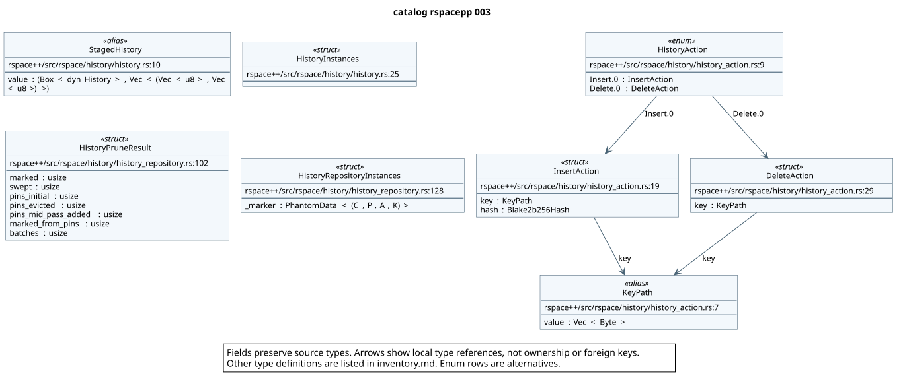

# catalog rspacepp 003

[Inventory](inventory.md) | [PlantUML](catalog-rspacepp-003.puml)

## Cross-Page References

- `InsertAction: hash -> Blake2b256Hash [catalog-rspacepp-002.svg]`
- `KeyPath: value -> Byte [catalog-shared-002.svg]`
