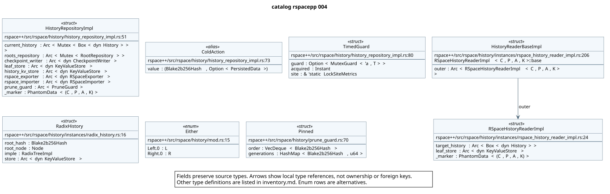

# catalog rspacepp 004

[Inventory](inventory.md) | [PlantUML](catalog-rspacepp-004.puml)

## Cross-Page References

- `ColdAction: value -> Blake2b256Hash [catalog-rspacepp-002.svg]`
- `ColdAction: value -> PersistedData [catalog-rspacepp-002.svg]`
- `HistoryRepositoryImpl: prune_guard -> PruneGuard [catalog-rspacepp-005.svg]`
- `HistoryRepositoryImpl: roots_repository -> RootRepository [catalog-rspacepp-006.svg]`
- `Pinned: generations -> Blake2b256Hash [catalog-rspacepp-002.svg]`
- `Pinned: order -> Blake2b256Hash [catalog-rspacepp-002.svg]`
- `RadixHistory: imple -> RadixTreeImpl [catalog-rspacepp-005.svg]`
- `RadixHistory: root_hash -> Blake2b256Hash [catalog-rspacepp-002.svg]`
- `RadixHistory: root_node -> Node [catalog-rspacepp-005.svg]`
- `TimedGuard: site -> LockSiteMetrics [catalog-rspacepp-012.svg]`
