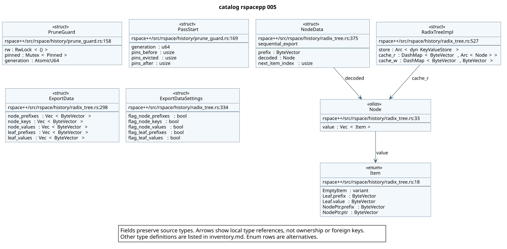

# catalog rspacepp 005

[Inventory](inventory.md) | [PlantUML](catalog-rspacepp-005.puml)

## Cardinality and Size

[Method, units, limits, and runtime evidence](sizing.md). These are declaration-level assessments, not measured live counts.

### PruneGuard

Cardinality: 0..n live values. Current count and owner-level limits are not derivable from this declaration.

Size: Sum of field inline layouts plus compiler padding, then uniquely owned allocations. repr and custom implementations can change layout.

| Field or variant | Cardinality | Inline bytes or layout | Additional storage or wire encoding |
| --- | --- | --- | --- |
| `rw` | 1 wrapper slot | Wrapper implementation and payload layout required | Payload allocations and any lock/waiter allocations. Once and lazy payloads can be uninitialized |
| `pinned` | 1 wrapper slot | Wrapper implementation and payload layout required | Payload allocations and any lock/waiter allocations. Once and lazy payloads can be uninitialized |
| `generation` | 1 atomic value | Target atomic layout required | None for the atomic value itself |

### PassStart

Cardinality: 0..n live values. Current count and owner-level limits are not derivable from this declaration.

Size: Sum of field inline layouts plus compiler padding, then uniquely owned allocations. repr and custom implementations can change layout.

| Field or variant | Cardinality | Inline bytes or layout | Additional storage or wire encoding |
| --- | --- | --- | --- |
| `generation` | 1 scalar | 8 B | None |
| `pins_before` | 1 scalar | 8 B | None |
| `pins_evicted` | 1 scalar | 8 B | None |
| `pins_after` | 1 scalar | 8 B | None |

### Item

Cardinality: 0..n live values. Current count and owner-level limits are not derivable from this declaration.

Size: Compiler enum layout plus allocations of the active variant only. Do not sum alternative variants.

| Field or variant | Cardinality | Inline bytes or layout | Additional storage or wire encoding |
| --- | --- | --- | --- |
| `EmptyItem` | 1 mutually exclusive alternative | No payload. Enum discriminant layout required | None for this unit variant |
| `Leaf.prefix` | 1 value when this variant is active | Compiler layout required | Follow the referenced declaration or external implementation. No allocation bound established. |
| `Leaf.value` | 1 value when this variant is active | Compiler layout required | Follow the referenced declaration or external implementation. No allocation bound established. |
| `NodePtr.prefix` | 1 value when this variant is active | Compiler layout required | Follow the referenced declaration or external implementation. No allocation bound established. |
| `NodePtr.ptr` | 1 value when this variant is active | Compiler layout required | Follow the referenced declaration or external implementation. No allocation bound established. |

### Node

Cardinality: Alias, not a separate allocation. Count values of the target type.

Size: Same layout and allocations as target. Do not add alias bytes again.

| Field or variant | Cardinality | Inline bytes or layout | Additional storage or wire encoding |
| --- | --- | --- | --- |
| `value` | 0..n elements | 24 B. Vec header on the generator target | capacity * I(element), plus live element-owned allocations. Zero-sized elements need no backing allocation. Element: Follow the referenced declaration or external implementation. No allocation bound established. |

### ExportData

Cardinality: 0..n live values. Current count and owner-level limits are not derivable from this declaration.

Size: Sum of field inline layouts plus compiler padding, then uniquely owned allocations. repr and custom implementations can change layout.

| Field or variant | Cardinality | Inline bytes or layout | Additional storage or wire encoding |
| --- | --- | --- | --- |
| `node_prefixes` | 0..n elements | 24 B. Vec header on the generator target | capacity * I(element), plus live element-owned allocations. Zero-sized elements need no backing allocation. Element: Follow the referenced declaration or external implementation. No allocation bound established. |
| `node_keys` | 0..n elements | 24 B. Vec header on the generator target | capacity * I(element), plus live element-owned allocations. Zero-sized elements need no backing allocation. Element: Follow the referenced declaration or external implementation. No allocation bound established. |
| `node_values` | 0..n elements | 24 B. Vec header on the generator target | capacity * I(element), plus live element-owned allocations. Zero-sized elements need no backing allocation. Element: Follow the referenced declaration or external implementation. No allocation bound established. |
| `leaf_prefixes` | 0..n elements | 24 B. Vec header on the generator target | capacity * I(element), plus live element-owned allocations. Zero-sized elements need no backing allocation. Element: Follow the referenced declaration or external implementation. No allocation bound established. |
| `leaf_values` | 0..n elements | 24 B. Vec header on the generator target | capacity * I(element), plus live element-owned allocations. Zero-sized elements need no backing allocation. Element: Follow the referenced declaration or external implementation. No allocation bound established. |

### ExportDataSettings

Cardinality: 0..n live values. Current count and owner-level limits are not derivable from this declaration.

Size: Sum of field inline layouts plus compiler padding, then uniquely owned allocations. repr and custom implementations can change layout.

| Field or variant | Cardinality | Inline bytes or layout | Additional storage or wire encoding |
| --- | --- | --- | --- |
| `flag_node_prefixes` | 1 scalar | 1 B | None |
| `flag_node_keys` | 1 scalar | 1 B | None |
| `flag_node_values` | 1 scalar | 1 B | None |
| `flag_leaf_prefixes` | 1 scalar | 1 B | None |
| `flag_leaf_values` | 1 scalar | 1 B | None |

### NodeData

Cardinality: 0..n live values. Current count and owner-level limits are not derivable from this declaration.

Size: Sum of field inline layouts plus compiler padding, then uniquely owned allocations. repr and custom implementations can change layout.

| Field or variant | Cardinality | Inline bytes or layout | Additional storage or wire encoding |
| --- | --- | --- | --- |
| `prefix` | 1 value | Compiler layout required | Follow the referenced declaration or external implementation. No allocation bound established. |
| `decoded` | 1 value | Compiler layout required | Follow the referenced declaration or external implementation. No allocation bound established. |
| `next_item_index` | 1 scalar | 8 B | None |

### RadixTreeImpl

Cardinality: 0..n live values. Current count and owner-level limits are not derivable from this declaration.

Size: Sum of field inline layouts plus compiler padding, then uniquely owned allocations. repr and custom implementations can change layout.

| Field or variant | Cardinality | Inline bytes or layout | Additional storage or wire encoding |
| --- | --- | --- | --- |
| `store` | 1 shared strong reference | Pointer or fat pointer, depending on target type | One shared allocation holds the target, counters and alignment. Count it once across all handles |
| `cache_r` | 0..n key/value pairs | Container and hasher implementation required | n keys and n values, their owned allocations, spare capacity, buckets or tree nodes, and control bytes. No type-level count cap |
| `cache_w` | 0..n key/value pairs | Container and hasher implementation required | n keys and n values, their owned allocations, spare capacity, buckets or tree nodes, and control bytes. No type-level count cap |

## Cross-Page References

- `ExportData: leaf_prefixes -> ByteVector [catalog-shared-002.svg]`
- `ExportData: leaf_values -> ByteVector [catalog-shared-002.svg]`
- `ExportData: node_keys -> ByteVector [catalog-shared-002.svg]`
- `ExportData: node_prefixes -> ByteVector [catalog-shared-002.svg]`
- `ExportData: node_values -> ByteVector [catalog-shared-002.svg]`
- `Item: Leaf.prefix -> ByteVector [catalog-shared-002.svg]`
- `Item: Leaf.value -> ByteVector [catalog-shared-002.svg]`
- `Item: NodePtr.prefix -> ByteVector [catalog-shared-002.svg]`
- `Item: NodePtr.ptr -> ByteVector [catalog-shared-002.svg]`
- `NodeData: prefix -> ByteVector [catalog-shared-002.svg]`
- `PruneGuard: pinned -> Pinned [catalog-rspacepp-004.svg]`
- `RadixTreeImpl: cache_r -> ByteVector [catalog-shared-002.svg]`
- `RadixTreeImpl: cache_w -> ByteVector [catalog-shared-002.svg]`
