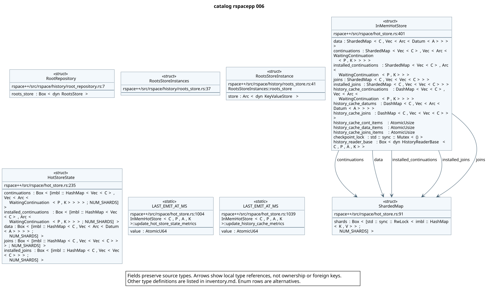

# catalog rspacepp 006

[Inventory](inventory.md) | [PlantUML](catalog-rspacepp-006.puml)

## Cross-Page References

- `HotStoreState: continuations -> WaitingContinuation [catalog-rspacepp-010.svg]`
- `HotStoreState: data -> Datum [catalog-rspacepp-009.svg]`
- `HotStoreState: installed_continuations -> WaitingContinuation [catalog-rspacepp-010.svg]`
- `InMemHotStore: continuations -> WaitingContinuation [catalog-rspacepp-010.svg]`
- `InMemHotStore: data -> Datum [catalog-rspacepp-009.svg]`
- `InMemHotStore: history_cache_continuations -> WaitingContinuation [catalog-rspacepp-010.svg]`
- `InMemHotStore: history_cache_datums -> Datum [catalog-rspacepp-009.svg]`
- `InMemHotStore: installed_continuations -> WaitingContinuation [catalog-rspacepp-010.svg]`
- `ShardedMap: shards -> V [catalog-casper-043.svg]`
