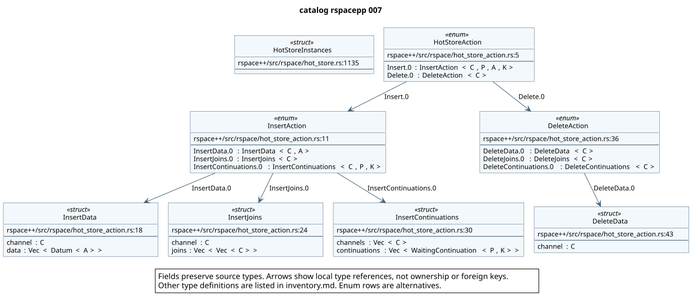

# catalog rspacepp 007

[Inventory](inventory.md) | [PlantUML](catalog-rspacepp-007.puml)

## Cross-Page References

- `DeleteAction: DeleteContinuations.0 -> DeleteContinuations [catalog-rspacepp-008.svg]`
- `DeleteAction: DeleteJoins.0 -> DeleteJoins [catalog-rspacepp-008.svg]`
- `InsertContinuations: continuations -> WaitingContinuation [catalog-rspacepp-010.svg]`
- `InsertData: data -> Datum [catalog-rspacepp-009.svg]`
