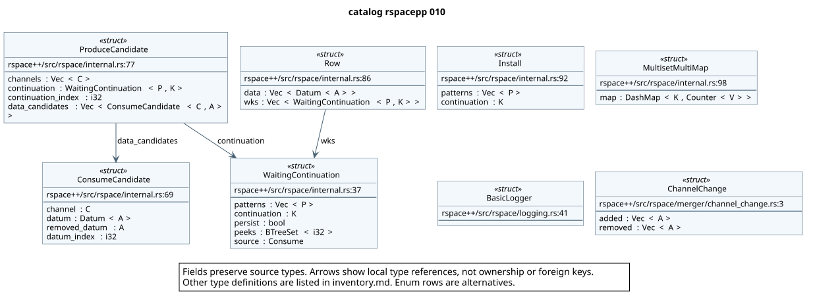

# catalog rspacepp 010

[Inventory](inventory.md) | [PlantUML](catalog-rspacepp-010.puml)

## Cross-Page References

- `ConsumeCandidate: datum -> Datum [catalog-rspacepp-009.svg]`
- `MultisetMultiMap: map -> V [catalog-casper-043.svg]`
- `Row: data -> Datum [catalog-rspacepp-009.svg]`
- `WaitingContinuation: source -> Consume [catalog-rspacepp-019.svg]`
