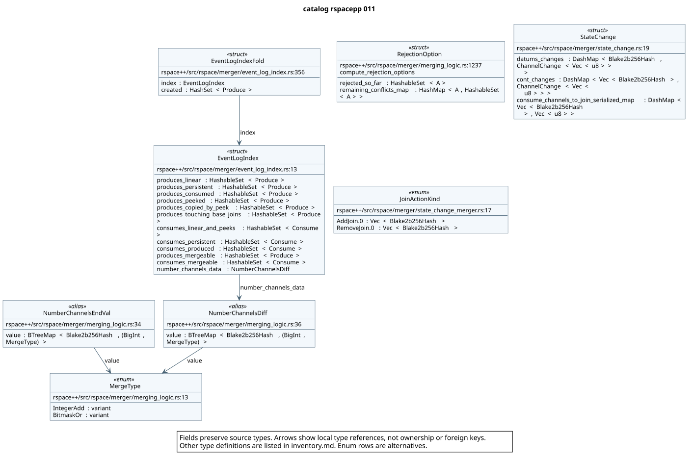

# catalog rspacepp 011

[Inventory](inventory.md) | [PlantUML](catalog-rspacepp-011.puml)

## Cardinality and Size

[Method, units, limits, and runtime evidence](sizing.md). These are declaration-level assessments, not measured live counts.

### EventLogIndex

Cardinality: 0..n live values. Current count and owner-level limits are not derivable from this declaration.

Size: Sum of field inline layouts plus compiler padding, then uniquely owned allocations. repr and custom implementations can change layout.

| Field or variant | Cardinality | Inline bytes or layout | Additional storage or wire encoding |
| --- | --- | --- | --- |
| `produces_linear` | 1 value | Compiler layout required | Follow the referenced declaration or external implementation. No allocation bound established. |
| `produces_persistent` | 1 value | Compiler layout required | Follow the referenced declaration or external implementation. No allocation bound established. |
| `produces_consumed` | 1 value | Compiler layout required | Follow the referenced declaration or external implementation. No allocation bound established. |
| `produces_peeked` | 1 value | Compiler layout required | Follow the referenced declaration or external implementation. No allocation bound established. |
| `produces_copied_by_peek` | 1 value | Compiler layout required | Follow the referenced declaration or external implementation. No allocation bound established. |
| `produces_touching_base_joins` | 1 value | Compiler layout required | Follow the referenced declaration or external implementation. No allocation bound established. |
| `consumes_linear_and_peeks` | 1 value | Compiler layout required | Follow the referenced declaration or external implementation. No allocation bound established. |
| `consumes_persistent` | 1 value | Compiler layout required | Follow the referenced declaration or external implementation. No allocation bound established. |
| `consumes_produced` | 1 value | Compiler layout required | Follow the referenced declaration or external implementation. No allocation bound established. |
| `produces_mergeable` | 1 value | Compiler layout required | Follow the referenced declaration or external implementation. No allocation bound established. |
| `consumes_mergeable` | 1 value | Compiler layout required | Follow the referenced declaration or external implementation. No allocation bound established. |
| `number_channels_data` | 1 value | Compiler layout required | Follow the referenced declaration or external implementation. No allocation bound established. |

### EventLogIndexFold

Cardinality: 0..n live values. Current count and owner-level limits are not derivable from this declaration.

Size: Sum of field inline layouts plus compiler padding, then uniquely owned allocations. repr and custom implementations can change layout.

| Field or variant | Cardinality | Inline bytes or layout | Additional storage or wire encoding |
| --- | --- | --- | --- |
| `index` | 1 value | Compiler layout required | Follow the referenced declaration or external implementation. No allocation bound established. |
| `created` | 0..n distinct elements | Container and hasher implementation required | Element storage, owned allocations, spare capacity and index overhead. No type-level count cap |

### MergeType

Cardinality: 0..n live values. Current count and owner-level limits are not derivable from this declaration.

Size: Compiler enum layout plus allocations of the active variant only. Do not sum alternative variants.

| Field or variant | Cardinality | Inline bytes or layout | Additional storage or wire encoding |
| --- | --- | --- | --- |
| `IntegerAdd` | 1 mutually exclusive alternative | No payload. Enum discriminant layout required | None for this unit variant |
| `BitmaskOr` | 1 mutually exclusive alternative | No payload. Enum discriminant layout required | None for this unit variant |

### NumberChannelsEndVal

Cardinality: Alias, not a separate allocation. Count values of the target type.

Size: Same layout and allocations as target. Do not add alias bytes again.

| Field or variant | Cardinality | Inline bytes or layout | Additional storage or wire encoding |
| --- | --- | --- | --- |
| `value` | 0..n key/value pairs | Container and hasher implementation required | n keys and n values, their owned allocations, spare capacity, buckets or tree nodes, and control bytes. No type-level count cap |

### NumberChannelsDiff

Cardinality: Alias, not a separate allocation. Count values of the target type.

Size: Same layout and allocations as target. Do not add alias bytes again.

| Field or variant | Cardinality | Inline bytes or layout | Additional storage or wire encoding |
| --- | --- | --- | --- |
| `value` | 0..n key/value pairs | Container and hasher implementation required | n keys and n values, their owned allocations, spare capacity, buckets or tree nodes, and control bytes. No type-level count cap |

### RejectionOption

Cardinality: 0..n live values. Current count and owner-level limits are not derivable from this declaration.

Size: Sum of field inline layouts plus compiler padding, then uniquely owned allocations. repr and custom implementations can change layout.

| Field or variant | Cardinality | Inline bytes or layout | Additional storage or wire encoding |
| --- | --- | --- | --- |
| `rejected_so_far` | 1 value | Compiler layout required | Follow the referenced declaration or external implementation. No allocation bound established. |
| `remaining_conflicts_map` | 0..n key/value pairs | Container and hasher implementation required | n keys and n values, their owned allocations, spare capacity, buckets or tree nodes, and control bytes. No type-level count cap |

### StateChange

Cardinality: 0..n live values. Current count and owner-level limits are not derivable from this declaration.

Size: Sum of field inline layouts plus compiler padding, then uniquely owned allocations. repr and custom implementations can change layout.

| Field or variant | Cardinality | Inline bytes or layout | Additional storage or wire encoding |
| --- | --- | --- | --- |
| `datums_changes` | 0..n key/value pairs | Container and hasher implementation required | n keys and n values, their owned allocations, spare capacity, buckets or tree nodes, and control bytes. No type-level count cap |
| `cont_changes` | 0..n key/value pairs | Container and hasher implementation required | n keys and n values, their owned allocations, spare capacity, buckets or tree nodes, and control bytes. No type-level count cap |
| `consume_channels_to_join_serialized_map` | 0..n key/value pairs | Container and hasher implementation required | n keys and n values, their owned allocations, spare capacity, buckets or tree nodes, and control bytes. No type-level count cap |

### JoinActionKind

Cardinality: 0..n live values. Current count and owner-level limits are not derivable from this declaration.

Size: Compiler enum layout plus allocations of the active variant only. Do not sum alternative variants.

| Field or variant | Cardinality | Inline bytes or layout | Additional storage or wire encoding |
| --- | --- | --- | --- |
| `AddJoin.0` | 0..n elements when this variant is active | 24 B. Vec header on the generator target | capacity * I(element), plus live element-owned allocations. Zero-sized elements need no backing allocation. Element: Follow the referenced declaration or external implementation. No allocation bound established. |
| `RemoveJoin.0` | 0..n elements when this variant is active | 24 B. Vec header on the generator target | capacity * I(element), plus live element-owned allocations. Zero-sized elements need no backing allocation. Element: Follow the referenced declaration or external implementation. No allocation bound established. |

## Cross-Page References

- `EventLogIndex: consumes_linear_and_peeks -> Consume [catalog-rspacepp-019.svg]`
- `EventLogIndex: consumes_linear_and_peeks -> HashableSet [catalog-shared-002.svg]`
- `EventLogIndex: consumes_mergeable -> Consume [catalog-rspacepp-019.svg]`
- `EventLogIndex: consumes_mergeable -> HashableSet [catalog-shared-002.svg]`
- `EventLogIndex: consumes_persistent -> Consume [catalog-rspacepp-019.svg]`
- `EventLogIndex: consumes_persistent -> HashableSet [catalog-shared-002.svg]`
- `EventLogIndex: consumes_produced -> Consume [catalog-rspacepp-019.svg]`
- `EventLogIndex: consumes_produced -> HashableSet [catalog-shared-002.svg]`
- `EventLogIndex: produces_consumed -> HashableSet [catalog-shared-002.svg]`
- `EventLogIndex: produces_consumed -> Produce [catalog-rspacepp-019.svg]`
- `EventLogIndex: produces_copied_by_peek -> HashableSet [catalog-shared-002.svg]`
- `EventLogIndex: produces_copied_by_peek -> Produce [catalog-rspacepp-019.svg]`
- `EventLogIndex: produces_linear -> HashableSet [catalog-shared-002.svg]`
- `EventLogIndex: produces_linear -> Produce [catalog-rspacepp-019.svg]`
- `EventLogIndex: produces_mergeable -> HashableSet [catalog-shared-002.svg]`
- `EventLogIndex: produces_mergeable -> Produce [catalog-rspacepp-019.svg]`
- `EventLogIndex: produces_peeked -> HashableSet [catalog-shared-002.svg]`
- `EventLogIndex: produces_peeked -> Produce [catalog-rspacepp-019.svg]`
- `EventLogIndex: produces_persistent -> HashableSet [catalog-shared-002.svg]`
- `EventLogIndex: produces_persistent -> Produce [catalog-rspacepp-019.svg]`
- `EventLogIndex: produces_touching_base_joins -> HashableSet [catalog-shared-002.svg]`
- `EventLogIndex: produces_touching_base_joins -> Produce [catalog-rspacepp-019.svg]`
- `EventLogIndexFold: created -> Produce [catalog-rspacepp-019.svg]`
- `JoinActionKind: AddJoin.0 -> Blake2b256Hash [catalog-rspacepp-002.svg]`
- `JoinActionKind: RemoveJoin.0 -> Blake2b256Hash [catalog-rspacepp-002.svg]`
- `NumberChannelsDiff: value -> Blake2b256Hash [catalog-rspacepp-002.svg]`
- `NumberChannelsEndVal: value -> Blake2b256Hash [catalog-rspacepp-002.svg]`
- `RejectionOption: rejected_so_far -> HashableSet [catalog-shared-002.svg]`
- `RejectionOption: remaining_conflicts_map -> HashableSet [catalog-shared-002.svg]`
- `StateChange: consume_channels_to_join_serialized_map -> Blake2b256Hash [catalog-rspacepp-002.svg]`
- `StateChange: cont_changes -> Blake2b256Hash [catalog-rspacepp-002.svg]`
- `StateChange: cont_changes -> ChannelChange [catalog-rspacepp-010.svg]`
- `StateChange: datums_changes -> Blake2b256Hash [catalog-rspacepp-002.svg]`
- `StateChange: datums_changes -> ChannelChange [catalog-rspacepp-010.svg]`
