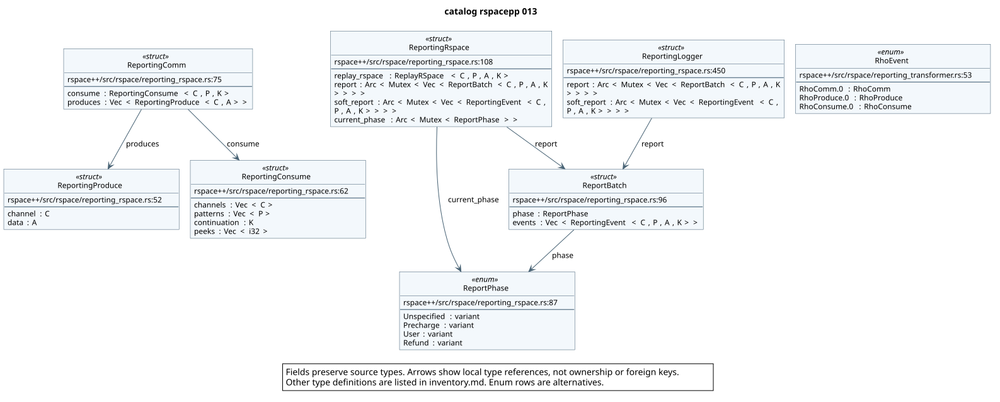

# catalog rspacepp 013

[Inventory](inventory.md) | [PlantUML](catalog-rspacepp-013.puml)

## Cross-Page References

- `ReportBatch: events -> ReportingEvent [catalog-rspacepp-012.svg]`
- `ReportingLogger: soft_report -> ReportingEvent [catalog-rspacepp-012.svg]`
- `ReportingRspace: replay_rspace -> ReplayRSpace [catalog-rspacepp-012.svg]`
- `ReportingRspace: soft_report -> ReportingEvent [catalog-rspacepp-012.svg]`
- `RhoEvent: RhoComm.0 -> RhoComm [catalog-rspacepp-014.svg]`
- `RhoEvent: RhoConsume.0 -> RhoConsume [catalog-rspacepp-014.svg]`
- `RhoEvent: RhoProduce.0 -> RhoProduce [catalog-rspacepp-014.svg]`
