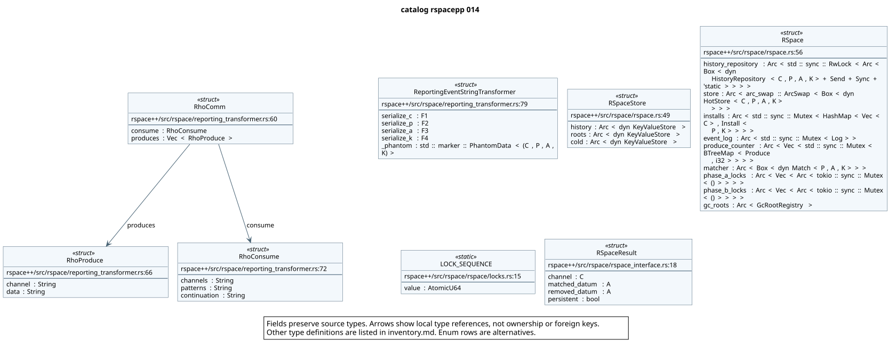

# catalog rspacepp 014

[Inventory](inventory.md) | [PlantUML](catalog-rspacepp-014.puml)

## Cross-Page References

- `RSpace: event_log -> Log [catalog-rspacepp-019.svg]`
- `RSpace: gc_roots -> GcRootRegistry [catalog-rspacepp-001.svg]`
- `RSpace: installs -> Install [catalog-rspacepp-010.svg]`
- `RSpace: produce_counter -> Produce [catalog-rspacepp-019.svg]`
