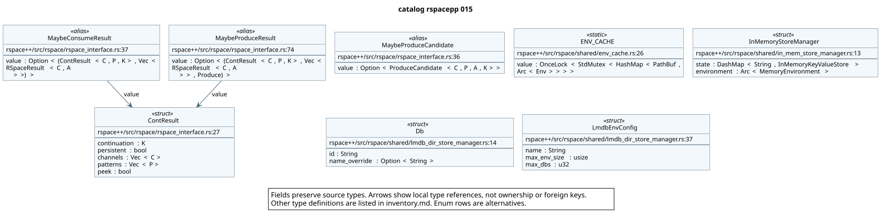

# catalog rspacepp 015

[Inventory](inventory.md) | [PlantUML](catalog-rspacepp-015.puml)

## Cross-Page References

- `ENV_CACHE: value -> Env [catalog-rho-pure-eval-001.svg]`
- `InMemoryStoreManager: environment -> MemoryEnvironment [catalog-shared-008.svg]`
- `MaybeConsumeResult: value -> RSpaceResult [catalog-rspacepp-014.svg]`
- `MaybeProduceCandidate: value -> ProduceCandidate [catalog-rspacepp-010.svg]`
- `MaybeProduceResult: value -> Produce [catalog-rspacepp-019.svg]`
- `MaybeProduceResult: value -> RSpaceResult [catalog-rspacepp-014.svg]`
