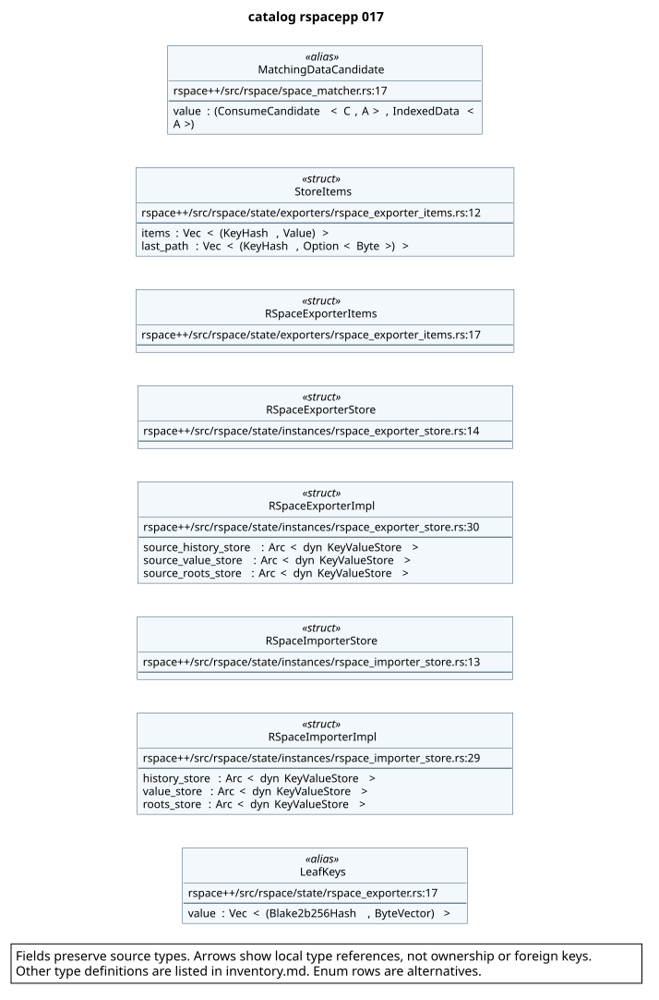

# catalog rspacepp 017

[Inventory](inventory.md) | [PlantUML](catalog-rspacepp-017.puml)

## Cross-Page References

- `LeafKeys: value -> Blake2b256Hash [catalog-rspacepp-002.svg]`
- `LeafKeys: value -> ByteVector [catalog-shared-002.svg]`
- `MatchingDataCandidate: value -> ConsumeCandidate [catalog-rspacepp-010.svg]`
- `MatchingDataCandidate: value -> IndexedData [catalog-rspacepp-009.svg]`
- `StoreItems: items -> KeyHash [catalog-rspacepp-016.svg]`
- `StoreItems: last_path -> Byte [catalog-shared-002.svg]`
- `StoreItems: last_path -> KeyHash [catalog-rspacepp-016.svg]`
