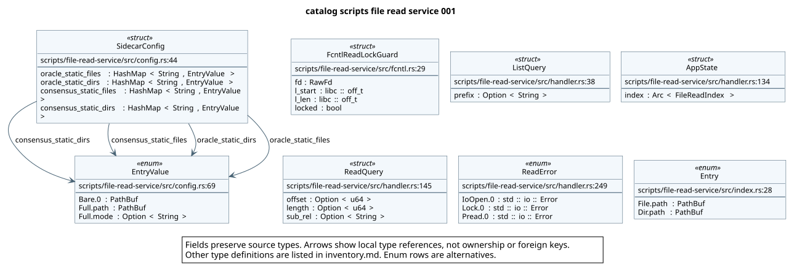

# catalog scripts file read service 001

[Inventory](inventory.md) | [PlantUML](catalog-scripts-file-read-service-001.puml)

## Cross-Page References

- `AppState: index -> FileReadIndex [catalog-scripts-file-read-service-002.svg]`
