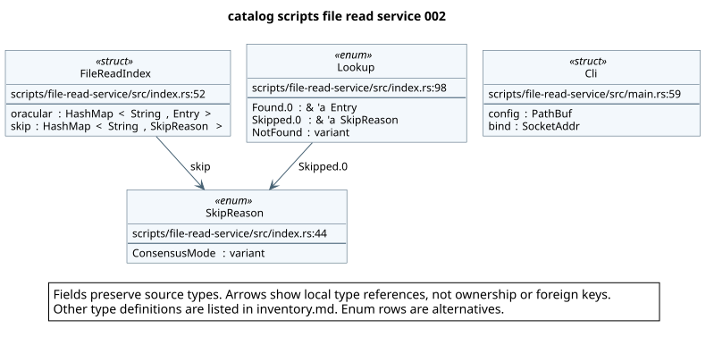

# catalog scripts file read service 002

[Inventory](inventory.md) | [PlantUML](catalog-scripts-file-read-service-002.puml)

## Cross-Page References

- `FileReadIndex: oracular -> Entry [catalog-scripts-file-read-service-001.svg]`
- `Lookup: Found.0 -> Entry [catalog-scripts-file-read-service-001.svg]`
