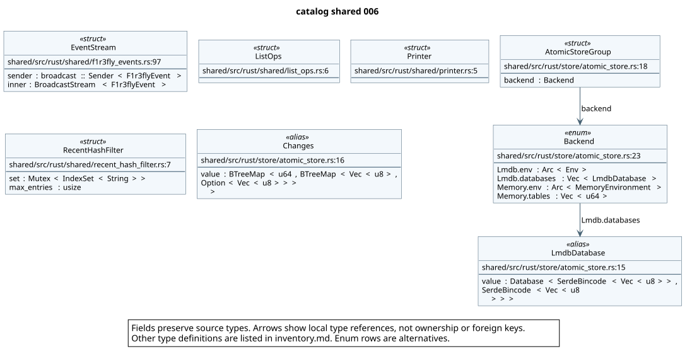

# catalog shared 006

[Inventory](inventory.md) | [PlantUML](catalog-shared-006.puml)

## Cross-Page References

- `Backend: Lmdb.env -> Env [catalog-rho-pure-eval-001.svg]`
- `Backend: Memory.env -> MemoryEnvironment [catalog-shared-008.svg]`
- `EventStream: inner -> F1r3flyEvent [catalog-shared-003.svg]`
- `EventStream: sender -> F1r3flyEvent [catalog-shared-003.svg]`
