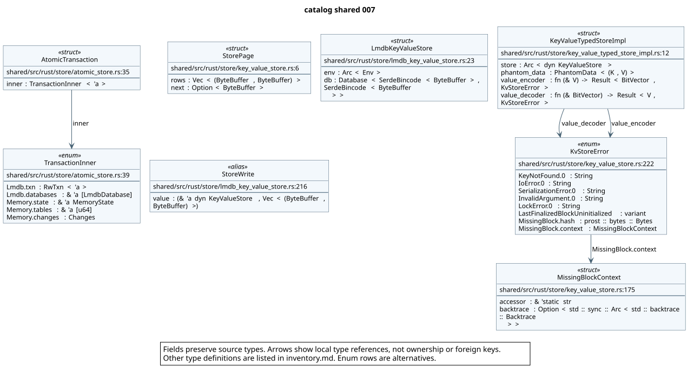

# catalog shared 007

[Inventory](inventory.md) | [PlantUML](catalog-shared-007.puml)

## Cardinality and Size

[Method, units, limits, and runtime evidence](sizing.md). These are declaration-level assessments, not measured live counts.

### AtomicTransaction

Cardinality: 0..n live values. Current count and owner-level limits are not derivable from this declaration.

Size: Sum of field inline layouts plus compiler padding, then uniquely owned allocations. repr and custom implementations can change layout.

| Field or variant | Cardinality | Inline bytes or layout | Additional storage or wire encoding |
| --- | --- | --- | --- |
| `inner` | 1 value | Compiler layout required | Follow the referenced declaration or external implementation. No allocation bound established. |

### TransactionInner

Cardinality: 0..n live values. Current count and owner-level limits are not derivable from this declaration.

Size: Compiler enum layout plus allocations of the active variant only. Do not sum alternative variants.

| Field or variant | Cardinality | Inline bytes or layout | Additional storage or wire encoding |
| --- | --- | --- | --- |
| `Lmdb.txn` | 1 value when this variant is active | Compiler layout required | Follow the referenced declaration or external implementation. No allocation bound established. |
| `Lmdb.databases` | 1 borrowed reference when this variant is active | Pointer or fat pointer. Referent layout required | No owned allocation. Referent: 0..n elements |
| `Memory.state` | 1 borrowed reference when this variant is active | Pointer or fat pointer. Referent layout required | No owned allocation. Referent: 1 value |
| `Memory.tables` | 1 borrowed reference when this variant is active | Pointer or fat pointer. Referent layout required | No owned allocation. Referent: 0..n elements |
| `Memory.changes` | 1 value when this variant is active | Compiler layout required | Follow the referenced declaration or external implementation. No allocation bound established. |

### StorePage

Cardinality: 0..n live values. Current count and owner-level limits are not derivable from this declaration.

Size: Sum of field inline layouts plus compiler padding, then uniquely owned allocations. repr and custom implementations can change layout.

| Field or variant | Cardinality | Inline bytes or layout | Additional storage or wire encoding |
| --- | --- | --- | --- |
| `rows` | 0..n elements | 24 B. Vec header on the generator target | capacity * I(element), plus live element-owned allocations. Zero-sized elements need no backing allocation. Element: Sum of component-owned allocations |
| `next` | 0..1 present payload | Option layout includes any tag or niche optimization. Do not assume I(T) + 1 | None when absent. Present payload: 1 value. Follow the referenced declaration or external implementation. No allocation bound established. |

### MissingBlockContext

Cardinality: 0..n live values. Current count and owner-level limits are not derivable from this declaration.

Size: Sum of field inline layouts plus compiler padding, then uniquely owned allocations. repr and custom implementations can change layout.

| Field or variant | Cardinality | Inline bytes or layout | Additional storage or wire encoding |
| --- | --- | --- | --- |
| `accessor` | 1 borrowed reference | Pointer or fat pointer. Referent layout required | No owned allocation. Referent: 1 value |
| `backtrace` | 0..1 present payload | Option layout includes any tag or niche optimization. Do not assume I(T) + 1 | None when absent. Present payload: 1 shared strong reference. One shared allocation holds the target, counters and alignment. Count it once across all handles |

### KvStoreError

Cardinality: 0..n live values. Current count and owner-level limits are not derivable from this declaration.

Size: Compiler enum layout plus allocations of the active variant only. Do not sum alternative variants.

| Field or variant | Cardinality | Inline bytes or layout | Additional storage or wire encoding |
| --- | --- | --- | --- |
| `KeyNotFound.0` | 0..n UTF-8 bytes when this variant is active | 24 B. String header on the generator target | capacity() bytes, excluding allocator overhead. UTF-8 byte length is not character count |
| `IoError.0` | 0..n UTF-8 bytes when this variant is active | 24 B. String header on the generator target | capacity() bytes, excluding allocator overhead. UTF-8 byte length is not character count |
| `SerializationError.0` | 0..n UTF-8 bytes when this variant is active | 24 B. String header on the generator target | capacity() bytes, excluding allocator overhead. UTF-8 byte length is not character count |
| `InvalidArgument.0` | 0..n UTF-8 bytes when this variant is active | 24 B. String header on the generator target | capacity() bytes, excluding allocator overhead. UTF-8 byte length is not character count |
| `LockError.0` | 0..n UTF-8 bytes when this variant is active | 24 B. String header on the generator target | capacity() bytes, excluding allocator overhead. UTF-8 byte length is not character count |
| `LastFinalizedBlockUninitialized` | 1 mutually exclusive alternative | No payload. Enum discriminant layout required | None for this unit variant |
| `MissingBlock.hash` | 1 value when this variant is active | Compiler layout required | Follow the referenced declaration or external implementation. No allocation bound established. |
| `MissingBlock.context` | 1 value when this variant is active | Compiler layout required | Follow the referenced declaration or external implementation. No allocation bound established. |

### KeyValueTypedStoreImpl

Cardinality: 0..n live values. Current count and owner-level limits are not derivable from this declaration.

Size: Sum of field inline layouts plus compiler padding, then uniquely owned allocations. repr and custom implementations can change layout.

| Field or variant | Cardinality | Inline bytes or layout | Additional storage or wire encoding |
| --- | --- | --- | --- |
| `store` | 1 shared strong reference | Pointer or fat pointer, depending on target type | One shared allocation holds the target, counters and alignment. Count it once across all handles |
| `phantom_data` | 0 runtime payloads | 0 B | None |
| `value_encoder` | 1 function pointer | 8 B. Function pointer on the generator target | None for the pointer itself |
| `value_decoder` | 1 function pointer | 8 B. Function pointer on the generator target | None for the pointer itself |

### LmdbKeyValueStore

Cardinality: 0..n live values. Current count and owner-level limits are not derivable from this declaration.

Size: Sum of field inline layouts plus compiler padding, then uniquely owned allocations. repr and custom implementations can change layout.

| Field or variant | Cardinality | Inline bytes or layout | Additional storage or wire encoding |
| --- | --- | --- | --- |
| `env` | 1 shared strong reference | Pointer or fat pointer, depending on target type | One shared allocation holds the target, counters and alignment. Count it once across all handles |
| `db` | 1 value | Compiler layout required | Follow the referenced declaration or external implementation. No allocation bound established. |

### StoreWrite

Cardinality: Alias, not a separate allocation. Count values of the target type.

Size: Same layout and allocations as target. Do not add alias bytes again.

| Field or variant | Cardinality | Inline bytes or layout | Additional storage or wire encoding |
| --- | --- | --- | --- |
| `value` | 2 component values | Sum of component inline sizes plus compiler padding | Sum of component-owned allocations |

## Cross-Page References

- `KeyValueTypedStoreImpl: phantom_data -> V [catalog-casper-043.svg]`
- `KeyValueTypedStoreImpl: value_decoder -> BitVector [catalog-shared-003.svg]`
- `KeyValueTypedStoreImpl: value_decoder -> V [catalog-casper-043.svg]`
- `KeyValueTypedStoreImpl: value_encoder -> BitVector [catalog-shared-003.svg]`
- `KeyValueTypedStoreImpl: value_encoder -> V [catalog-casper-043.svg]`
- `LmdbKeyValueStore: db -> ByteBuffer [catalog-shared-002.svg]`
- `LmdbKeyValueStore: env -> Env [catalog-rho-pure-eval-001.svg]`
- `StorePage: next -> ByteBuffer [catalog-shared-002.svg]`
- `StorePage: rows -> ByteBuffer [catalog-shared-002.svg]`
- `StoreWrite: value -> ByteBuffer [catalog-shared-002.svg]`
- `TransactionInner: Lmdb.databases -> LmdbDatabase [catalog-shared-006.svg]`
- `TransactionInner: Memory.changes -> Changes [catalog-shared-006.svg]`
- `TransactionInner: Memory.state -> MemoryState [catalog-shared-008.svg]`
