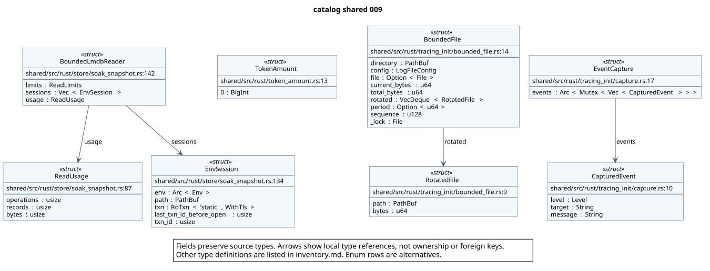

# catalog shared 009

[Inventory](inventory.md) | [PlantUML](catalog-shared-009.puml)

## Cardinality and Size

[Method, units, limits, and runtime evidence](sizing.md). These are declaration-level assessments, not measured live counts.

### ReadUsage

Cardinality: 0..n live values. Current count and owner-level limits are not derivable from this declaration.

Size: Sum of field inline layouts plus compiler padding, then uniquely owned allocations. repr and custom implementations can change layout.

| Field or variant | Cardinality | Inline bytes or layout | Additional storage or wire encoding |
| --- | --- | --- | --- |
| `operations` | 1 scalar | 8 B | None |
| `records` | 1 scalar | 8 B | None |
| `bytes` | 1 scalar | 8 B | None |

### EnvSession

Cardinality: 0..n live values. Current count and owner-level limits are not derivable from this declaration.

Size: Sum of field inline layouts plus compiler padding, then uniquely owned allocations. repr and custom implementations can change layout.

| Field or variant | Cardinality | Inline bytes or layout | Additional storage or wire encoding |
| --- | --- | --- | --- |
| `env` | 1 shared strong reference | Pointer or fat pointer, depending on target type | One shared allocation holds the target, counters and alignment. Count it once across all handles |
| `path` | 1 value | Compiler layout required | Follow the referenced declaration or external implementation. No allocation bound established. |
| `txn` | 1 value | Compiler layout required | Follow the referenced declaration or external implementation. No allocation bound established. |
| `last_txn_id_before_open` | 1 scalar | 8 B | None |
| `txn_id` | 1 scalar | 8 B | None |

### BoundedLmdbReader

Cardinality: 0..n live values. Current count and owner-level limits are not derivable from this declaration.

Size: Sum of field inline layouts plus compiler padding, then uniquely owned allocations. repr and custom implementations can change layout.

| Field or variant | Cardinality | Inline bytes or layout | Additional storage or wire encoding |
| --- | --- | --- | --- |
| `limits` | 1 value | Compiler layout required | Follow the referenced declaration or external implementation. No allocation bound established. |
| `sessions` | 0..n elements | 24 B. Vec header on the generator target | capacity * I(element), plus live element-owned allocations. Zero-sized elements need no backing allocation. Element: Follow the referenced declaration or external implementation. No allocation bound established. |
| `usage` | 1 value | Compiler layout required | Follow the referenced declaration or external implementation. No allocation bound established. |

### TokenAmount

Cardinality: 0..n live values. Current count and owner-level limits are not derivable from this declaration.

Size: Sum of field inline layouts plus compiler padding, then uniquely owned allocations. repr and custom implementations can change layout.

| Field or variant | Cardinality | Inline bytes or layout | Additional storage or wire encoding |
| --- | --- | --- | --- |
| `0` | 1 value | Compiler layout required | Follow the referenced declaration or external implementation. No allocation bound established. |

### RotatedFile

Cardinality: 0..n live values. Current count and owner-level limits are not derivable from this declaration.

Size: Sum of field inline layouts plus compiler padding, then uniquely owned allocations. repr and custom implementations can change layout.

| Field or variant | Cardinality | Inline bytes or layout | Additional storage or wire encoding |
| --- | --- | --- | --- |
| `path` | 1 value | Compiler layout required | Follow the referenced declaration or external implementation. No allocation bound established. |
| `bytes` | 1 scalar | 8 B | None |

### BoundedFile

Cardinality: 0..n live values. Current count and owner-level limits are not derivable from this declaration.

Size: Sum of field inline layouts plus compiler padding, then uniquely owned allocations. repr and custom implementations can change layout.

| Field or variant | Cardinality | Inline bytes or layout | Additional storage or wire encoding |
| --- | --- | --- | --- |
| `directory` | 1 value | Compiler layout required | Follow the referenced declaration or external implementation. No allocation bound established. |
| `config` | 1 value | Compiler layout required | Follow the referenced declaration or external implementation. No allocation bound established. |
| `file` | 0..1 present payload | Option layout includes any tag or niche optimization. Do not assume I(T) + 1 | None when absent. Present payload: 1 value. Follow the referenced declaration or external implementation. No allocation bound established. |
| `current_bytes` | 1 scalar | 8 B | None |
| `total_bytes` | 1 scalar | 8 B | None |
| `rotated` | 0..n elements | Container implementation required | Element storage, owned allocations, spare capacity or per-node links. No type-level count cap |
| `period` | 0..1 present payload | Option layout includes any tag or niche optimization. Do not assume I(T) + 1 | None when absent. Present payload: 1 scalar. None |
| `sequence` | 1 scalar | 16 B | None |
| `_lock` | 1 value | Compiler layout required | Follow the referenced declaration or external implementation. No allocation bound established. |

### CapturedEvent

Cardinality: 0..n live values. Current count and owner-level limits are not derivable from this declaration.

Size: Sum of field inline layouts plus compiler padding, then uniquely owned allocations. repr and custom implementations can change layout.

| Field or variant | Cardinality | Inline bytes or layout | Additional storage or wire encoding |
| --- | --- | --- | --- |
| `level` | 1 value | Compiler layout required | Follow the referenced declaration or external implementation. No allocation bound established. |
| `target` | 0..n UTF-8 bytes | 24 B. String header on the generator target | capacity() bytes, excluding allocator overhead. UTF-8 byte length is not character count |
| `message` | 0..n UTF-8 bytes | 24 B. String header on the generator target | capacity() bytes, excluding allocator overhead. UTF-8 byte length is not character count |

### EventCapture

Cardinality: 0..n live values. Current count and owner-level limits are not derivable from this declaration.

Size: Sum of field inline layouts plus compiler padding, then uniquely owned allocations. repr and custom implementations can change layout.

| Field or variant | Cardinality | Inline bytes or layout | Additional storage or wire encoding |
| --- | --- | --- | --- |
| `events` | 1 shared strong reference | Pointer or fat pointer, depending on target type | One shared allocation holds the target, counters and alignment. Count it once across all handles |

## Cross-Page References

- `BoundedFile: config -> LogFileConfig [catalog-shared-010.svg]`
- `BoundedLmdbReader: limits -> ReadLimits [catalog-shared-008.svg]`
- `EnvSession: env -> Env [catalog-rho-pure-eval-001.svg]`
