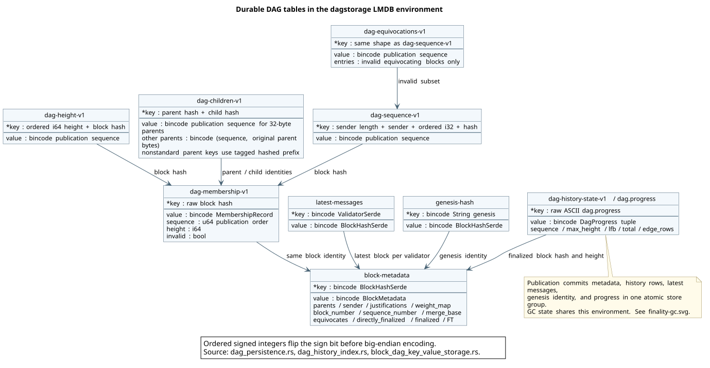
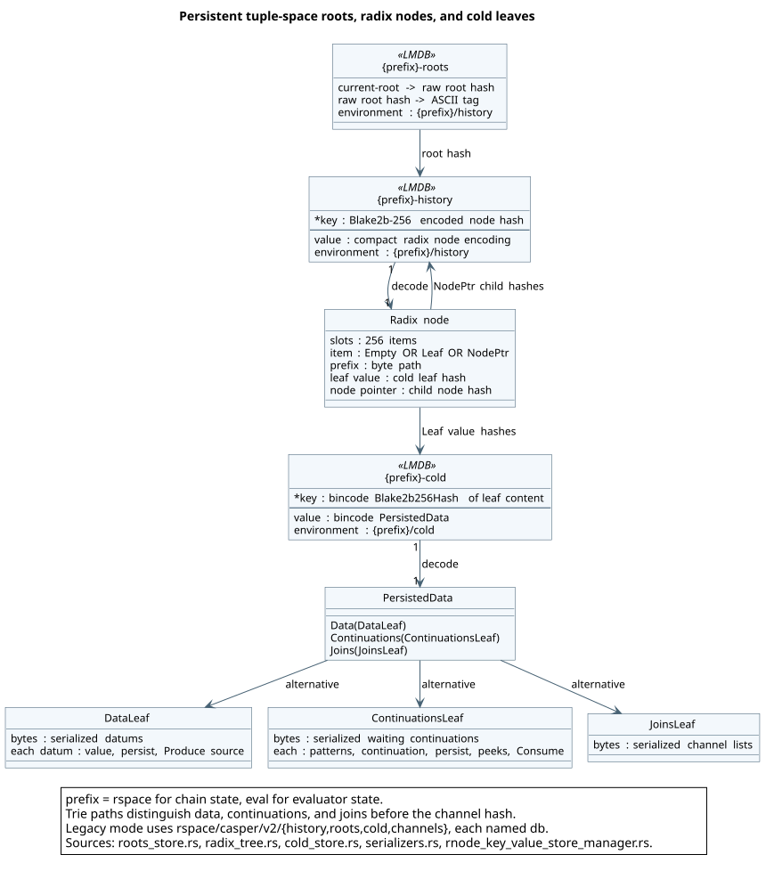
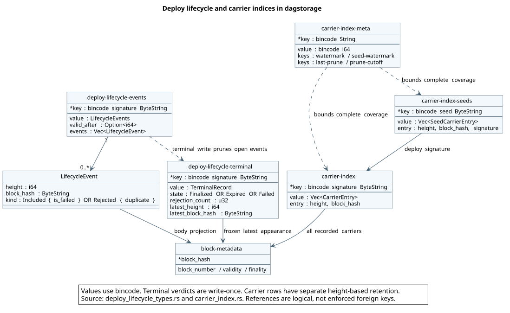

# Stored Data

The node uses named LMDB databases and structured files, not a relational database.
These diagrams show record keys, encodings, and logical relationships.
They do not imply database-enforced foreign keys.

## Diagrams

| Diagram | Rendered view | Editable source |
| --- | --- | --- |
| Block bodies, approval, and reports | [SVG](blocks.svg) | [PlantUML](blocks.puml) |
| Durable DAG | [SVG](dag.svg) | [PlantUML](dag.puml) |
| Finality and garbage collection | [SVG](finality-gc.svg) | [PlantUML](finality-gc.puml) |
| Deploy pool and recovery buffer | [SVG](deploys.svg) | [PlantUML](deploys.puml) |
| Deploy lifecycle and carriers | [SVG](deploy-lifecycle.svg) | [PlantUML](deploy-lifecycle.puml) |
| Tuple-space history | [SVG](tuple-space.svg) | [PlantUML](tuple-space.puml) |
| Deploy queue | [SVG](deploy-queue.svg) | [PlantUML](deploy-queue.puml) |
| Filesystem WAL and snapshots | [SVG](filesystem.svg) | [PlantUML](filesystem.puml) |
| Logical contract state | [SVG](contract-state.svg) | [PlantUML](contract-state.puml) |
| Configuration and other files | [SVG](node-files.svg) | [PlantUML](node-files.puml) |

## Database Inventory

Environment paths are relative to the node data directory unless stated otherwise.
The [store mapping](../../../casper/src/rust/storage/rnode_key_value_store_manager.rs) defines the node database names and directories.
The [typed store](../../../shared/src/rust/store/key_value_typed_store_impl.rs) uses bincode unless a custom codec replaces it.

| Environment | Named database | Key to value | Diagram |
| --- | --- | --- | --- |
| `blockstorage` | `blocks` | Raw block hash to compressed protobuf block | [Blocks](blocks.svg) |
| `dagstorage` | `blocks-approved` | Byte `[42]` to protobuf approved block | [Blocks](blocks.svg) |
| `dagstorage` | `block-metadata` | Encoded block hash to metadata | [DAG](dag.svg) |
| `dagstorage` | `latest-messages` | Encoded validator to encoded block hash | [DAG](dag.svg) |
| `dagstorage` | `dag-membership-v1` | Raw block hash to publication sequence, height, and invalid flag | [DAG](dag.svg) |
| `dagstorage` | `dag-height-v1` | Ordered height and hash to publication sequence | [DAG](dag.svg) |
| `dagstorage` | `dag-children-v1` | Parent and child identity to publication record | [DAG](dag.svg) |
| `dagstorage` | `dag-sequence-v1` | Sender, sequence number, and hash to publication sequence | [DAG](dag.svg) |
| `dagstorage` | `dag-equivocations-v1` | Invalid subset of the sender-sequence index | [DAG](dag.svg) |
| `dagstorage` | `genesis-hash` | Encoded `genesis` string to encoded block hash | [DAG](dag.svg) |
| `dagstorage` | `dag-history-state-v1` | Raw reserved keys to publication and GC progress | [Finality](finality-gc.svg) |
| `dagstorage` | `dag-gc-retry-v1` | Raw block hash to height | [Finality](finality-gc.svg) |
| `dagstorage` | `floor-index` | Encoded block hash to floor hash | [Finality](finality-gc.svg) |
| `dagstorage` | `frontier-index` | Encoded block hash to frontier hash | [Finality](finality-gc.svg) |
| `dagstorage` | `mergeable-channel-cache` | Encoded state, creator, and sequence key to deploy channel changes | [Finality](finality-gc.svg) |
| `dagstorage` | `deploy-lifecycle-events` | Signature to open inclusion and rejection events | [Lifecycle](deploy-lifecycle.svg) |
| `dagstorage` | `deploy-lifecycle-terminal` | Signature to write-once terminal record | [Lifecycle](deploy-lifecycle.svg) |
| `dagstorage` | `carrier-index` | Signature to carrier entries | [Lifecycle](deploy-lifecycle.svg) |
| `dagstorage` | `carrier-index-seeds` | Name seed to carrier entries with signatures | [Lifecycle](deploy-lifecycle.svg) |
| `dagstorage` | `carrier-index-meta` | Reserved strings to watermark and prune heights | [Lifecycle](deploy-lifecycle.svg) |
| `deploystorage` | `deploy_storage` | Signature to checked deploy record | [Deploys](deploys.svg) |
| `deploystorage` | `rejected_deploy_buffer` | Signature to checked deploy record | [Deploys](deploys.svg) |
| `deploystorage` | `deploy_storage_seeds` | Name seed to holder signature | [Deploys](deploys.svg) |
| `deploystorage` | `rejected_deploy_buffer_seeds` | Name seed to holder signature | [Deploys](deploys.svg) |
| `deploystorage` | `deploy_storage_quarantine` | Original key to original invalid bytes | [Deploys](deploys.svg) |
| `deploystorage` | `rejected_deploy_buffer_quarantine` | Original key to original invalid bytes | [Deploys](deploys.svg) |
| `rspace/history` | `rspace-history` | Node hash to compact radix node | [Tuple space](tuple-space.svg) |
| `rspace/history` | `rspace-roots` | Root markers and current root pointer | [Tuple space](tuple-space.svg) |
| `rspace/cold` | `rspace-cold` | Leaf hash to encoded data, continuations, or joins | [Tuple space](tuple-space.svg) |
| `eval/history` | `eval-history` | Evaluator radix nodes | [Tuple space](tuple-space.svg) |
| `eval/history` | `eval-roots` | Evaluator root markers and current root pointer | [Tuple space](tuple-space.svg) |
| `eval/cold` | `eval-cold` | Evaluator cold leaves | [Tuple space](tuple-space.svg) |
| `reporting` | `reporting-cache` | Raw block hash to compressed event report | [Blocks](blocks.svg) |
| `transaction` | `transaction` | Registered only. No production writer found in this revision | [Blocks](blocks.svg) |
| Queue directory | `records` | Signature to bincode `QueueRecord` | [Queue](deploy-queue.svg) |
| Queue directory | `payloads` | Signature to signed deploy protobuf bytes | [Queue](deploy-queue.svg) |
| Queue directory | `meta` | Raw `format` key to big-endian format version | [Queue](deploy-queue.svg) |

Legacy RSpace mode overrides the history, roots, cold, and channels database names to `db`.
It places each database in `rspace/casper/v2/{history,roots,cold,channels}`.
`rspace-channels` is a compatibility mapping, not an additional current tuple-space writer.

## Persistence Boundaries

The DAG atomic store group covers publication and finality progress.
It does not make writes across all node environments atomic.
Deploy quarantine, lifecycle, carrier, block-body, and tuple-space operations have their own boundaries.

The runtime can retain a block's metadata after its body is pruned.
A deploy can have several carrier blocks but only one terminal verdict.
A terminal queue record can remain after its payload is removed.

WAL snapshots and detached DAG captures are different formats.
Neither is a raw serialization of the node's entire memory.
The filesystem diagrams identify optional features and operational inputs separately from consensus tables.

## Source Anchors

- [Block codec](../../../block-storage/src/rust/key_value_block_store.rs)
- [DAG publication](../../../block-storage/src/rust/dag/dag_persistence.rs)
- [History key encoding](../../../block-storage/src/rust/dag/dag_history_index.rs)
- [GC records](../../../block-storage/src/rust/dag/dag_gc_store.rs)
- [Deploy records](../../../block-storage/src/rust/deploy/key_value_deploy_storage.rs)
- [Deploy codec](../../../block-storage/src/rust/deploy/deploy_codec.rs)
- [Lifecycle records](../../../block-storage/src/rust/dag/deploy_lifecycle_types.rs)
- [Carrier records](../../../block-storage/src/rust/dag/carrier_index.rs)
- [Mergeable records](../../../casper/src/rust/util/rholang/runtime_manager.rs)
- [Tuple-space serialization](../../../rspace++/src/rspace/serializers/serializers.rs)
- [Queue records](../../../deploy-queue/src/store.rs)
- [WAL snapshot encoding](../../../rholang/src/rust/interpreter/io/snapshot.rs)
- [Payload files](../../../casper/src/rust/engine/wal_payload_server.rs)
- [Saved peers](../../../comm/src/rust/discovery/known_peers.rs)

See the [memory catalog](../memory/inventory.md) for complete decoded record fields and nested value types.
