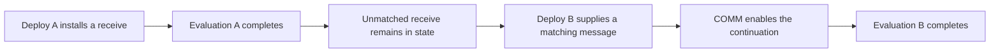

# Execution and Resource Authorization

## Scope and authority

This document explains execution, completion, concurrency, and resource authorization for every replication mechanism. It does not introduce protocol rules or activate a proposal.

Each mechanism applies these terms in a binding document. The [CbC Casper binding](./casper/execution-and-resource-authorization.md) is the first. The decision records of a mechanism control its rules. This document does not supersede them.

Execution and accounting are platform functions. A replication mechanism orders and finalizes commits. It does not define how a deploy executes or how its cost is charged.

## Units of work

| Term | Meaning | Not equivalent to |
|---|---|---|
| Commit | The unit that a replication mechanism orders and finalizes. It has a pre-state, a set of deploys, a post-state, and evidence that only its mechanism can check. | A CPU task or an application lifetime. |
| Deploy | Signed input submitted for admission and execution. | A commit or all future activity of an installed contract. |
| Execution attempt | One runtime evaluation of a deploy against a selected state and execution budget. | Successful application completion or finality. |
| Atomic COMM | A tuple-space communication that matches sends and receives and enables a continuation. | A commit, deploy, CPU instruction, or fixed elapsed-time unit. |

The [platform glossary](./Glossary.md#execution-attempt) defines execution attempts and atomic COMMs. PR #627 proposes the glossary term commit. A CbC Casper block is one kind of commit. An RGB peer-clique commit holds one transaction and has no block.

A node that produces a commit executes its deploys and records the post-state. Other nodes replay the deploys and compare the result with the recorded post-state.

## Completion boundaries

Use a named completion boundary instead of an unqualified statement that work runs to completion.

| Boundary | Meaning | What it does not establish |
|---|---|---|
| Evaluation completion | The evaluation returns after its active reduction work finishes, or reports an execution error. | Every stored continuation has fired. |
| Commit validation completion | Replay and the validity checks of the mechanism return a classification. | Finality. |
| Finality | The mechanism declares the commit irrevocable under its fault assumptions. | Completion of every application represented in the state. |
| Application completion | The application reaches its explicitly defined result or acknowledgment. | A result implied only by evaluation return. |

A successful evaluation can leave data and unmatched receives in RSpace. Those receives are stored continuations, not host threads waiting indefinitely for a message.

A later deploy can provide a matching message and enable a stored continuation. The application can therefore span several execution attempts and commits.

The diagram shows execution boundaries, not finality timing or funding attribution. Those rules require separate validation and accounting contracts.

In the current reducer, `DebruijnInterpreter::inj` awaits the initial evaluation and drains deferred continuation tasks. Evaluation completion does not require removal of unmatched receives.

A run-to-completion description applies only to that bounded evaluation scope. It does not prohibit cooperative yields or concurrent branches, and does not promise successful termination.

Errors and resource exhaustion remain possible. The [cost model](./rholang/13-cost-model.md) defines the existing phlogiston exhaustion behavior.

## Concurrency levels

Concurrency permits work to overlap. Parallelism executes work simultaneously when runtime scheduling and available hardware permit it.

| Level | Description | Required distinction |
|---|---|---|
| Between nodes | Nodes can produce and validate commits concurrently. | Replicated validation is not exclusive workload partitioning. |
| Between local replays | A node can bound how many replays overlap. | Separate replay runtimes do not imply parallel deploy execution within one runtime. |
| Between deploys in one commit | Each mechanism binding states the order of its deploys. | Overlap between deploys needs its own replay and accounting contract. |
| Within one execution attempt | Rholang parallel composition can schedule concurrent branches and enabled continuations. | `P \| Q` does not promise linear CPU scaling. |

Local scheduling must preserve the applicable replay and accounting contract. A model for intra-deploy reduction does not authorize parallel execution of separate deploys.

## Accounting versus resource protection

Resource authorization determines which authenticated authority can fund an operation under the applicable accounting rules. Cost accounting records charges and settlement under those rules.

Neither function selects CPU workers, removes dependencies, or establishes finality. Physical resource protection requires separate operation bounds and host controls.

| Concern | Existing contract or recorded proposal | Limit of the claim |
|---|---|---|
| Existing deploy budget | The client signs `phloLimit` and `phloPrice`. Prepayment, refund, and exhaustion apply. | A phlogiston limit is not a direct memory or elapsed-time limit. |
| Historical PR #216 accounting | Signature-indexed supply authorizes atomic COMM costs. The proposal uses reservations and settlement. | A COMM count alone does not bound the work inside each operation. |
| Physical execution cost | Interpreter operations, native calls, storage, replay, and scheduling consume physical resources. | Economic authorization does not establish bounded physical execution. |
| Node protection | Admission bounds, replay permits, and operational resource controls constrain different resource uses. | A host timeout or resource breach is not a successful execution result. |

The accounting rules apply to every mechanism, because every mechanism executes deploys through the same execution path. The CbC Casper decision ledger records the current decisions on the cost fields (D-12).

The historical token proposal is not the current deploy contract. Its token-per-COMM rule supplies no fixed CPU-time, memory, or elapsed-time bound per COMM.

A resource-bound claim must identify the operations covered and their bounds. It must distinguish execution, replay, storage, and concurrency costs from funding authority.

Stored continuations also require explicit funding attribution when later messages enable them. This document does not choose a payer.

## Provisional accounting direction

The [Cost-Accounting Direction and Reference Plan](./plans/cost-accounting-direction.md) records a provisional accounting-authority interpretation and its evidence gaps.
A switch to funded or multisigned execution fragments remains unverified.

[EPIC-028](./ToDos.md#epic-028-cost-accounting-direction-and-reference-authority) schedules source comparison, funding and signature contracts, execution-boundary analysis, and maintainer dispositions.
The [D-12 follow-up](./casper/design/decision-ledger/12-deploy-cost-limits.md#10-provisional-direction-follow-up) preserves the existing decision.
Neither record changes this reference's completion boundaries or activates a proposal.

## Relationship to proposed designs

Two draft designs use these terms. Neither is approved, so this document cites them by pull request number.

| Design | Relationship |
|---|---|
| Replication boundary, PR #627 | The execution port is the only path from a mechanism to Rholang and RSpace++. Its `play` and `replay` operations are execution attempts on a commit. Its `merge` operation is execution code, not mechanism code. The commit and the finality event are the mechanism-neutral units of section [Units of work](#units-of-work). |
| Adaptive execution, PR #714 | The bound on local replay and merge concurrency and the admission bounds of section [Accounting versus resource protection](#accounting-versus-resource-protection) become node-local controls inside a tier profile. No control may change commit validity. An overload rejection is a typed error, not a successful execution result. |

When a design is approved, its terms replace the descriptions in this section, and its documents become link targets.

## Review requirements

For an execution or accounting change, record the exact node revision, configuration, accounting authority, protocol version, and replication mechanism. Identify the concurrency level and completion boundary.

Compare replay outcomes, state commitments, and settlement with the applicable reference path. Retain failure and exhaustion cases, not only successful workloads.

State physical work bounds separately from economic bounds. Do not infer protocol activation, workload partitioning, or application completion from a passing concurrency test.
