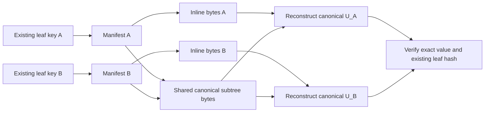

# Storage-Subtree Deduplication of Canonical Cold Leaves

Status: draft research and implementation proposal. Subtree reuse and net savings are not yet measured.
Date: 2026-11-25.

## Objective

Store identical encoded continuation subtrees once within a node.
Reconstruct each existing canonical cold-leaf value exactly when a reader or exporter requests it.
Preserve the [shared storage contract](README.md#shared-contract).

This is physical-storage deduplication, not a change to the Rholang abstract syntax tree, or AST.
It does not intern runtime objects or change continuation execution.
It does not replace canonical leaf hashes with subtree hashes.

## Evidence and Missing Measurements

The [baseline](README.md#measurement-baseline) contains 1,739,994 Par occurrences in continuation leaves.
Those counts include retained versions and replica copies.
They do not prove identical subtree contents.
The existing content-addressed store already reuses identical whole leaves under a given physical key.
This proposal targets reuse between different leaf values and repeated subtrees within a leaf.

Identical copies on different validators are not a local deduplication benefit.
Raw-hash and bincode-hash copies are a separate key-format issue.
Historical leaf retention is also a separate concern.
LMDB means Lightning Memory-Mapped Database.

Before implementation, measure:

- Distinct canonical subtree byte strings and their encoded sizes within each node.
- Reuse within one leaf and between different leaf hashes.
- Reuse at the selected finalized root and across other retained roots.
- Reuse of complete continuation bodies compared with smaller Par subtrees.
- Reference, object-key, manifest, and LMDB page overhead.
- Reconstruction depth, reference fan-out, read amplification, and required working memory.
- Incremental savings over [storage-only compression](storage-only-compression.md).

Use a schema-aware bounded parser to identify exact byte spans.
Keep payloads local and export aggregate results only.
Do not sum inclusive parent and child subtree sizes as separate savings.
Choose non-overlapping replacement spans for each candidate representation.

## Representation

A leaf manifest describes how to reconstruct its original `PersistedData` bytes.
The manifest keeps the existing logical leaf key.
An object store holds immutable canonical byte strings selected from those bytes.
Neither structure becomes part of the consensus trie.

The proposed manifest contains:

| Field | Purpose |
| --- | --- |
| Magic and manifest version | Distinguish manifests from legacy and compressed whole-leaf records |
| Canonical value length and digest | Verify the complete reconstructed value, including its leaf-kind tag |
| Extraction schema identifier | Identify the byte-span parser used to create the manifest |
| Ordered segments | Concatenate inline bytes and object references in original byte order |
| Reference metadata | Identify each object and its exact expanded length |

Use an explicit physical-format discriminator shared with the compression design.
Legacy, compressed, and deduplicated values must not require heuristic format detection.
Unknown versions and corrupt records return errors.

Each segment is either `Inline(original_bytes)` or `Ref(object_id, expanded_length)`.
Preserve vector lengths, option tags, enum tags, record order, and duplicate occurrences.
Preserve patterns, guards, random state, peeks, and trace fields.
Do not sort segments by object hash or rebuild a normalized AST.
Semantic equivalence is insufficient because different bytes can produce different consensus hashes.

## Object Identity

Use a domain-separated content identifier for each immutable object.
Frame the domain, format version, subtree kind, schema identifier, length, and canonical subtree bytes unambiguously.
Use a repository-supported cryptographic hash.
The identifier is local storage metadata, not a replacement for a canonical channel, trace, or leaf hash.

Hash the reconstructed subtree bytes, not its compressed or reference-based physical representation.
Verify object identity and length on reads and reuse.
Reject conflicting content under an existing object identifier.
Do not silently trust a hash-key match after storage corruption.

Begin with flat objects that contain complete continuation-body or Par byte spans.
The first version should not let objects reference other objects.
This limits reconstruction depth and simplifies crash recovery and object collection.
Keep small, unique, or unprofitable spans inline.

Recursive object graphs are a later extension only if measured savings justify their cost.
That extension needs cycle detection, depth limits, reference budgets, and bounded expansion.
Those checks remain necessary even when well-formed content hashes make cycles unlikely.

## Byte Extraction and Reconstruction

The [current serializer](../../rspace++/src/rspace/serializers/serializers.rs) remains authoritative.
The extractor identifies source byte spans without changing their contents.
It must consume the complete canonical input and reject malformed nested lengths.
An unsupported extraction schema can use a whole raw or compressed leaf after canonical validation.
An extraction-budget limit also selects a self-contained representation before publication.
An invalid canonical value remains an error.

Do not deserialize and reserialize subtrees as the extraction mechanism without proving exact byte preservation.
The [model build](../../models/build.rs) includes serialization behavior that can normalize fields.
Exact span retention avoids treating such a transformation as byte equality.

The proposed read sequence is:

1. Open a consistent read transaction for the manifest and its objects.
2. Check manifest size, segment count, and declared expanded length.
3. Load referenced objects through bounded reads.
4. Verify each object before copying its canonical bytes.
5. Concatenate segments in their original order.
6. Verify the reconstructed value digest and existing leaf hash.
7. Return the canonical bytes through the logical cold-store interface.

Missing objects and failed checks are storage errors, not absent continuations.
Count repeated references against the expanded-output budget.
Unique-object counts alone do not bound expansion.
Cap aggregate scratch memory and concurrent reconstructions.
Do not retain an unbounded decoded-object cache.

State export returns complete canonical values.
State import validates those values before selecting a local storage representation.
Peers do not need the object store or manifest format to exchange state.

## Publication and Transactions

Place manifests and objects in named databases within the same cold LMDB environment.
Use separate object namespaces for chain state and evaluator state.
The [store mapping](../../casper/src/rust/storage/rnode_key_value_store_manager.rs) currently places history and cold data in separate environments.
Do not assume a transaction can commit across those environments.

Commit new objects and their leaf manifest in one cold-environment write transaction.
Publish history references only after that transaction commits.
Preserve the existing cold-before-history publication order.
A crash can leave unreferenced complete objects, but must not leave a committed manifest with missing objects.

The [generic store interface](../../shared/src/rust/store/key_value_store.rs) does not itself provide this multi-database transaction contract.
Sequential calls to `put_if_absent` are not a substitute.
Prototype a dedicated transaction interface and fault-test it before enabling deduplicated writes.

Preserve insertion and canonical compare-and-delete semantics.
Manifest replacement must be atomic against the expected current record.
Reader transactions must cover both the selected manifest and all object lookups.
Separate read transactions could observe a manifest before deletion and its objects after collection.

## Object Lifetime and Collection

Object collection must start from every committed manifest, not only the latest finalized root.
This deliberately preserves objects for historical, unresolved, and not-yet-published cold leaves.
Removing cold leaves by chain-root reachability is outside this proposal.

Do not infer deletion safety from the measurement report's unreferenced-row category.
Do not delete shared objects when one manifest is removed.
Other manifests can still reference those objects.

The current [PruneGuard](../../rspace++/src/rspace/history/prune_guard.rs) protects history writers and root pins.
It does not automatically protect a new cold-object collector.
In the current [checkpoint path](../../rspace++/src/rspace/history/history_repository_impl.rs), cold writes precede the history guard.
Extending collection without explicit cold-store coordination would risk restoring the recent missing-node races.

The initial prototype should disable object deletion and bound total object storage.
At that bound, new writes should use a self-contained leaf representation.
This is a temporary safety mode, not a complete retention solution.

Before production use, implement and validate these collection conditions:

- Mark all objects referenced by committed manifests in a consistent starting view.
- Protect manifests and objects published during the collection pass.
- Protect reused old objects, not only objects created after the pass started.
- Coordinate reference checks, object insertion, manifest publication, and deletion through the same cold-store transaction protocol.
- Preserve in-flight readers through consistent LMDB snapshots or an equivalent verified lifetime mechanism.
- Bound scan state, delete batches, reader duration, and writer stalls.
- Abort collection on an incomplete mark or integrity error.
- Restart conservatively after a crash or interrupted collection pass.

A writer barrier or durable generation protocol needs its own design and race tests.
Reference counting alone is not proposed as the initial deletion authority.
Crash-consistent counter updates and concurrent reuse would add another correctness problem.
Production enablement remains blocked until safe reclamation is demonstrated.

## Migration and Rollback

Support legacy, compressed, and manifest records through one logical cold-store reader.
Preserve both existing key forms and their lookup precedence.
Do not rewrite keys or alter retention policy during migration.

Migrate each leaf with an atomic objects-plus-manifest transaction.
Verify byte-for-byte reconstruction before replacing the existing representation.
Limit batch bytes and transaction duration.
Retain progress only after each batch commits.

Rollback materializes complete canonical values from all manifests.
It also expands compressed values when the target binary cannot read them.
Verify every reconstructed value before removing any required object database.
Stop the shard for the initial rollback implementation and use a consistent backup.
An option that disables new deduplication does not make old binaries compatible with existing manifests.

## Compression Interaction

Identify subtrees before physical compression.
The object store can compress unique canonical subtree bytes with the first proposal's bounded codec.
The object identifier must remain independent of codec choice and compression level.
Do not claim combined savings by adding independently measured compression and deduplication percentages.

Compare these four configurations on the same corpus:

1. Existing raw canonical storage.
2. Whole-leaf compression.
3. Subtree deduplication with raw objects.
4. Subtree deduplication with compressed objects.

Include manifests, object keys, unshared literals, retained objects, and page overhead in each result.
Count reconstruction reads and decompression work as costs.
Use net savings over compression alone as the reason to accept the added complexity.

## Validation

| Test group | Required evidence |
| --- | --- |
| Exact reconstruction | Original and reconstructed canonical bytes match for every captured and generated leaf |
| Reuse | Different leaves share identical spans without changing occurrence counts or output order |
| No false sharing | Different guards, patterns, random states, or trace fields remain different where their bytes differ |
| Shape boundaries | Empty trees, small trees, repeated children, large bodies, and deep trees respect extraction limits |
| Corruption | Missing objects, wrong kinds, bad lengths, invalid references, and digest mismatches return errors |
| Resource bounds | Repeated-reference expansion and concurrent reads cannot exceed configured memory or work budgets |
| Atomicity | Faults before, during, and after cold commit cannot expose dangling manifests |
| Reader lifetime | Concurrent replacement, deletion, and collection preserve a consistent complete read |
| Collection races | Reuse during sweep, new manifests during marking, and interrupted passes preserve all required objects |
| Shared lifetime | Removing one manifest never removes objects still referenced by another |
| Migration | Mixed records, both key forms, restarts, and rollback preserve all canonical values |
| State transfer | Legacy and optimized nodes exchange the same canonical state in both directions |
| Consensus regression | Genesis, replay, merge recovery, counter updates, locks, and finalization retain baseline results |

Compare deterministic replay outputs with identical ordered inputs.
Require consistent finalized state and continued progress in live tests, not identical proposal timing.
Measure cold and warm reads separately.
Record canonical bytes, physical bytes, object counts, reference counts, cache bytes, CPU time, and checkpoint latency.
Record process memory, state-transfer latency, finalized-deploy latency, and collection stalls.
Use bounded metric labels and never expose contract contents through diagnostics.

## Delivery and Open Decisions

1. Measure exact reuse without changing the running shard.
2. Select profitable non-overlapping extraction units from the results.
3. Prototype flat manifests and objects against disposable LMDB stores.
4. Prove atomic publication and byte-exact reads with deletion disabled.
5. Design and validate bounded concurrent object collection.
6. Compare all four storage configurations under representative traffic.
7. Validate migration, rollback, and mixed-node state transfer before enablement.

Open decisions include extraction granularity, object hash framing, transaction support, resource limits, and the collection protocol.
Savings may be small after whole-leaf compression and reference overhead.
If reconstruction or lifetime costs exceed the benefit, keep compression alone.
