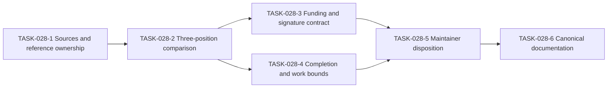

# Cost-Accounting Direction and Reference Plan

**Status.** Provisional analysis and documentation plan. No new protocol or accounting decision is ratified here.

**Recorded.** 2026-10-14.

**Tracking.** [EPIC-028](../ToDos.md#epic-028-cost-accounting-direction-and-reference-authority) and [US-013](../UserStories.md#us-013-traceable-cost-accounting-direction).

## Provisional conclusion

The historical PR #216 comparison supports an accounting-authority shift. It describes authenticated supply, potentially shared funding, atomic communication costs, reservations, and settlement.

A switch from completed evaluations to funded or multisigned execution fragments remains unverified. Funding authorization does not itself establish execution validity, replay equivalence, or finality.

The existing model does not guarantee successful completion of every deploy. Execution errors and resource exhaustion remain possible.

This conclusion is provisional, not a rejection or approval of the intended direction. The current PR #216 head and relevant approved proposals remain to be examined.

The user reports that a Zoom discussion prompted this interpretation. No transcript, meeting date, participant approvals, or exact statement accompanies this record.

That discussion is not presumed to be the ratification meeting of 2026-09-16. The user's recollection supplies a question, not proof of a protocol decision.

## Questions to resolve

1. Does accounting authorize resources while the runtime still finishes currently enabled reductions?
2. Does the intended design instead permit an execution attempt to stop and resume across blocks?
3. Does funding attach to a deploy, an atomic communication, an execution fragment, or a complete block?
4. Which signatures authorize input, expenditure, execution, validation, or consensus support?
5. Can one party hold several roles without merging their authorization scopes?
6. Who funds a stored continuation when a later deploy enables it?
7. How do economic bounds relate to physical work bounds and replay costs?

A block can record settlement without becoming the payment unit. A funding signature does not necessarily authorize a block or attest its correct execution.

The proposed funding-or-signatures alternative needs an explicit rule. The future analysis must determine whether funding and signatures are alternatives, combined conditions, or separate obligations.

## Evidence states and comparison scope

| Target | Evidence available at planning time | Required follow-up |
|---|---|---|
| Original proposal | D-12 records a historical comparison of PR #216 at `3980ed402`. That comparison is not necessarily the first proposal. | Locate the original paper and proposal revision. Record full immutable identities. |
| Recorded requirements | D-12's Decision section preserves the signed cost fields and existing protections. | Identify any later accepted amendment and its exact scope. |
| Current PR #216 | No current head review supports this conclusion. | Pin the head, documentation, code, and tests in one comparison record. |
| Approved FIPs | The user supplied the approved-directory location. No individual proposal was reviewed for this plan. | Identify relevant proposals, approval records, revisions, and activation conditions. |
| Zoom discussion | User-reported interpretation only. | Obtain a shareable meeting record or maintainer-approved summary, if available. |

FIP means F1R3FLY Improvement Proposal. Directory placement alone does not identify which rule governs this question.

Each conclusion must identify its source and revision. Missing evidence stays unresolved, rather than becoming an assumed implementation or approval.

## Reference locations and ownership

| Reference | Location | Role and status |
|---|---|---|
| Platform execution reference | [docs/execution-and-resource-authorization.md](../execution-and-resource-authorization.md) | Canonical shared terminology and execution boundaries. It does not ratify accounting policy. |
| Casper binding | [docs/casper/execution-and-resource-authorization.md](../casper/execution-and-resource-authorization.md) | Casper-specific block, replay, and finalization context. |
| Existing cost model | [docs/rholang/13-cost-model.md](../rholang/13-cost-model.md) | Reference for the existing phlogiston contract. |
| D-12 | [docs/casper/design/decision-ledger/12-deploy-cost-limits.md](../casper/design/decision-ledger/12-deploy-cost-limits.md) | Recorded cost-field decision and proposed follow-up questions. |
| Decision authority | [Casper decision ledger](../casper/design/decision-ledger/README.md) | Approval rules and linked decision records. |
| Historical comparison | [Cost-accounting reconciliation](../casper/design/cost-accounting-cbc-fv-reconciliation.md) | Review evidence at named revisions, not current-head authority. |
| Candidate implementation | [PR #216](https://github.com/F1R3FLY-io/f1r3node-rust/pull/216) | Mutable candidate. Future comparisons must pin its head and branch-only document paths. |
| Approved proposals | [FIPS approved directory](https://github.com/F1R3FLY-io/FIPS/tree/main/approved) | External proposal location. Exact applicable documents and approval scope remain unidentified. |
| Original accounting paper | No verified location recorded yet. | TASK-028-1 must establish title, authorship, version, location, and authority scope. |
| Zoom record | No shareable reference recorded yet. | TASK-028-1 must record availability without exposing private meeting data. |
| Work tracking | [docs/ToDos.md](../ToDos.md#epic-028-cost-accounting-direction-and-reference-authority) | Epic, dependencies, acceptance criteria, and completion evidence. |

Shared accounting definitions belong in the platform reference and [platform glossary](../Glossary.md). Casper-specific validity and activation conditions belong in the Casper binding and decision ledger.

Detailed future accounting specifications need maintainer-approved locations. TASK-028-1 will assign those locations and owners without copying external sources into competing normative documents.

Branch-only references must name the repository, full revision, and path. External proposal references must name the proposal identifier, revision, approval record, and applicability.

## Task sequence

The task acceptance criteria live in EPIC-028. All six tasks remain pending. Creating this plan does not complete their source reviews or decisions.

## Proposed D-12 extension

[D-12 section 10](../casper/design/decision-ledger/12-deploy-cost-limits.md#10-provisional-direction-follow-up) records the provisional conclusion and follow-up scope.

The rejected cost-field removal remains the recorded decision. This plan does not restore that removal, approve shared funding, or authorize partial execution.

A future extension or separate decision needs the ledger's required approvals. An approved FIP must have an explicit mapping to any affected Casper rule.

The disposition must distinguish economic authorization, execution completion, signature authority, replay correctness, and physical work bounds. Unresolved items must retain named owners and blockers.

A documentation-task completion is not implementation acceptance or protocol activation.

## Completion gates

- The reference registry identifies exact sources, owners, authority scope, and revision status.
- The comparison covers the original proposal, recorded requirements, and a pinned current candidate.
- The funding and signature contract states the signed object, authorized action, payer, settlement, and replay obligations.
- The execution contract distinguishes stored continuations from paused active reductions and identifies any proposed resume boundary.
- The evidence plan covers failures, exhaustion, shared funding, later continuation activation, and repeated settlement or replay.
- Maintainers record an approval, rejection, or deferral for each proposed change under the applicable decision process.
- Canonical references and glossary links match those dispositions without silently replacing historical decisions.

No runtime change, cloud run, protocol activation, commit, or push follows from this plan. Each action requires separate authorization.
