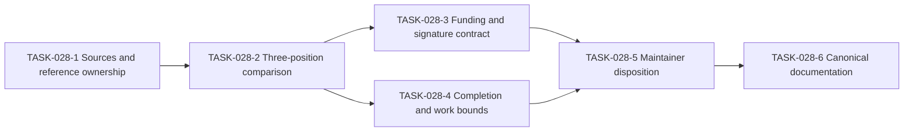

# Cost-Accounting Direction and Reference Plan

**Status.** Provisional analysis and documentation plan. No new protocol or accounting decision is ratified here.

**Recorded.** 2026-10-14.

**Tracking.** [EPIC-028](../ToDos.md#epic-028-cost-accounting-direction-and-reference-authority) and [US-013](../UserStories.md#us-013-traceable-cost-accounting-direction).

## Provisional conclusion

The historical PR #216 comparison supports an accounting-authority shift. It describes authenticated supply, potentially shared funding, atomic communication costs, reservations, and settlement.

A switch from completed evaluations to funded or multisigned execution fragments remains unverified. Funding authorization does not itself establish execution validity, replay equivalence, or finality.

The existing model does not guarantee successful completion of every deploy. Execution errors and resource exhaustion remain possible.

This conclusion is provisional, not a rejection or approval of the intended direction. The pinned current PR #216 head (`ccbee9287`) and relevant approved proposals remain to be examined.

The user reports that a Zoom discussion prompted this interpretation. On 2026-10-16 the user identified the [stall-loop design](https://github.com/F1R3FLY-io/publications/blob/0b3255fc83be09c6210e9902dbfc495366b72115/cost-accounting/stall-loop-design.pdf) as the outcome of that discussion. Revision 2 of 2026-10-17 is the current revision.

The design is a draft for discussion, dated 2026-10-16. It records three decisions, but it names no approvers. This plan treats those decisions as provisional evidence, not as ratified protocol decisions.

That discussion is not presumed to be the ratification meeting of 2026-09-16. The [Casper decision ledger](../casper/design/decision-ledger/README.md) remains the only record of ratified Casper decisions.

## Questions to resolve

1. Does accounting authorize resources while the runtime still finishes currently enabled reductions?
2. Does the intended design instead permit an execution attempt to stop and resume across blocks?
3. Does funding attach to a deploy, an atomic communication, an execution fragment, or a complete block?
4. Which signatures authorize input, expenditure, execution, validation, or consensus support?
5. Can one party hold several roles without merging their authorization scopes?
6. Who funds a stored continuation when a later deploy enables it?
7. How do economic bounds relate to physical work bounds and replay costs?

A block can record settlement without becoming the payment unit. A funding signature does not necessarily authorize a block or attest its correct execution.

The proposed funding-or-signatures alternative needs an explicit rule. The future analysis must determine whether funding and signatures are alternatives, combined conditions, or separate obligations.

## Provisional answers from the stall-loop design

The stall-loop design reads the PR #216 head branch, `feature/cost-accounted-rho`. It proposes cost-accounted order-then-execute for shards whose genesis policy activates offered execution (v6 shards). Legacy shards keep the current pipeline.

Its answers apply only to that v6 proposal. They are inputs to TASK-028-2 to TASK-028-4, not dispositions. A comparison of revision 1 and revision 2 found no change to these answers.

| Question | Provisional answer in the design | Status |
|---|---|---|
| 1. Resource authorization while reductions finish | Yes, within one block. One runner injects every accepted envelope of a block into one RSpace session. The envelopes reduce until each one quiesces or exhausts its limit. | Proposed |
| 2. Stop and resume across blocks | No. Holds live within one block's execution. No reservation table survives across blocks, and the rule against escrow stays. | Proposed |
| 3. Unit of funding | A gate checks each envelope before execution, with linear-estimate holds (DR-64) and shared-purse groups (DR-65). The run charges every COMM to the signature of each participant. | Proposed |
| 4. Signature authority | The deploy signature funds the work and marks its conflicts. The block signature keeps its consensus role. One runner records the execution, and other nodes replay and attest the record. | Proposed |
| 5. Several roles for one party | The design does not address this question. | Open |
| 6. Payer of a stored continuation | A race for a datum or a continuation draws on the signature that owns the contested process. Metering of settlement log-channel continuations is an activation condition. | Partly answered |
| 7. Economic and physical bounds | Each charge becomes a function of its recorded event, within the protocol-6 host-work caps. Two known determinism gaps must close before activation. | Proposed |

Branch `feature/cost-accounted-ote` at `e7469fd47c7ec87bd1c957d202e1d28ac5218d0d` implements tranche 1 of the v6 proposal. Its plan is `docs/plans/v6-order-then-execute-tranche-1.md` on that branch. The branch is based on `dev`, not on PR #216. The table gives its state for each question.

| Question | Tranche 1 state |
|---|---|
| 1 | Implemented, with one RSpace session for each block. |
| 2 | Consistent, because no run state survives to the next block. |
| 3 | Different: one shared budget for each block, a stub gate and settlement, and no fees or refunds before step B1. |
| 4 | Partly implemented: a wrong attestation is logged, not slashed. |
| 5 | Not addressed. |
| 6 | Not implemented. |
| 7 | Different: the run uses the charges of `dev` until step B2. |

The design also changes two execution boundaries for v6 shards. The proposer does not execute deploys, and execution follows finality. Finality then precedes the known post-state of a block. The canonical order of the finalized blocks assumes A-LIN. Revision 2 measured that A-LIN does not hold on current multi-parent shards. Its finalizer response asks for a proof on v6 shards or a documented halt.

The platform reference and the Casper binding describe current shards. They identify these v6 differences as proposals, not current behavior.

## Evidence states and comparison scope

| Target | Evidence available at planning time | Required follow-up |
|---|---|---|
| Original proposal | D-12 records a historical comparison of PR #216 at `3980ed402`. That comparison is not necessarily the first proposal. | Locate the original paper and proposal revision. Record full immutable identities. |
| Recorded requirements | D-12's Decision section preserves the signed cost fields and existing protections. | Identify any later accepted amendment and its exact scope. |
| Current PR #216 | Revision 2 of the stall-loop design names the reviewed head of `feature/cost-accounted-rho` as `ccbee928`. That matches the head `ccbee9287` of 2026-10-16. | Pin the head, documentation, code, and tests in one comparison record. |
| Approved FIPs | The user supplied the approved-directory location. No individual proposal was reviewed for this plan. | Identify relevant proposals, approval records, revisions, and activation conditions. |
| Zoom discussion | The user identified the stall-loop design as its outcome. The design names no approvers. | Record any maintainer approval of the three design decisions under the ledger process. |

FIP means F1R3FLY Improvement Proposal. Directory placement alone does not identify which rule governs this question.

Each conclusion must identify its source and revision. Missing evidence stays unresolved, rather than becoming an assumed implementation or approval.

## Reference locations and ownership

| Reference | Location | Role and status |
|---|---|---|
| Platform execution reference | [docs/execution-and-resource-authorization.md](../execution-and-resource-authorization.md) | Canonical shared terminology and execution boundaries. It does not ratify accounting policy. |
| Casper binding | [docs/casper/execution-and-resource-authorization.md](../casper/execution-and-resource-authorization.md) | Casper-specific block, replay, and finalization context. |
| Existing cost model | [docs/rholang/13-cost-model.md](../rholang/13-cost-model.md) | Reference for the existing phlogiston contract. |
| D-12 | [docs/casper/design/decision-ledger/12-deploy-cost-limits.md](../casper/design/decision-ledger/12-deploy-cost-limits.md) | Recorded cost-field decision and proposed follow-up questions. |
| Decision authority | [Casper decision ledger](../casper/design/decision-ledger/README.md) | Approval rules and linked decision records. |
| Historical comparison | [Cost-accounting reconciliation](../casper/design/cost-accounting-cbc-fv-reconciliation.md) | Review evidence at named revisions, not current-head authority. |
| Candidate implementation | [PR #216](https://github.com/F1R3FLY-io/f1r3node-rust/pull/216) | Mutable candidate. Future comparisons must pin its head and branch-only document paths. |
| Candidate v6 core | Branch `feature/cost-accounted-ote`, revision `e7469fd47c7ec87bd1c957d202e1d28ac5218d0d`, plan `docs/plans/v6-order-then-execute-tranche-1.md` | Mutable candidate behind the flag `casper.v6-order-then-execute`, default off. It implements the consensus core of the v6 proposal without the PR #216 accounting. |
| Approved proposals | [FIPS approved directory](https://github.com/F1R3FLY-io/FIPS/tree/main/approved) | External proposal location. Exact applicable documents and approval scope remain unidentified. |
| Original accounting paper | No verified location recorded yet. | TASK-028-1 must establish title, authorship, version, location, and authority scope. |
| Zoom record | The [stall-loop design](https://github.com/F1R3FLY-io/publications/blob/0b3255fc83be09c6210e9902dbfc495366b72115/cost-accounting/stall-loop-design.pdf) is the outcome record. Revision 1 is the draft of 2026-10-16. Revision 2 of 2026-10-17 is at publications `0b3255fc83be09c6210e9902dbfc495366b72115`. | Review evidence and proposals, not a normative source. TASK-028-1 must record its authority scope. |
| Finalizer response | The [response to stall-loop section 5.10.1](https://github.com/F1R3FLY-io/publications/blob/0b3255fc83be09c6210e9902dbfc495366b72115/cost-accounting/stall-loop-design-5-10-1-response.pdf), 2026-10-16. Revision 2 adopts it. | Review evidence for the finalization boundary only. It does not address funding or signatures. |
| Work tracking | [docs/ToDos.md](../ToDos.md#epic-028-cost-accounting-direction-and-reference-authority) | Epic, dependencies, acceptance criteria, and completion evidence. |

Shared accounting definitions belong in the platform reference and [platform glossary](../Glossary.md). Casper-specific validity and activation conditions belong in the Casper binding and decision ledger.

Detailed future accounting specifications need maintainer-approved locations. TASK-028-1 will assign those locations and owners without copying external sources into competing normative documents.

Branch-only references must name the repository, full revision, and path. External proposal references must name the proposal identifier, revision, approval record, and applicability.

## Task sequence

The task acceptance criteria live in EPIC-028. All six tasks remain pending. Creating this plan does not complete their source reviews or decisions.

## Proposed D-12 extension

[D-12 section 10](../casper/design/decision-ledger/12-deploy-cost-limits.md#10-provisional-direction-follow-up) records the provisional conclusion and follow-up scope.

The rejected cost-field removal remains the recorded decision. This plan does not restore that removal, approve shared funding, or authorize partial execution.

A future extension or separate decision needs the ledger's required approvals. An approved FIP must have an explicit mapping to any affected Casper rule.

The disposition must distinguish economic authorization, execution completion, signature authority, replay correctness, and physical work bounds. Unresolved items must retain named owners and blockers.

A documentation-task completion is not implementation acceptance or protocol activation.

## Completion gates

- The reference registry identifies exact sources, owners, authority scope, and revision status.
- The comparison covers the original proposal, recorded requirements, and a pinned current candidate.
- The funding and signature contract states the signed object, authorized action, payer, settlement, and replay obligations.
- The execution contract distinguishes stored continuations from paused active reductions and identifies any proposed resume boundary.
- The evidence plan covers failures, exhaustion, shared funding, later continuation activation, and repeated settlement or replay.
- Maintainers record an approval, rejection, or deferral for each proposed change under the applicable decision process.
- Canonical references and glossary links match those dispositions without silently replacing historical decisions.

No runtime change, cloud run, protocol activation, commit, or push follows from this plan. Each action requires separate authorization.
