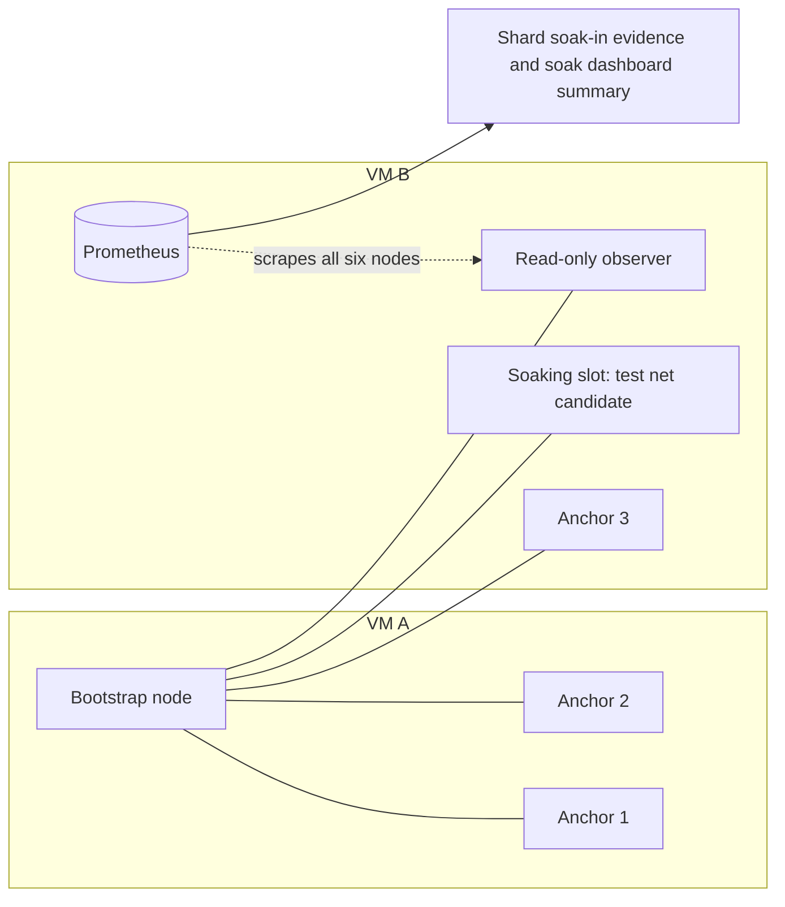
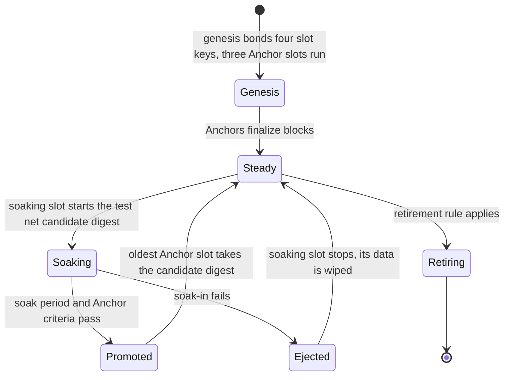
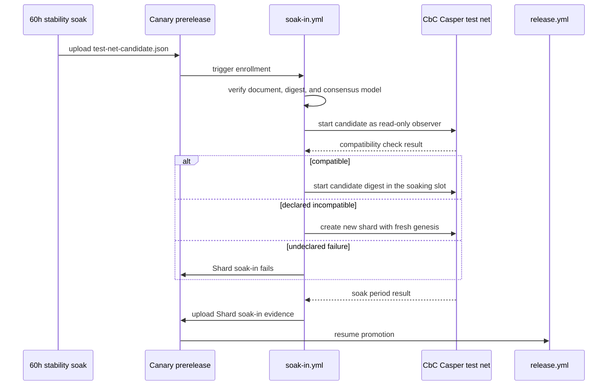

# F1r3fly CbC Casper Test Net Design (EPIC-014)

- **Status:** Draft for review, 2026-10-06. Updated 2026-10-11 with candidate selection, the first shard, the soaking slot queue, the resolved questions, and the consensus model provisions. Updated 2026-10-15 with the F1r3Faucet test token faucet (Section 12.4), its deploy target, and its placement (Sections 10, 12.4, and 14)
- **Task:** TASK-014-1 in `docs/ToDos.md`
- **User story:** US-010 in `docs/UserStories.md`
- **Governing text:** `docs/release-process.md` Section 12 and the proposed Section 12.1 amendment, Section 12.2, and the Section 10 candidate selection (pending ratification as TASK-014-5)
- **Terms:** [Test net](../Glossary.md#test-net), [Test net candidate](../Glossary.md#test-net-candidate), [Shard soak-in](../Glossary.md#shard-soak-in), [Anchor](../Glossary.md#anchor), [60h stability soak](../Glossary.md#60h-stability-soak)

## 1. Scope

This record designs one test net only: the **F1r3fly CbC Casper test net**. It applies to the CbC Casper consensus and state machine replication (SMR) model and to no other model. It covers the topology, the shard lifecycle, the enrollment flow, the compatibility check, and shard retirement. It also proposes values for the six deferred parameters in Section 12.1.

**Terminology.** "F1r3fly CbC Casper" names the consensus protocol of this test net, and its `consensus_model` identifier is `cbc-casper`. CbC stands for correct by construction. Used alone, "CbC" still names the verification process in the Glossary, not a consensus model.

In this record, "the test net" without a qualifier means the F1r3fly CbC Casper test net. The words shard, validator, Anchor, soaking slot, and bond have their CbC Casper meanings. Section 12 records the provisions for the other models: RGB, Casanova, and Cordial Miners.

This record does not change a workflow, a script, or an OCI resource. TASK-014-2 builds the infrastructure after a maintainer accepts this design. TASK-014-6 changes the release workflows after a maintainer ratifies Section 12.1.

Values marked **Proposed** are design proposals. The first weeks of test net operation can change them before Phase 6 completes.

## 2. Fixed rules

These rules come from Section 12.1. This design does not reopen them.

1. Only a test net candidate enrolls. A test net candidate is a canary that passed the 60h stability soak on its exact image digest.
2. A test net candidate keeps its canary tag. The `test-net-candidate.json` gate document marks its status.
3. A shard mixes releases. Anchors run earlier releases, and the soaking node runs the test net candidate.
4. All shards in one test net use one consensus and state machine replication (SMR) model.
5. A test net candidate that is incompatible with its shard starts a new shard with a fresh genesis.
6. The Shard soak-in result gates stable promotion.

## 3. Topology

**Proposed:** The first shard has four bonded validators on two VMs. Three validators are Anchors. One validator slot holds the soaking node. A bootstrap node and a read-only observer complete the shard.

**First shard:** The test net starts after the first stable release under the new process. That stable digest runs all three Anchors, with a fresh genesis. The next test net candidate is the first soaking node (release-process Section 12.1).

VM B also runs Prometheus. Section 8 defines its scrape targets, retention, and access.

Four validators let the shard tolerate one faulty validator under the usual Byzantine bound of n ≥ 3f + 1. The soaking node is that tolerated fault. A test net candidate that misbehaves cannot stop the three Anchors from finalizing blocks.

The layout reuses the two-VM structure of `scripts/remote/` (`oci-provision.sh`, `deploy.sh`, and the `docker/shard.vps*.yml` compose files). The current shapes in that tooling are 2 OCPU with 4 GB and 4 OCPU with 8 GB. Those shapes are for short benchmarks and are too small for this shard.

**Proposed sizing:** The soak RSS envelope for a full shard is 16.7 to 19.3 GB. Each VM therefore starts with 4 OCPU and 24 GB of memory, plus a block volume for node data. TASK-014-2 measures the real use and adjusts the shapes.

**Proposed architecture:** The 60h stability soak tests the linux/amd64 image digest. The test net therefore runs linux/amd64 VMs. An arm64 shard would run a digest that no soak tested.

## 4. Shard lifecycle

**Fixed slots (decided 2026-10-11).** Genesis bonds four slot keys: Anchor 1, Anchor 2, Anchor 3, and the soaking slot. The bonds never change. Only the image digest of each slot changes, as `scripts/remote/testnet-slots.sh` records.

A Shard soak-in therefore does not use dynamic PoS bonding. The slashing suite and the bonding integration tests cover that path.

A shard holds one soaking node at a time. A weekly release cadence and a soak period of five days or less fit this limit.

A test net candidate that arrives while the soaking slot is busy waits in a queue. The queue keeps the newest waiting candidate of each release line: the standard line and each Deployment Train. When the slot frees, the waiting candidates enroll in arrival order. A newer candidate supersedes only an older waiting candidate of its own line (release-process Sections 12.1 and 12.2).

When the soaking node passes, the oldest Anchor slot restarts with the candidate digest on its existing node data. This step tests the in-place upgrade path that operators use. The soaking slot then stops, and its data is wiped. The next candidate in the soaking slot syncs from the shard, which tests the sync path. Each promotion thus moves the release mix forward by one release.

### 4.1 Slot revert (decided 2026-10-11)

A release never rolls back. A defect found after promotion needs a new release (fix forward).

An operator can revert one Anchor slot to its previous digest as a test net recovery step. The revert is allowed only when the newer release declares no storage-format change (Section 6). Otherwise, the operator stops the slot, wipes its data, and lets it sync again on the newest good release. The operator records each revert or wipe, with its reason, in EPIC-014.

## 5. Enrollment flow

The Friday scheduled slot of the 60h stability soak selects the newest eligible `master` canary and runs it in candidate artifact mode (release-process Section 10). Full OCI validation and the required slashing suite run at the same time. `soak-in.yml` enrolls the test net candidate only after both gates pass and the soaking slot is free.

Enrollment runs in the protected `release-credentials` environment. Only workflow files from the default branch run it. The deploy step pulls the image from OCIR by the digest in the gate document, never by tag.

## 6. Compatibility check

The compatibility check decides between joining a shard and starting a new shard. A test net candidate must not receive a fresh shard only because it fails to replay current state. A regression that breaks replay is a soak-in failure, not an incompatibility.

**Proposed rule:** Incompatibility is declared, not inferred.

1. A release that changes the wire format, the block format, or the genesis state declares this in its candidate evidence. The exact field is set during implementation, for example `requires_fresh_genesis: true`. A release that changes the on-disk storage format (LMDB, RSpace, or the WAL) declares this in a second field, for example `storage_format_changed: true`. The second field controls the slot revert in Section 4.1. It does not send the candidate to a new shard.
2. A declared candidate goes directly to a new shard.
3. An undeclared candidate first runs as a read-only observer on the current shard. It must sync to the last finalized block and replay a fixed window of recent blocks with identical post-state hashes.
4. An undeclared candidate that passes the check starts in the soaking slot, with the bonded soaking-slot key.
5. An undeclared candidate that fails the check fails its Shard soak-in. A maintainer can add the declaration and start enrollment again.

**Proposed replay window:** 200 blocks. With the default epoch length of 10, this window covers 20 epoch boundaries.

## 7. Deferred parameters

| # | Parameter (Section 12.1) | Proposed value | Reason |
|---|---|---|---|
| 1 | Soak-in period length | 5 days | Fits one candidate per shard at a weekly cadence. Stable promotion then follows about 7.5 days after the canary |
| 2 | Anchor promotion criteria | Five criteria, listed below the table | Each criterion compares the candidate with the Anchors on the same shard and the same load |
| 3 | Test net composition | One shard, four validators, three Anchors, one soaking slot, one observer | Lowest cost that still mixes releases and tolerates one fault |
| 4 | Compatibility check | Declared incompatibility, plus a 200-block observer replay for undeclared candidates (Section 6) | Keeps a regression from receiving a fresh shard |
| 5 | Retirement policy | A shard retires 14 days after a newer shard holds three Anchors. A shard open to partners gives 30 days notice | Keeps one current shard and gives partners time to move |
| 6 | Other gates before test net entry | Full OCI validation and the required slashing suite must pass before enrollment. They run during the 60h stability soak (release-process Section 12.1) | A candidate that fails a gate cannot become stable, so test net time on that candidate has no value |

The proposed Anchor promotion criteria in row 2 are:

1. The soaking node has no unplanned restart.
2. The soaking node is not slashed and does not equivocate.
3. Its last-finalized-block lag stays within the Anchor median plus one epoch.
4. Its block proposals stay within 20 percent of the Anchor median.
5. Its RSS stays within the soak envelope.

The numeric thresholds in row 2 are first values. The first four weeks of operation measure the Anchor medians and adjust the thresholds.

## 8. Load and observation

An idle shard produces almost no evidence. **Proposed:** A low, constant deploy load runs against the shard, at about 10 percent of the dev integration soak rate. The load generator reuses the soak harness drivers.

**Proposed metrics store:** A self-hosted Prometheus container runs on VM B. It reuses the rule file and the Grafana dashboards in `docker/monitoring/` (see `docker/prometheus-grafana.md`). No account or external service is necessary.

The test net needs its own scrape file. The existing `docker/monitoring/prometheus.yml` finds nodes by Docker DNS names on one host, and those names do not resolve across two VMs.

- **Targets:** Each node already exports Prometheus metrics on its HTTP API port (`prometheus = true` in `docker/conf/default.conf`). Prometheus scrapes all six nodes on both VMs at static private VCN addresses. A host exporter or cAdvisor supplies VM memory and restart data.
- **Retention:** At least 10 days, which is two 5-day soak periods. Data lives on the VM B block volume.
- **Access:** Prometheus has no public port. Operators reach it through the operator network only. Partners never reach it (TASK-014-4).
- **Images:** The Prometheus image is pinned by digest. `docker/monitoring.yml` uses `:latest` tags, so the test net compose file must not copy those tags.
- **Grafana:** Optional, for operators only. If it runs, its admin password comes from OCI Vault. The `admin/admin` default in `docker/monitoring.yml` is for local use only.

`soak-in.yml` evaluates the Anchor criteria (Section 7) with Prometheus queries at the end of the soak period. Prometheus is the only time-series store for the test net.

The soak dashboard is a static GitHub Pages site that `soak-dashboard-pages.yml` builds from report artifacts. It does not read Prometheus. `soak-in.yml` publishes a Shard soak-in summary to it, as the soaks publish their reports. The OCI Notifications topic receives the Shard soak-in status and its alerts.

## 9. Evidence

The Shard soak-in publishes one gate document to the canary prerelease, in the Section 8.1 format. **Proposed name:** `shard-soak-in-evidence.json`. Proposed extra fields:

- `consensus_model` and `test_net_shard`
- `path`: `joined` or `new_shard`
- `compatibility_check` result and replay window
- `soak_period_seconds` and `completed`
- The result of each Anchor criterion, with the Prometheus query, the time range, and the measured value
- `anchor_promoted`

The promotion controller checks this document as it checks other gate documents. A document whose run does not match fails the gate.

## 10. Security

- Validator private keys live in OCI Vault, as for the soak scheduler. Keys never appear in artifacts, logs, or evidence.
- Each shard uses its own VCN and security list. Only the protocol and discovery ports are public. SSH access is limited to the operator network.
- The HTTP API ports that export metrics and the Prometheus port are not public. Prometheus scrapes the nodes over the VCN.
- The deploy workflow uses short-lived credentials from the `release-credentials` environment.
- TASK-014-4 opens read-only observer endpoints to partners. Partners never receive validator access.
- **First partner access (decided 2026-10-11):** Partners get read-only access to the gRPC and HTTP API of the observer on the main shard. They reach no validator, no Prometheus, and no SSH. Partners see mixed-release behavior, including the soaking candidate.
- **Faucet (added 2026-10-15):** The F1r3Faucet wallet key lives in OCI Vault. The faucet is the only client that gets a deploy path. Partners get test tokens through the faucet, not through deploy access (Section 12.4).
- **Faucet network rule (decided 2026-10-15):** A network security group (NSG) rule opens the HTTP API port of each Anchor to the faucet subnet only. These ports are 40413, 40423, and 40433. The rule opens no port of the soaking slot, the bootstrap node, or Prometheus. Partners still reach only the observer.

## 11. Cost

Two VMs run all the time, with block volumes. The OCI budget alerts from the runner leak guardrails apply to the test net compartment. TASK-014-2 records the monthly cost before a second shard is added.

## 12. Consensus models

This design covers the F1r3fly CbC Casper test net only. The platform is designed for more than one consensus and SMR model. `docs/artifacts/f1r3fly-consensus-neutral-sm.md` and the branch `feature/consensus-neutral-boundary` describe the other models as ordering media in front of the same execution layer.

### 12.1 Consensus model registry

| Model | `consensus_model` identifier | Ordering medium | State in this repository | Test net |
|---|---|---|---|---|
| CbC Casper | `cbc-casper` | Multi-parent PoS block DAG | Implemented in the `casper` crate | This record |
| Casanova | `casanova` (proposed) | Leaderless optimistic PoS block DAG | Specified, not implemented. An adapter is in progress | Not designed |
| Cordial Miners | `cordial-miners` (proposed) | Blocklace (partial order, then τ total order) | Cited only | Not designed |
| RGB | `rgb` (proposed) | Peer-clique sidecar that anchors to Bitcoin single-use seals and Lightning, with client-side validation | Private F1r3fly-RGB tree, not in this repository | Not designed |

Today the release scripts accept only `cbc-casper`. An absent `consensus_model` field means `cbc-casper`. A new identifier enters the scripts only when its model has an implementation and a ratified test net design.

### 12.2 Provisions for other models

These rules keep the CbC Casper design from blocking the other models:

1. Each model gets its own test net, with its own VCN, keys, metrics store, and design record. A test net never mixes models, even across shards.
2. A test net candidate enrolls only in the test net of its own `consensus_model`. The gate documents (`test-net-candidate.json` and `shard-soak-in-evidence.json`) already record the model.
3. The release process stays model-neutral: the 60h stability soak, the test net candidate, the Shard soak-in gate, and the candidate lifecycle. Each model's design record defines what "shard", "Anchor", "soaking slot", and "compatibility" mean for that model.
4. The model-specific parts of this record do not transfer by default. These parts are the four-validator topology, the fixed genesis bonds, the n ≥ 3f + 1 bound, the replay check, and the Anchor criteria.

### 12.3 Model modules and their soaks (decided 2026-10-11)

The branch `feature/consensus-neutral-boundary` defines a modular replication boundary. That branch tracks it as EPIC-025. A shard binds one model at start, and the binding never changes.

Each model defines its own soak as part of the model. The 60h stability soak and the Shard soak-in of a model use the soak definition of that model.

The F1r3fly CbC Casper implementation now lives in the Rust code of this repository. It will move to a new repository. The system-integration repository (`../system-integration`) then brings that implementation into the soak, as it brings the node image today. The test net then takes F1r3fly CbC Casper releases from the new repository.

When the move happens, three parts of this record change. These parts are the source of the test net candidate, the slot images, and the system-integration pin of the soak. The test net topology, lifecycle, and gates stay the same.

Notes for each model:

- **Casanova** is a leaderless PoS block DAG. A validator shard with Anchors and a soaking slot can probably carry over, but its finality and Anchor criteria differ.
- **Cordial Miners** uses a blocklace and needs no Reliable Broadcast. A miner set can take the place of the validator set. The Anchor criteria must measure τ-order progress instead of last-finalized-block lag.
- **RGB** runs as a peer-clique sidecar. It anchors to Bitcoin single-use seals and to Lightning, and validation is client-side. An RGB test net therefore needs a Bitcoin test network and Lightning nodes beside the peer clique. Its design record defines what "mixed-release shard" and "Anchor" mean for a peer clique. RGB follows the same release process as the other models (decided 2026-10-11).

### 12.4 Test tokens: F1r3Faucet (added 2026-10-15)

Developers and partners get test tokens from [F1r3Faucet](https://github.com/F1R3FLY-io/F1r3Faucet). One faucet and website serve every test net. Each consensus or SMR model plugs in through one adapter, so a new model adds an adapter and changes no other adapter. TASK-014-10 tracks the work.

The faucet code lives in F1r3Faucet. Each test net supplies these items:

1. **Genesis funding:** The genesis of each shard funds a faucet wallet. A running shard cannot add a genesis balance, so a new shard with a fresh genesis (Section 6) funds its own faucet wallet. The test net uses its own wallets file, and the faucet wallet is an entry in that file. The compose files must not mount the shared development file `docker/genesis/wallets.txt`.
2. **Shard registry:** The test net publishes each live shard with its consensus model, genesis, status, and observer endpoints. The faucet reads this registry and hard-codes no shard. A retired shard leaves the registry.
3. **Deploy target (decided 2026-10-15):** The faucet sends transfer deploys to the three Anchors only, with failover between them. It never sends a deploy to the soaking slot. Deploys are node-local and never gossip (the `list_pending_deploys` doc comment in `casper/src/rust/api/block_api.rs`). A node that accepts a deploy proposes it itself, so a non-validating observer would hold a deploy until the deploy expires. Section 10 defines the network rule.
4. **Key custody:** The faucet wallet key lives in OCI Vault, as the validator keys do (Section 10).
5. **Operation (placement decided 2026-10-15):** For the CbC Casper test net, the faucet runs in a new private subnet of the test net VCN. A load balancer in the public subnet is its only public entry point. An alert fires when a faucet wallet balance drops below a threshold. Rate limits bound the tokens for each address and each client.

   The layout for more than one test net is decided before the second test net starts. One option is one faucet VCN that connects to each test net VCN through a dynamic routing gateway (DRG). The other option is one faucet API in each test net VCN.
6. **Node status:** The faucet reads the node status for the node version and the capabilities. F1r3Faucet [`docs/designs/node-compatibility.md`](https://github.com/F1R3FLY-io/F1r3Faucet/blob/dev/docs/designs/node-compatibility.md) defines how the faucet uses them. The status fields are proposed in PR #743 (TASK-013-8).

Each model's design record defines how the faucet funds an address on that model: the address format, the funding transfer, and the receipt. The CbC Casper adapter funds a REV address with a transfer deploy. RGB uses client-side validation, so its design record defines its own funding flow.

## 13. Questions

### 13.1 Resolved (2026-10-11 and 2026-10-15)

1. **Rollback:** Releases fix forward. An operator can revert an Anchor slot only when the release declares no storage-format change (Section 4.1).
2. **Bonding:** Genesis bonds four fixed slot keys. Only digests change. Promotion moves the candidate digest into the oldest Anchor slot (Section 4).
3. **First partner access:** Read-only observer API on the main shard (Section 10). A stable-only partner shard with deploy access stays open for TASK-014-4.
4. **Deployment Trains:** Train candidates use the same shard and soaking slot. The queue keeps the newest waiting candidate of each release line (Section 4).
5. **Faucet deploy target (2026-10-15):** The faucet sends its deploys to the three Anchors only, through an NSG rule that admits only the faucet subnet. A deploy-enabled observer is not used, because an observer does not propose the deploys that it accepts (Section 12.4).

### 13.2 Open

1. Which partners get access first, and when does a partner need deploy access?
2. Does one f1r3node release that carries more than one consensus model soak in the test net of each model before stable promotion?

## 14. Implementation state

PR #654 implements these parts:

| Part | Files | State |
|---|---|---|
| Test net candidate marker | `release-gate-evidence.sh test-net-candidate`, `merge-recovery-soak.yml` | A pass verdict writes the marker. A regress verdict writes it only after an accepted review by a maintain or admin collaborator, when a maintainer reruns the publish job |
| Marker verification | `release-gates.sh verify-test-net-candidate`, `soak-in.yml` | The verification reuses the preflight, stability-soak, and regression-verdict gates. Enrollment stays held |
| Shard soak-in gate | `release-gates.sh`, `release.yml`, repository variable `RELEASE_SHARD_SOAK_IN_GATE` | The variable is unset, so the gate is advisory and stable releases keep shipping |
| Consensus model | `release-evidence.sh` | An optional evidence field. Absent means `cbc-casper` |
| Test net VMs | `scripts/remote/testnet.env`, `just testnet-plan` | Dry run only |
| Slot pins | `scripts/remote/testnet-slots.sh`, `docker/testnet.vm-a.yml`, `docker/testnet.vm-b.yml` | Digest-only pins. The registry path comes from `TESTNET_IMAGE_REPOSITORY` at deploy time |

These items block the first `--apply` (TASK-014-2):

1. The testbed security list opens SSH and ports 40400 to 40455 to all addresses. Section 10 needs SSH limited to the operator network. The VCN also needs these faucet items (Section 12.4):
   - a private subnet for the faucet, with a load balancer in the public subnet
   - the NSG rule that opens the Anchor HTTP API ports 40413, 40423, and 40433 to the faucet subnet only
2. Validator keys reach the nodes as command-line arguments from `.env.remote`. Section 10 needs the keys in OCI Vault.
3. `deploy.sh` ships only the testbed compose files and key set. It must ship the test net compose files, the slot file, and the Anchor 3 and soaking-slot keys.
4. No workflow publishes `shard-soak-in-evidence.json` yet (TASK-014-3).
5. The Friday scheduled slot builds `master` from source. It must select the newest eligible `master` canary and run candidate artifact mode (TASK-014-7).
6. No stable release exists under the new process. The first shard needs one to seed its Anchors (EPIC-013 Phase 4).
7. The test net compose files and `deploy.sh` ship no metrics store. VM B needs the Prometheus service, its scrape targets for both VMs, a block volume for retention, and no public port.

The remaining steps are:

1. A maintainer reviews this record and the proposed values.
2. A maintainer ratifies Section 12.1 (TASK-014-5).
3. TASK-014-2 closes the seven blockers and runs the first `--apply` with maintainer approval.
4. After the test net runs, a maintainer sets the repository variable `RELEASE_SHARD_SOAK_IN_GATE` to `enforced`. A variable change has no review gate, so the maintainer records the change and its reason in EPIC-014.
