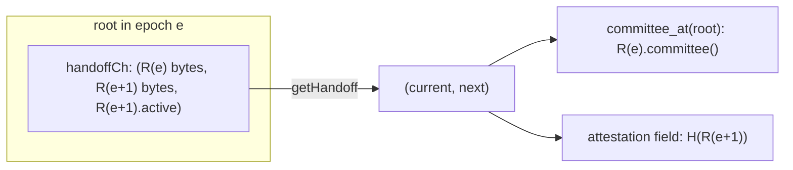

# FX-18: the validator-set handoff record (proposal to lane A2)

Lane B, 2026-11-05. Branch `patch/FX-18-handoff`. For lane A2, and for Meredith's review. This memo also proposes an answer to question 26 (the bond set for the join quorum).

## The problem

The validator set of a block is the committee at the root that the block attests (`ValidatorSetSource::bonds(attestation)`).

Before this patch, the close that starts epoch e wrote the new active set into its own post-state root. A block that attests that root, or any later root, is therefore validated against the new set. No root that the outgoing set attests contains the new set. So the outgoing set never certifies its successor, and a joiner that holds only the outgoing set cannot verify the new one.

## The change: a one-epoch lookahead

The set that serves in epoch e + 1 is now picked at the close that starts epoch e. During epoch e, every root holds two records:

| Record | Content | Who attests roots that hold it |
|---|---|---|
| current, R(e) | the committee that serves in epoch e | R(e) |
| next, R(e+1) | the committee picked at the start of epoch e | R(e) |

So every attestation that R(e) makes during epoch e names a root that holds R(e+1). That is the certification.

Effects on timing:

- A bond that settles in epoch e is picked at the start of epoch e + 1 and serves from epoch e + 2. Before, it served from epoch e + 1.
- A withdrawer that withdraws in epoch e leaves `allBonds` at the start of epoch e + 1, as before. Its stake stays in the record that serves epoch e + 1, so it serves that epoch out. It is not in the next pick.
- This is the same pattern as validator updates that take effect two heights later, or a sync committee that the current committee signs one period in advance.

## The record format

A record is the protobuf encoding of one Rholang `Par`, written by PoSV6 with `toByteArray`:

```
(previous, active, bonds)
  previous : ByteArray      Blake2b256 of the previous record's bytes; empty for R(0)
  active   : Set(ByteArray) public keys picked by pickActiveValidators
  bonds    : Map(ByteArray -> Int)  allBonds at the pick
```

- **Hash:** H(R) = Blake2b256 of the record's bytes, exactly as stored. A verifier never re-encodes a record. It hashes the bytes that it received and decodes the same bytes.
- **Committee:** the keys in `active` with a stake in `bonds` greater than 0, with that stake.
- **Chain:** R(e+1).previous = H(R(e)). A record that skips its predecessor fails the check.
- **Genesis:** R(0) = (empty, the initial active set, the initial bonds). R(1) = (H(R(0)), the same set, the same bonds).

The record carries all bonds and not only the committee's stakes. Restriction to the active set in Rholang needs a fold over the set, which adds a cost for each validator to every epoch close (not measured). The restriction is done in Rust instead (`HandoffRecord::committee`).

## Where it lives



- PoSV6 keeps the records on a private channel, `handoffCh`. It is written only at genesis and at the close that starts an epoch. Bond and withdraw calls do not touch it.
- `PoS!("getHandoff", ret)` returns `(current, next)`.
- The close that starts epoch e: `activeValidators` := the active set of the old next record. `handoffCh` := (old next, (H(old next), pick(allBonds), allBonds), the new pick).
- Rust: `RuntimeManager::get_handoff(root)`, `v6::handoff::{HandoffRecord, handoff_hash, verify_handoff}`, `v6::validators::committee_at(rm, root)`.
- `AttestedRootValidators` now reads the committee from the current record, not from `floor_committee`. The stakes are fixed for the epoch, and the stakes that consensus counts are the stakes that a joiner counts.

## What lane A2 is asked to define

1. **The attestation field (recommended).** Add `bytes handoff = 3` to `AttestationProto`. The proposer sets it to H(next) at the attested root (`rm.get_handoff(root)`). `V6Core::attestation()` is synchronous, so the engine adds the field after it reads the root.
2. **The validity check.** A node that holds the attested root checks that `handoff` equals H(next) at that root. A difference is a misattestation of the same class as a wrong root, because the field is a function of the root. A node that does not hold the root records nothing, as today.
3. **The certificate that a joiner receives.** For each epoch e, signed blocks from members of R(e) whose attestations name roots of epoch e and carry H(R(e+1)). The joiner checks each block signature, then calls `verify_handoff(R(e), R(e+1), certifications, θ)`. That function counts each signer once, counts only members of R(e), and requires the certified stake to be greater than θ of R(e)'s stake.
   - A block signature covers the whole block. If that makes the certificate too large, lane A2 can define a smaller signed form. The verifier takes `(validator, certified hash)` pairs after the signature check, so the change does not touch it.
4. **The alternative (not recommended).** No new field: the joiner checks R(e+1) against the attested root with a proof of the `handoffCh` datum in the history trie. That needs a proof format for the radix history, and a proof for each certificate.

## The join (proposed answer to question 26)

1. The joiner takes R(0) from the approved genesis block.
2. For each epoch, it verifies R(e+1) from R(e) and its certificate. It needs no state and no blocks behind the fringe, only the records and the certificates (P12).
3. At the anchor (the LFB's canonical root), it checks the attestation quorum of P12-2 with R(k), the last record that it verified.
4. It downloads the state at the anchor root and checks that the current record there has hash H(R(k)).

The certificates of past epochs must be kept, or a checkpoint (a trusted R(k)) must replace them. That is a retention choice for lane A2 and Meredith. One certificate per epoch is small next to the blocks that P12 lets a node prune.

## Not changed

- The epoch counter, the quarantine formula and the release schedule (Decisions 105, 114).
- `floor_committee` and the non-v6 paths that call it.
- The engine's fallback when the validator source fails. It still reads `snapshot.on_chain_state.bonds_map` (live bonds). See the known issues in the FX-18 log.
