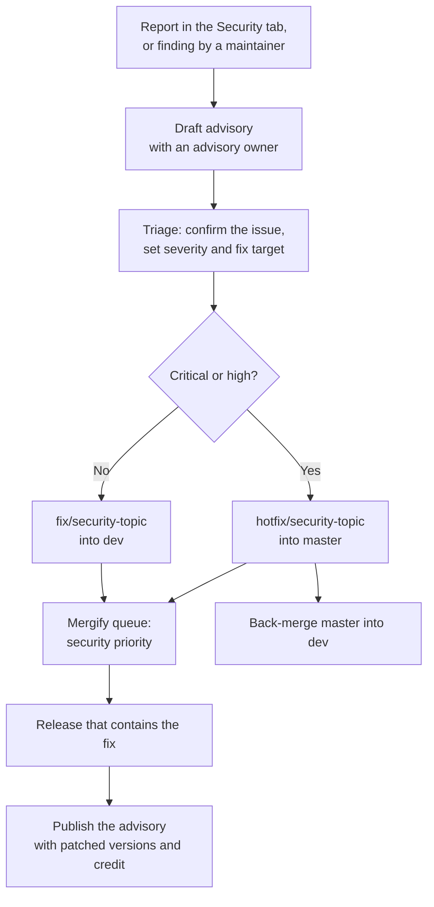

# Security Advisory Process

This procedure tells maintainers how to handle a vulnerability from the first report to the published advisory. A reporter uses [SECURITY.md](../SECURITY.md). The [contribution guide](../CONTRIBUTING.md) gives the general branch and pull request rules.

## Rules for all steps

**WARNING:** Do not describe an undisclosed vulnerability in public. A public branch name, commit, pull request, test, issue, or review can give an attacker the exploit.

- Keep the discussion of impact and exploit detail in the advisory.
- Give each public item a neutral description until the advisory is published.
- Do not put a GHSA identifier in a public item before publication. A GHSA identifier is the identifier of a GitHub security advisory.
- Add each person who needs the detail as a collaborator on the advisory.

## Roles

Each advisory has one **advisory owner**. The first maintainer who reads the report is the advisory owner until another maintainer accepts the role. The advisory owner records the name in the advisory.

The advisory owner sets the severity, tells the reporter the status, and moves the advisory through the steps below. `@F1R3FLY-io/ci-maintainers` owns this document and `SECURITY.md` in `.github/CODEOWNERS`.

## Process overview



## Procedure

### 1. Open the draft advisory

A report through **Report a vulnerability** already creates a draft advisory.

If a maintainer finds the vulnerability, create the draft before any other step. Use **Security**, **Advisories**, **New draft security advisory**, or use this command:

```bash
gh api -X POST repos/F1R3FLY-io/f1r3node-rust/security-advisories --input advisory.json
```

### 2. Triage

1. Acknowledge a report within 3 business days, as `SECURITY.md` states.
2. Confirm the issue against the latest `dev`, and record the commit.
3. List the affected versions and components.
4. Set the severity with the CVSS calculator in the advisory form. CVSS is the Common Vulnerability Scoring System.
5. Record the fix target from the [timing table](#timing-targets).
6. If the report is not a vulnerability, close the advisory and give the reporter the reason.

If the CVSS score understates the effect on consensus safety, funds, or key material, raise the severity. Record the reason in the advisory.

### 3. Select the fix path

| Severity | Branch | Target |
|---|---|---|
| Critical, high | `hotfix/security-<topic>` | `master` |
| Medium, low | `fix/security-<topic>` | `dev` |

The advisory owner can change this selection and records the reason in the advisory.

Select a neutral topic. For example, use `fix/security-login-checks`, not `fix/security-auth-bypass`. The `security` name tells the public that a security fix exists. This project accepts that limit because the name gives the fix its queue priority.

If the branch has another name, add the `security` label by hand. The label gives the same priority.

### 4. Write and review the fix

The default path is a public branch with neutral text. The heavy pipeline and the Mergify queue need a branch in this repository, so the merge path is public.

Use this default for all severities unless the issue is critical. For a critical issue, do this work in a temporary private fork first:

1. In the advisory, start a temporary private fork.
2. Write the fix in the private fork, and review the fix there.
3. Push the reviewed commits to a neutral branch of this repository.
4. Open a pull request from that branch.

GitHub Actions does not run on a temporary private fork, so the fix must also pass the normal pipeline. The `mergify-only` ruleset blocks a merge from the advisory page.

Obey these rules for the public branch:

- Write the commit messages and the pull request body as a general behavior change.
- Write the regression test as a general property. Do not add an exploit payload before publication.
- Keep review comments about the exploit in the advisory.
- Split unrelated changes into their own pull request. The security priority applies only to the security fix.

A security fix keeps all other gates. The `security` label does not waive review, or the correct-by-construction (CbC) evidence for a `cbc=mandatory` file. Write a CbC claim as a general property, and keep the exploit detail in the advisory.

### 5. Merge and release

1. Let Mergify merge the pull request. A security fix interrupts the checks of the other pull requests in the queue. See [Queue priority](ci.md#queue-priority).
2. After a merge into `master`, run `just backmerge`. This step keeps the fix in the next promotion.
3. After a merge into `dev`, run `just promote` when the fix must reach a release. See the [release process](release-process.md).
4. Find the first release that contains the fix, with `git tag --contains <merge commit>`.

### 6. Publish the advisory

Publish the advisory after a release contains the fix. Before you publish, complete these steps:

1. Set the patched version to the first release that contains the fix.
2. Set the affected versions.
3. Add credit for the reporter, if the reporter wants credit.
4. Request a CVE identifier for a critical or high advisory. For a medium or low advisory, the advisory owner decides.
5. Tell the reporter the publication date.

### 7. Close the work

1. Add the fix to the release notes.
2. Record any follow-up work in a task or a public issue. The text can name the advisory after publication.
3. If the fix was partial, open a new draft advisory for the remaining issue.

## Timing targets

The clock starts on the date of the report or the date of the maintainer finding.

| Severity | Fix target |
|---|---|
| Critical | 7 days |
| High | 14 days |
| Medium | 30 days |
| Low | 90 days |

The outer limit for disclosure is 90 days. At this limit, publish the advisory with the known mitigations, or extend the date. To extend the date, record the reason in the advisory and tell the reporter.

If a draft misses its fix target, the advisory owner records the new date and the reason in the advisory.

## A vulnerability that is already public

A public pull request, issue, or message can disclose a vulnerability before the advisory exists. In this case, do these steps:

1. Open a draft advisory, and use it to coordinate the fix.
2. Do not add more detail in public. Ask the author to use the advisory for related findings.
3. Do not rely on an edit or a deletion of the public text. Copies can remain.
4. Add the `security` label to the fix.
5. Treat the issue at the next higher severity for the timing table. An attacker can read the disclosure now.
6. Keep any related undisclosed issue private. Fix that issue in a separate change.

## Dependency advisories

Report a vulnerability in a third-party dependency to its upstream project. This repository tracks dependency advisories with `cargo deny` and with the weekly `deny-schedule.yml` sweep.

A new dependency advisory can fail `cargo deny` on all branches. To repair the failure, use a `hotfix/` branch into `master`, and update `deny.toml` and `supply-chain/` if the project accepts an exception.
